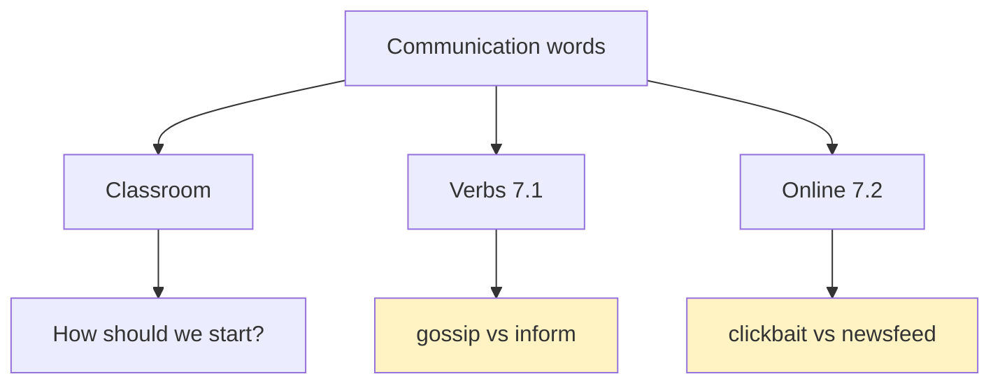
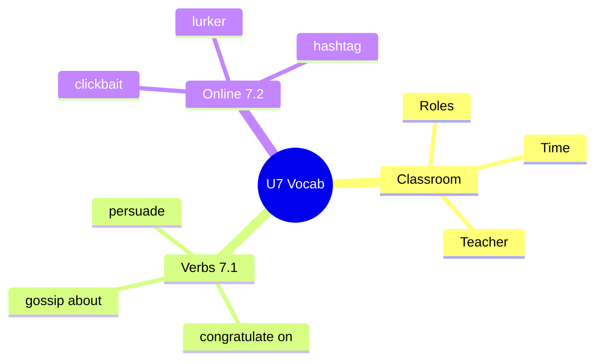

# 📖 Vocabulary & Use - Communication & Online Life (U7)

## 🎯 Introducción

> [!info] 💡 ¿Por Qué Importa?
>
> La unidad 7 habla de cómo nos comunicamos — y para discutir necesitas los verbos exactos (*gossip* no es *inform*, *persuade* no es *mention*) más el vocabulario online (*clickbait*, *lurker*, *trending topic*). Sin ellos, todo es "talk"; con ellos, describes con precisión.
>
> **Analogía del mundo real:** son tus herramientas de taller — no usas martillo (*criticize*) donde va destornillador (*persuade*).
>
> | Sin Esto | Con Esto |
> |---|---|
> | "We talk with phones." | "We **keep in touch** with family and **catch up with** friends." |
> | "Bad internet things." | "**Clickbait** wastes my time; a **lurker** never posts." |
>
> **En esta nota:** classroom language, 12 verbos de comunicación (7.1), 13 términos online (7.2) y drill de categorización.

---

## 📋 Definiciones Formales

> [!note] 📋 Classroom language (úscalo en clase, en inglés)
>
> | Situación | Frases |
> |---|---|
> | Choosing roles | *How should we start? / Why don't you be… and I'll be… / Who wants to present?* |
> | Understanding | *So what are we supposed to do? / I'm not really sure. / Should we ask the teacher?* |
> | More time | *Sorry, we're not done yet. We need a few more minutes.* |
> | Finishing | *OK. So are we done with this part? / I think so. What's next?* |
> | Teacher | *When is…due? / I was out on… Can you tell me what I missed? / Will this be on the test?* |

> [!note] 📋 Tabla 1×1 — Verbos de comunicación (7.1)
>
> | Verbo | Significado | Ejemplo ES → EN |
> |---|---|---|
> | **keep in touch with** | mantenerse en contacto | Nos mantenemos en contacto → *We **keep in touch** with family.* |
> | **catch up with** | ponerse al día | Me pongo al día con amigos → *I **catch up with** friends.* |
> | **gossip (about)** | chismear | Chismean de famosos → *They **gossip about** celebrities.* |
> | **congratulate (on)** | felicitar | Felicítalo → ***Congratulate** him on the prize.* |
> | **respond to / reply to** | responder | Responde invitaciones → ***Respond to** invitations.* |
> | **inform of** | informar | Informan a sus familias → *Apps **inform** them **of** progress.* |
> | **mention / report** | mencionar / reportar | Greenpeace reportó → *Greenpeace **reported** more use.* |
> | **contact** | contactar | El app lo contactó → *The app **contacted** him.* |
> | **persuade** | persuadir | Los convencieron → *Relatives **persuaded** them to buy one.* |
> | **criticize** | criticar | Critican a usuarios → *They **criticize** people for overuse.* |

> [!note] 📋 Tabla 1×1 — Vida online (7.2)
>
> | Término | Significado | Ejemplo |
> |---|---|---|
> | **clickbait** | titular anzuelo | *That "Ten best" list is pure **clickbait**.* |
> | **hashtag / trending topic** | etiqueta / tendencia | *#SundayBrunch was **trending**.* |
> | **lurker** | mirón que no publica | *"Hector you're such a **lurker**. Lol."* |
> | **newsfeed / timeline** | muro / cronología | *Photos appear in my **newsfeed**.* |
> | **geo-tag / tag** | geoetiqueta / etiquetar | *They **geo-tagged** the restaurant.* |
> | **meme / lifecast / podcaster** | meme / transmitir vida / podcastero | *A **meme** about Mondays.* |

---

## 🛠️ Método / Procedimiento (Categorizar por significado)

> [!note] 📋 Procedimiento (ejercicio 7.1A / 7.2A del libro)
>
> 1. Lee cada palabra y pregúntate: ¿hablar, escribir o reaccionar?
> 2. Agrupa: *respond, reply, mention, report* (responder) · *gossip, criticize* (opinar) · *persuade, congratulate* (influir).
> 3. Verifica con ejemplo propio: 1 frase por grupo.
>
> **Principio clave:** nunca memorices listas sueltas — cada palabra entra con su grupo + 1 frase tuya.

---

## 🎨 Ejemplos Trabajados (Bilingües)

> [!example] 🟢 Ejemplo 1 — Tres preguntas personales (7.1C)
>
> - *How do you **keep in touch with** people who live far away?* (¿Cómo te mantienes en contacto con gente lejos?)
> - *When did you last **congratulate** a friend? What was it?* (¿Cuándo felicitaste a un amigo?)
> - *When did you **persuade** somebody to do something?* (¿Cuándo persuadiste a alguien?)

> [!example] 🟢 Ejemplo 2 — Online (7.2C)
>
> - *What do you usually click on: photos, **memes** or **trending topics**?*
> - *What **clickbait** do you enjoy? What are consequences of clicking it?*

---

## ⚠️ Errores Comunes y Principios Lógicos

> [!danger] ❌ Error 1 — Preposición equivocada (viola **collocation**)
>
> - ❌ **EL ERROR ESTÁ AQUÍ:** *"congratulate to him"*, *"gossip of celebrities"*.
> - ✅ Así sí: ***congratulate on**, **gossip about**, **respond/reply to**, **keep in touch with*** — van en paquete.

> [!danger] ❌ Error 2 — *inform* sin *of/about* (viola **verbo + preposición**)
>
> - ❌ **EL ERROR ESTÁ AQUÍ:** *"inform them progress"*.
> - ✅ Así sí: ***inform** them **of** progress* / *tell them **about** things*.

---

## 🎯 Metas de Aprendizaje

> [!note] 🎯 Nivel Básico
>
> - [ ] Digo los 10 verbos con su preposición sin mirar.
> - [ ] Defino los 13 términos online con 1 ejemplo.

> [!note] 🎯 Nivel Intermedio
>
> - [ ] Respondo las 3 preguntas personales (7.1C) en 1 minuto.
> - [ ] Uso 5 classroom phrases en clase real, en inglés.

---

## 🔁 Repaso SR (flashcards)

#flashcards/ingles-iii-u1

> [!note] 🧠 Repasa con el plugin Spaced Repetition
>
> - ¿*gossip* + preposición?::*Gossip **about*** (chismear de).
> - ¿*congratulate* + preposición?::*Congratulate **on*** (felicitar por).
> - ¿*lurker*?::Mirón que lee y nunca publica.
> - ¿*clickbait*?::Titular anzuelo para clics.
> - ¿Pedir más tiempo en clase?::*Sorry, we're not done yet. We need a few more minutes.*

---

## 📊 Resumen Visual

> [!success] 🔍 Comparación Final
>
> | Aspecto | Sin Esto | Con Esto |
> |---|---|---|
> | Hablar | "talk" para todo | Verbo exacto + preposición |
> | Online | "internet things" | clickbait, lurker, trending |

---

## 🔗 Seguir estudiando

> [!info] 📚 Seguir estudiando
>
> - Índice: [[00 - Índice Unit 1]]
> - Anterior: (vacío — primera nota del libro)
> - Siguiente: [[02 - Grammar & Examples - Reported Statements & Questions]]

## 📚 Referencias

> [!quote] 📖 Fuentes Consultadas
>
> - Empower B1+ (Cambridge): Unit 7, lessons 7.1–7.2 + Classroom Language (pp. 65–69).
> - Capturas: [[Libro de ingles las primeras unidades]] (§ 7.1, 7.2).

---

**Tags:** #IDIG1008 #unit1 #vocabulary #communication #english
