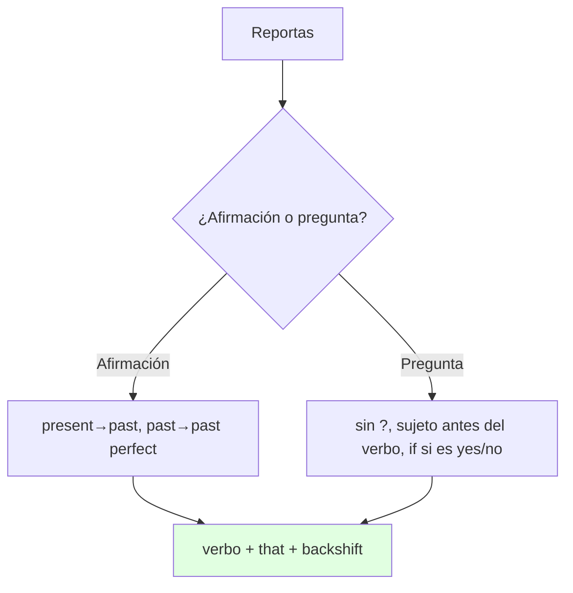
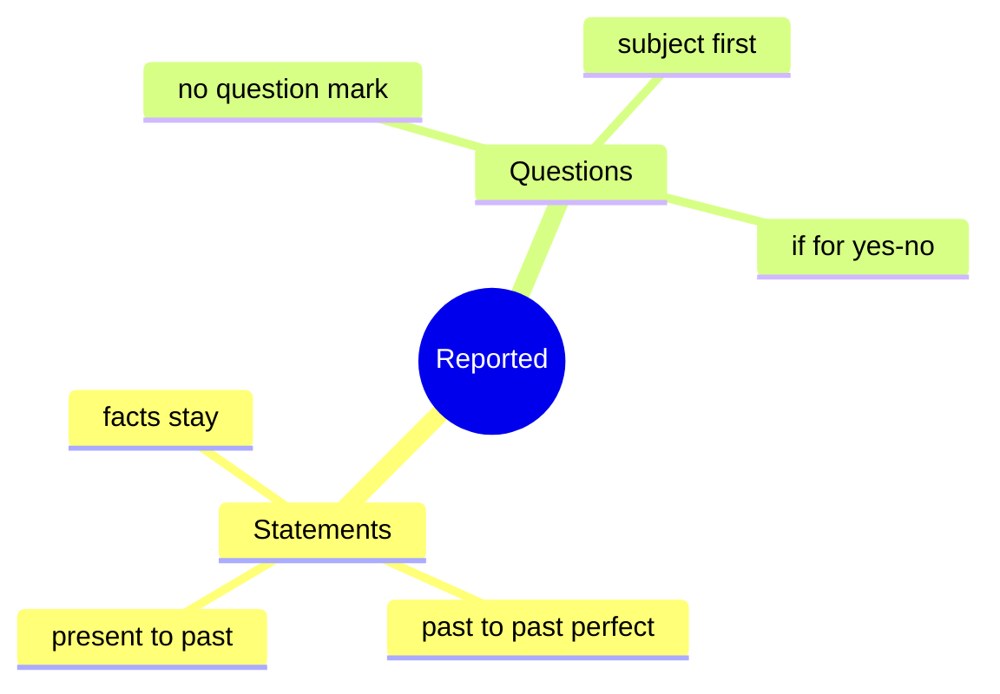

# 📐 Grammar & Examples - Reported Statements & Questions (U7)

## 🎯 Introducción

> [!info] 💡 ¿Por Qué Importa?
>
> Contar lo que otro dijo es el corazón de la unidad: *Bernard said that he used WhatsApp…* — y el inglés **retrocede los tiempos** (*use → used, will → would*). Sin backshift suenas en presente equivocado; con él, reportas como nativo.
>
> **Analogía del mundo real:** el estilo indirecto es citar con eco — todo lo que oíste vuelve un paso atrás en el tiempo.
>
> | Sin Backshift | Con Backshift |
> |---|---|
> | *"Manny explained that he lives with his family"* ❌ | *"Manny explained that he **lived** with his family."* ✅ |
> | *"She asked what did I do"* ❌ | *"She asked me what **I did**."* ✅ |
>
> **En esta nota:** statements (7.1) + questions (7.2) con reglas, fórmula en texto y accuracy checks del libro.

---

## 📋 Definiciones Formales

> [!note] 📋 Reported statements (7.1) — el tiempo retrocede 1 paso
>
> Fórmula en texto: *reporting verb (said/explained/commented) + (that) + sujeto + verbo-una-época-atrás*.
>
> | Directo | Indirecto | Ejemplo del libro |
> |---|---|---|
> | present | **past** | *"I live with my family" → Manny explained that he **lived**…* |
> | past | **past perfect** | *"WhatsApp eased…" → commented that it **had eased**…* |
> | present perfect | **past perfect** | *"use has increased" → reported that use **had increased**…* |
> | instrucción/orden | **present + pronombre + to** | *"buy a smartphone" → persuaded them **to buy**…* |
> | hecho/hábito general | **se queda igual** | *"unemployment **is** lower" → reported that it **is** lower.* |

> [!note] 📋 Reported questions (7.2) — orden afirmativo, sin auxiliares
>
> Fórmula en texto: *asked + (if) + sujeto + verbo en pasado, sin ? ni do/does/did*.
>
> | Directa | Indirecta | Ejemplo del libro |
> |---|---|---|
> | *"Do you prefer text or face?"* | **if + afirmativo** | *We asked them **if they preferred** to text…* |
> | *"Who is it for?"* | **wh- + afirmativo** | *We asked them **who they thought** it was for.* |
> | *"How often do you post?"* | **wh- + pasado** | *We asked them **how often they posted**…* |
> | *"What did I do?"* ❌ | ✅ | *She asked me **what I did**.* (accuracy check) |

---

## 🛠️ Método / Procedimiento (Reportar en 3 pasos)

> [!note] 📋 Procedimiento General
>
> 1. **Elige el verbo** (*said, asked, explained, mentioned, reported*).
> 2. **Retrocede el tiempo** 1 paso (salvo hechos generales).
> 3. **Si es pregunta:** quita `?`, pon sujeto antes del verbo, borra *do/does/did*, usa *if* para yes/no.
>
> **Principio clave:** primero el tiempo, después el orden — en ese orden siempre.

---

## 🎨 Ejemplos Trabajados (Bilingües)

> [!example] 🟢 Ejemplo 1 — Statements (7.1C, con tu compañero)
>
> - Tú: *"I live with my family."* → Reportas: *Manny explained that he **lived** with his family.* (Manny explicó que vivía con su familia.)
> - Tú: *"My brother won a prize."* → *My brother mentioned that he **had won** a prize at school.* (Mencionó que había ganado.)

> [!example] 🟢 Ejemplo 2 — Questions (7.2B, con otro compañero)
>
> - Te preguntaron: *"Do you prefer email, text or phone?"* → Reportas: *Maria asked me **if I preferred** email, text or phone.* (María me preguntó si prefería…)
> - Error clásico del libro: *She asked what **did I do*** ❌ → *She asked me what **I did*** ✅.

---

## 📝 Ejercicios del Libro (grammar ref pp. 135–137)

> [!example] ✏️ Ejercicio 1 — Direct → reported statements (7.1)
>
> Reporta cada oración:
>
> - "I prefer speaking face to face over texting." (He said that…)
> - "Get a new computer!" (She told…)
> - "That's why you should buy a tablet." (He convinced…)
> - "We won first prize in the competition." (They explained…)
> - "I will text you when I leave work." (She said…)
>
> > [!success]- ✅ Solución
> >
> > - *He said (that) he **preferred** speaking face to face…* (present → past).
> > - *She **told them to get** a new computer.* (orden → *told + to*).
> > - *He **convinced them (that)** buying a new tablet was a good idea.* (consejo → convencer + gerundio/that).
> > - *They **explained (that) they had won** first prize…* (past → past perfect).
> > - *She **said (that) she would text** when she left work.* (*will → would*).

> [!example] ✏️ Ejercicio 2 — Direct → reported questions (7.2)
>
> Reporta cada pregunta:
>
> - Why did you buy a new smartphone? (He asked…)
> - Do you prefer phone or text? (She asked…)
> - Will you get a new tablet for your birthday? (We asked her…)
> - Can you help me with this computer problem? (I asked them…)
> - How many friends did you meet on Facebook? (She asked him…)
>
> > [!success]- ✅ Solución
> >
> > - *He asked **why I had bought** a new smartphone.* (past → past perfect, sin auxiliar).
> > - *She asked **if I preferred** phone or text.* (yes/no → *if* + afirmativo).
> > - *We asked her **if she would get** a new tablet…* (*will → would*).
> > - *I asked them **if they could help** me…* (*can → could*).
> > - *She asked him **how many friends he had met** on Facebook.* (wh- + past perfect, sin *if*).

> [!example] ✏️ Ejercicio 3 — Rules: reported statements (7.1 drill 3A)
>
> Elige la opción correcta de cada regla:
>
> - To report a present tense statement, use the **present / past**.
> - To report a past tense statement, use the **past / past perfect**.
> - To report a present perfect statement, use the **past / past perfect**.
> - To report instructions, use the **present / past** + pronoun + *(not) to* + verb.
>
> > [!success]- ✅ Solución
> >
> > - ***past*** (*live → lived*).
> > - ***past perfect*** (*eased → had eased*).
> > - ***past perfect*** (*has increased → had increased*).
> > - ***present*** + pronoun + *to* (*persuaded them **to buy**…*).

> [!example] ✏️ Ejercicio 4 — Rules: reported questions (7.2 drill 3A)
>
> Elige la opción correcta de cada regla:
>
> - To report a question, **use / do not use** a question mark at the end.
> - The subject comes **before / after** the verb. **Use / Do not use** *do/does/did*.
> - Yes/no or preference questions use **that / if**.
> - Verbs in reported questions change to the **present / past**.
>
> > [!success]- ✅ Solución
> >
> > - ***Do not use*** (*no* hay *?* en indirecto).
> > - ***before*** + ***Do not use*** (*…they **preferred**…*, sujeto primero, sin auxiliar).
> > - ***if*** (*asked them **if** they preferred…*).
> > - ***past*** (igual backshift que statements).

---

## ⚠️ Errores Comunes y Principios Lógicos

> [!danger] ❌ Error 1 — Pregunta con orden de pregunta (viola **orden afirmativo**)
>
> - ❌ **EL ERROR ESTÁ AQUÍ:** *"She asked what did I do."*
> - ✅ Así sí: *She asked me what **I did**.* — en indirecto no hay inversión ni auxiliar.

> [!danger] ❌ Error 2 — *if* donde no va (viola **if solo yes/no**)
>
> - ❌ **EL ERROR ESTÁ AQUÍ:** *"They asked me if who came."*
> - ✅ Así sí: con *wh-* no hay *if* — *They asked me **who came**.*

> [!danger] ❌ Error 3 — Olvidar el backshift (viola **1 paso atrás**)
>
> - ❌ **EL ERROR ESTÁ AQUÍ:** *"He said he **is** tired"* (ayer lo dijo).
> - ✅ Así sí: *He said he **was** tired.* (hechos generales sí se quedan: *is lower this quarter*).

---

## 🎯 Metas de Aprendizaje

> [!note] 🎯 Nivel Básico
>
> - [ ] Retrocedo present→past y past→past perfect sin mirar.
> - [ ] Reporto yes/no con *if* y orden afirmativo.

> [!note] 🎯 Nivel Intermedio
>
> - [ ] Reporto las respuestas de mi compañero (7.1C + 7.2B) sin errores.
> - [ ] Decido cuándo NO mover el tiempo (hechos/hábitos).

---

## 🔁 Repaso SR (flashcards)

#flashcards/ingles-iii-u1

> [!note] 🧠 Repasa con el plugin Spaced Repetition
>
> - ¿Past en indirecto pasa a…?::Past perfect (*eased → had eased*).
> - ¿Pregunta indirecta lleva *?* o auxiliar?::No: orden afirmativo, sin do/does/did.
> - ¿Yes/no question usa…?::*If* + afirmativo en pasado.
> - ¿Cuándo NO hay backshift?::Hechos generales y hábitos (*is lower this quarter*).

---

## 📊 Resumen Visual

> [!success] 🔍 Comparación Final
>
> | Aspecto | Sin Esto | Con Esto |
> |---|---|---|
> | Tiempos | Todo en presente | 1 paso atrás |
> | Preguntas | *"what did I do"* | *"what I did"* |

---

## 🔗 Seguir estudiando

> [!info] 📚 Seguir estudiando
>
> - Índice: [[00 - Índice Unit 1]]
> - Anterior: [[01 - Vocabulary & Use - Communication & Online Life]]
> - Siguiente: [[03 - Functional Language & Pronunciation - Recounting Stories]]

## 📚 Referencias

> [!quote] 📖 Fuentes Consultadas
>
> - Empower B1+ (Cambridge): Unit 7, grammar 7.1–7.2 (pp. 66–69).
> - Capturas: [[Libro de ingles las primeras unidades]] (§ 7.1, 7.2).

---

**Tags:** #IDIG1008 #unit1 #grammar #reported-speech #english
