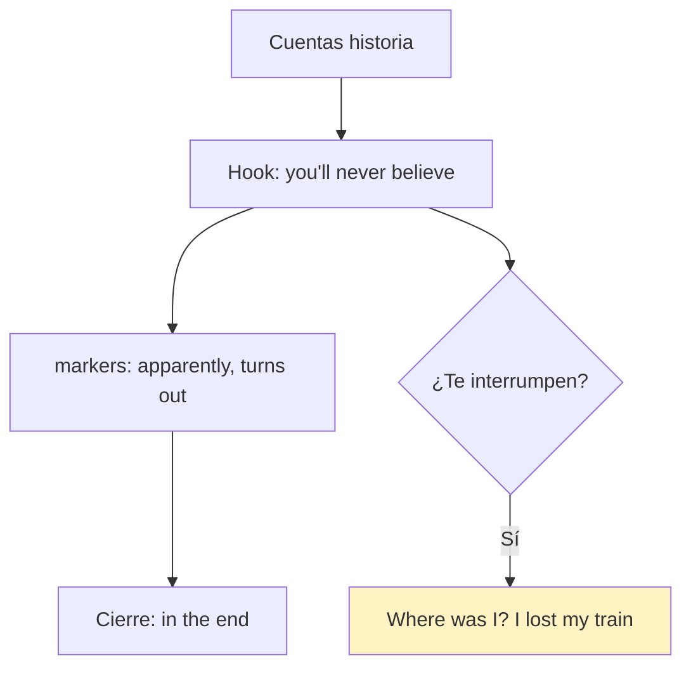
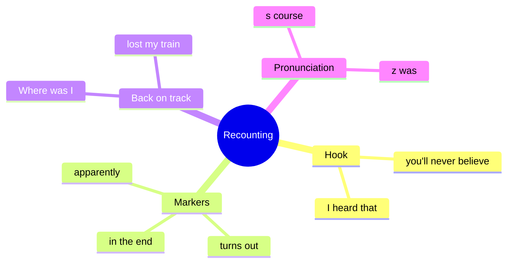

# 🗣️ Functional Language & Pronunciation - Recounting Stories (U7)

## 🎯 Introducción

> [!info] 💡 ¿Por Qué Importa?
>
> Recontar chismes e historias (*You'll never believe what happened…*) es la función de 7.3 — y cuando te interrumpen necesitas las frases de *getting back on track*. Más la pronunciación /s/ vs /z/ que el libro evalúa aquí.
>
> **Analogía del mundo real:** recontar es pasar película — *apparently* es el tráiler, *in the end* son los créditos, y si te pausan necesitas *where was I?* para retomar.
>
> | Sin Esto | Con Esto |
> |---|---|
> | "David no fue a la boda. Fin." | *"**You'll never believe** what happened… **it turns out** he overslept!"* |
> | Te interrumpen y te pierdes | *"**Where was I? Oh yeah…**" y sigues.* |
>
> **En esta nota:** chart de recounting (7.3), back on track, /s/ vs /z/ y role play.

---

## 📋 Definiciones Formales

> [!note] 📋 Tabla 1×1 — Recounting (7.3B, complétala con el audio)
>
> | Marcador | Uso | Ejemplo del libro |
> |---|---|---|
> | **I heard that…** | abrir el chisme | *I **heard that** David missed the wedding.* |
> | **Apparently…** | "al parecer" | ***Apparently**, he had lost his phone.* |
> | **Someone told me that…** | fuente anónima | ***Someone told me that** he overslept.* |
> | **He was like, "…"** | cita textual informal | *…and **he was like**, "Of course!"* |
> | **Well, (it) turns out…** | giro revelador | ***Well, turns out**, he was mad at Andrew.* |
> | **You'll never… / guess what…** | hook | ***You'll never believe** what happened to Marta!* |
> | **What happened was…** | explicar | ***What happened was**, she fell asleep at work.* |
> | **The funny/strange thing is…** | comentar | ***The funny thing was**, she prepared all night!* |
> | **In the end…** | cierre | ***In the end**, he laughed about it.* |

> [!note] 📋 Getting back on track (7.3, estrategia real)
>
> Cuando te interrumpen o te vas del tema: ***As I was saying… / Where was I? Oh yeah… / What was I saying? / I lost my train of thought!***

> [!note] 📋 Pronunciación /s/ vs /z/ (7.3)
>
> - **/s/** (*course*): *boss, bus, office* — sorda, como serpiente.
> - **/z/** (*was*): *as, turns, lose* — sonora, como zumbido.
> - Drill del libro: *boss / as / bus / turns / office / lose* → A (/s/) o B (/z/).

---

## 🛠️ Método / Procedimiento (Recontar en 4 pasos)

> [!note] 📋 Procedimiento General
>
> 1. **Hook** (*You'll never believe…*) + **fuente** (*I heard that…*).
> 2. **Hechos** con *apparently / turns out*.
> 3. **Cita** con *he was like* para dar vida.
> 4. **Cierre** con *in the end* + comentario (*funny/strange thing*).
>
> **Principio clave:** hook + fuente + giro + cierre — sin hook nadie escucha, sin cierre nadie recuerda.

---

## 🎨 Ejemplos Trabajados (Bilingües)

> [!example] 🟢 Ejemplo 1 — La historia de David (7.3 audio)
>
> *"**I heard that** David missed Andrew's wedding **because**, **apparently**, he had lost his phone. **Someone told me that** he 'accidentally' overslept. **Well, turns out**, he was mad at Andrew — **in the end**, who knows?"*

> [!example] 🟢 Ejemplo 2 — Role play (7.3C, con tu compañero)
>
> - Situación: no quieres ir a cenar, estás cansado, pero le prometiste a Ellen.
> - Útiles: ***Is there any way you can…? / Have you tried talking to him? / If I were in your shoes… / It can't hurt to… / You've got nothing to lose.***
> - Si te interrumpen a mitad: ***Where was I? Oh yeah…*** y sigues.

---

## 📝 Ejercicios del Libro (7.3 drills + pair work pp. 157–158)

> [!example] ✏️ Ejercicio 1 — /s/ o /z/ (7.3 drill B)
>
> Escribe A (/s/) o B (/z/): *boss, as, bus, turns, office, lose*.
>
> > [!success]- ✅ Solución
> >
> > - ***boss* → A** (/s/ silba).
> > - ***as* → B** (/z/ zumba).
> > - ***bus* → A**.
> > - ***turns* → B**.
> > - ***office* → A**.
> > - ***lose* → B** (¡no confundir con *loose*!).

> [!example] ✏️ Ejercicio 2 — Role play: la fiesta desastrosa (7.3 Student A/B)
>
> Tú eres A: cuenta que la fiesta de Marcus terminó en desastre (fuego en la casa, evacuaron, nadie herido). Tu compañero es B: muestra interés y sorpresa.
>
> > [!success]- ✅ Respuesta modelo (A)
> >
> > *"**You'll never believe** what happened! Marcus' birthday party ended in disaster — there was a fire at the house! **Apparently**, someone left candles near newspapers. **In the end**, everyone evacuated and nobody was hurt."*
> >
> > B responde: *"No way! **That sounds awful**. Were they OK?"*

> [!example] ✏️ Ejercicio 3 — Role play: Jane Carter (7.3 Student B)
>
> Cuenta la historia de Jane (manejó a sus vacaciones, vio a Jane en el súper: problemas de carro, pero bien y feliz en casa). Usa 3 marcadores.
>
> > [!success]- ✅ Respuesta modelo
> >
> > *"**I heard that** Jane Carter drove somewhere for summer vacation. **Someone told me that** they had car problems, but **it turns out** they were all fine and very happy to be home."*

> [!example] ✏️ Ejercicio 4 — La pintora de 13 años (7.3 Student A, p. 157)
>
> Cuenta la historia de Gabrielle: ganó el primer premio de pintura con 13 años (la menor), era su primera vez, pintó un paisaje cerca de su casa. Usa 3 marcadores.
>
> > [!success]- ✅ Respuesta modelo
> >
> > *"**You'll never guess** what happened! Gabrielle won first prize out of 20 candidates in the school painting contest. **Apparently** she had just started painting. **The funny thing is**, she painted a landscape of the area near her house!"*

> [!example] ✏️ Ejercicio 5 — Situaciones 7.3C (cena + deporte)
>
> Reacciona con el chart (modelos):
>
> > [!success]- ✅ Respuestas modelo
> >
> > - Cena (cansado, prometió a Ellen): *"OK, I mean, **can I ask you something**? Have you tried calling her? **If I were in your shoes**, I'd rest — **you've got nothing to lose**."*
> > - Deporte nuevo (sin tiempo): *"**Is there any way** you can try weekends? **You could also** join morning yoga. **That could work**!"*

> [!example] ✏️ Ejercicio 6 — Keeping engaged chart (7.3 drill B)
>
> Completa con el audio: *But that's not ___1___! ___2___ you know it? You won't ___3___ this, but… You can ___4___! You ___5___ what? Are you ___6___ for this? Isn't that ___7___?*
>
> > [!success]- ✅ Solución
> >
> > - ***all*** — *But that's not **all**!* (hay más).
> > - ***Wouldn't*** — ***Wouldn't** you know it?* (¡quién lo diría!).
> > - ***believe*** — *You won't **believe** this, but…*.
> > - ***imagine*** — *You can **imagine**!*.
> > - ***So*** — ***So**, what happened then?*.
> > - ***ready*** — *Are you **ready** for this?*.
> > - ***amazing*** — *Isn't that **amazing**?*.

> [!example] ✏️ Ejercicio 7 — Conversation 7.3C (verifica con audio 2.10)
>
> Completa con el chart: *OK, ___1___? I had a job interview… / …I was wondering that myself. And, ___2___ I was in the wrong interview. / But that's not funny! … But ___3___. I got it. I got the job! / ___4___? I got the wrong job!*
>
> > [!success]- ✅ Solución (según script; confirma con el audio)
> >
> > - ***I mean, can I ask you something*** (1: pedir la palabra).
> > - ***—wait, do you mean*** (2: frenar lo increíble).
> > - ***the funny thing is, they offered me*** (3: giro cómico).
> > - ***You won't believe this*** (4: remate).

> [!example] ✏️ Ejercicio 8 — Diálogos 2.19 (7.3C pair, práctica oral)
>
> Practica con tu compañero (sin clave: pronunciación + memoria):
>
> - A: *What are you doing for your birthday?* → B: *Not much. I have to go to school.*
> - A: *This room is a little small. Should we ask for a nicer one?* → B: *It can't hurt to ask. We've got nothing to lose.*
>
> > [!success]- ✅ Cómo verificarlo
> >
> > - Clusters completos + 1 marcador de engaged por diálogo (*Let me guess / That's so…*).

---

## ⚠️ Errores Comunes y Principios Lógicos

> [!danger] ❌ Error 1 — Contar sin marcadores (viola **hook + cierre**)
>
> - ❌ **EL ERROR ESTÁ AQUÍ:** soltar hechos planos sin *you'll never believe* ni *in the end*.
> - ✅ Así sí: abre con hook, cierra con comentario — la estructura se evalúa.

> [!danger] ❌ Error 2 — *he was like* en registro formal (viola **registro**)
>
> - ❌ **EL ERROR ESTÁ AQUÍ:** usar *he was like* en un email o presentación.
> - ✅ Así sí: *he was like* solo oral-informal; en formal → *he said that…*.

> [!danger] ❌ Error 3 — /s/ por /z/ (viola **sonoridad**)
>
> - ❌ **EL ERROR ESTÁ AQUÍ:** *lose* con /s/ (suena *loose* = flojo).
> - ✅ Así sí: *lose* con /z/ zumba; *course/boss/office* con /s/ silban.

---

## 🎯 Metas de Aprendizaje

> [!note] 🎯 Nivel Básico
>
> - [ ] Digo los 9 marcadores de recounting sin mirar.
> - [ ] Distingo /s/ de /z/ en las 6 palabras del drill.

> [!note] 🎯 Nivel Intermedio
>
> - [ ] Recuento la historia de David o Marta con hook + giro + cierre.
> - [ ] Retomo tras interrupción con *Where was I?* sin trabarme.

---

## 🔁 Repaso SR (flashcards)

#flashcards/ingles-iii-u1

> [!note] 🧠 Repasa con el plugin Spaced Repetition
>
> - ¿Hook clásico para historias?::*You'll never believe what happened…*
> - ¿Giro revelador?::*Well, (it) turns out…*
> - ¿Cita informal?::*He was like, "…"* (solo oral).
> - ¿Te interrumpen, qué dices?::*Where was I? Oh yeah… / I lost my train of thought!*
> - ¿/s/ o /z/ en *lose*?::/z/ (zumba); *course/boss* con /s/.

---

## 📊 Resumen Visual

> [!success] 🔍 Comparación Final
>
> | Aspecto | Sin Esto | Con Esto |
> |---|---|---|
> | Historias | Hechos planos | Hook + giro + cierre |
> | Interrupción | Te pierdes | *Where was I?* y sigues |

---

## 🔗 Seguir estudiando

> [!info] 📚 Seguir estudiando
>
> - Índice: [[00 - Índice Unit 1]]
> - Anterior: [[02 - Grammar & Examples - Reported Statements & Questions]]
> - Siguiente: [[04 - Reading, Writing, Speaking - Emoji, Emails & Survey]]

## 📚 Referencias

> [!quote] 📖 Fuentes Consultadas
>
> - Empower B1+ (Cambridge): Unit 7, lesson 7.3 (pp. 70–71).
> - Capturas: [[Libro de ingles las primeras unidades]] (§ 7.3).

---

**Tags:** #IDIG1008 #unit1 #functional #pronunciation #stories #english
