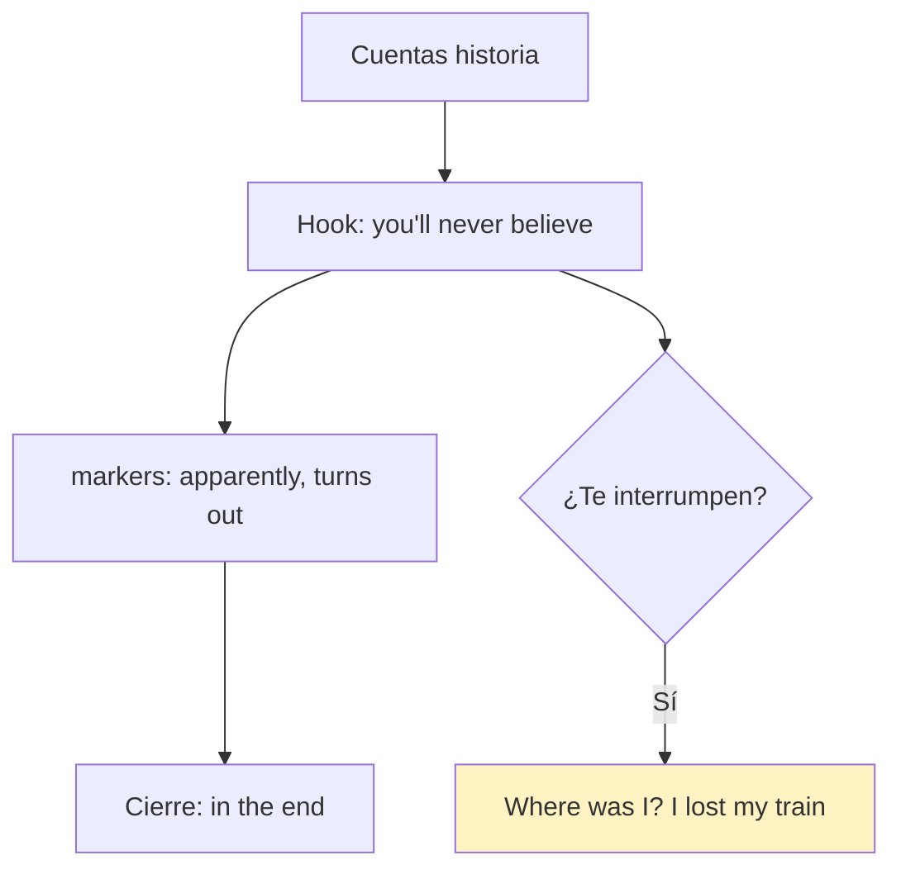
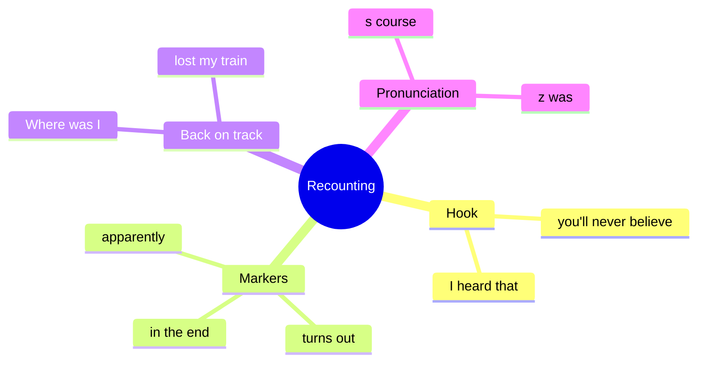

# 🗣️ Functional Language & Pronunciation - Recounting Stories (U7)

## 🎯 Introducción

> [!info] 💡 ¿Por Qué Importa?
>
> Recontar chismes e historias (*You'll never believe what happened…*) es la función de 7.3 — y cuando te interrumpen necesitas las frases de *getting back on track*. Más la pronunciación /s/ vs /z/ que el libro evalúa aquí.
>
> **Analogía del mundo real:** recontar es pasar película — *apparently* es el tráiler, *in the end* son los créditos, y si te pausan necesitas *where was I?* para retomar.
>
> | Sin Esto | Con Esto |
> |---|---|
> | "David no fue a la boda. Fin." | *"**You'll never believe** what happened… **it turns out** he overslept!"* |
> | Te interrumpen y te pierdes | *"**Where was I? Oh yeah…**" y sigues.* |
>
> **En esta nota:** chart de recounting (7.3), back on track, /s/ vs /z/ y role play.

---

## 📋 Definiciones Formales

> [!note] 📋 Tabla 1×1 — Recounting (7.3B, complétala con el audio)
>
> | Marcador | Uso | Ejemplo del libro |
> |---|---|---|
> | **I heard that…** | abrir el chisme | *I **heard that** David missed the wedding.* |
> | **Apparently…** | "al parecer" | ***Apparently**, he had lost his phone.* |
> | **Someone told me that…** | fuente anónima | ***Someone told me that** he overslept.* |
> | **He was like, "…"** | cita textual informal | *…and **he was like**, "Of course!"* |
> | **Well, (it) turns out…** | giro revelador | ***Well, turns out**, he was mad at Andrew.* |
> | **You'll never… / guess what…** | hook | ***You'll never believe** what happened to Marta!* |
> | **What happened was…** | explicar | ***What happened was**, she fell asleep at work.* |
> | **The funny/strange thing is…** | comentar | ***The funny thing was**, she prepared all night!* |
> | **In the end…** | cierre | ***In the end**, he laughed about it.* |

> [!note] 📋 Getting back on track (7.3, estrategia real)
>
> Cuando te interrumpen o te vas del tema: ***As I was saying… / Where was I? Oh yeah… / What was I saying? / I lost my train of thought!***

> [!note] 📋 Pronunciación /s/ vs /z/ (7.3)
>
> - **/s/** (*course*): *boss, bus, office* — sorda, como serpiente.
> - **/z/** (*was*): *as, turns, lose* — sonora, como zumbido.
> - Drill del libro: *boss / as / bus / turns / office / lose* → A (/s/) o B (/z/).

---

## 🛠️ Método / Procedimiento (Recontar en 4 pasos)

> [!note] 📋 Procedimiento General
>
> 1. **Hook** (*You'll never believe…*) + **fuente** (*I heard that…*).
> 2. **Hechos** con *apparently / turns out*.
> 3. **Cita** con *he was like* para dar vida.
> 4. **Cierre** con *in the end* + comentario (*funny/strange thing*).
>
> **Principio clave:** hook + fuente + giro + cierre — sin hook nadie escucha, sin cierre nadie recuerda.

---

## 🎨 Ejemplos Trabajados (Bilingües)

> [!example] 🟢 Ejemplo 1 — La historia de David (7.3 audio)
>
> *"**I heard that** David missed Andrew's wedding **because**, **apparently**, he had lost his phone. **Someone told me that** he 'accidentally' overslept. **Well, turns out**, he was mad at Andrew — **in the end**, who knows?"*

> [!example] 🟢 Ejemplo 2 — Role play (7.3C, con tu compañero)
>
> - Situación: no quieres ir a cenar, estás cansado, pero le prometiste a Ellen.
> - Útiles: ***Is there any way you can…? / Have you tried talking to him? / If I were in your shoes… / It can't hurt to… / You've got nothing to lose.***
> - Si te interrumpen a mitad: ***Where was I? Oh yeah…*** y sigues.

---

## ⚠️ Errores Comunes y Principios Lógicos

> [!danger] ❌ Error 1 — Contar sin marcadores (viola **hook + cierre**)
>
> - ❌ **EL ERROR ESTÁ AQUÍ:** soltar hechos planos sin *you'll never believe* ni *in the end*.
> - ✅ Así sí: abre con hook, cierra con comentario — la estructura se evalúa.

> [!danger] ❌ Error 2 — *he was like* en registro formal (viola **registro**)
>
> - ❌ **EL ERROR ESTÁ AQUÍ:** usar *he was like* en un email o presentación.
> - ✅ Así sí: *he was like* solo oral-informal; en formal → *he said that…*.

> [!danger] ❌ Error 3 — /s/ por /z/ (viola **sonoridad**)
>
> - ❌ **EL ERROR ESTÁ AQUÍ:** *lose* con /s/ (suena *loose* = flojo).
> - ✅ Así sí: *lose* con /z/ zumba; *course/boss/office* con /s/ silban.

---

## 🎯 Metas de Aprendizaje

> [!note] 🎯 Nivel Básico
>
> - [ ] Digo los 9 marcadores de recounting sin mirar.
> - [ ] Distingo /s/ de /z/ en las 6 palabras del drill.

> [!note] 🎯 Nivel Intermedio
>
> - [ ] Recuento la historia de David o Marta con hook + giro + cierre.
> - [ ] Retomo tras interrupción con *Where was I?* sin trabarme.

---

## 🔁 Repaso SR (flashcards)

#flashcards/ingles-iii-u1

> [!note] 🧠 Repasa con el plugin Spaced Repetition
>
> - ¿Hook clásico para historias?::*You'll never believe what happened…*
> - ¿Giro revelador?::*Well, (it) turns out…*
> - ¿Cita informal?::*He was like, "…"* (solo oral).
> - ¿Te interrumpen, qué dices?::*Where was I? Oh yeah… / I lost my train of thought!*
> - ¿/s/ o /z/ en *lose*?::/z/ (zumba); *course/boss* con /s/.

---

## 📊 Resumen Visual

> [!success] 🔍 Comparación Final
>
> | Aspecto | Sin Esto | Con Esto |
> |---|---|---|
> | Historias | Hechos planos | Hook + giro + cierre |
> | Interrupción | Te pierdes | *Where was I?* y sigues |

---

## 🔗 Seguir estudiando

> [!info] 📚 Seguir estudiando
>
> - Índice: [[00 - Índice Unit 1]]
> - Anterior: [[02 - Grammar & Examples - Reported Statements & Questions]]
> - Siguiente: [[04 - Reading, Writing, Speaking - Emoji, Emails & Survey]]

## 📚 Referencias

> [!quote] 📖 Fuentes Consultadas
>
> - Empower B1+ (Cambridge): Unit 7, lesson 7.3 (pp. 70–71).
> - Capturas: [[Libro de ingles las primeras unidades]] (§ 7.3).

---

**Tags:** #IDIG1008 #unit1 #functional #pronunciation #stories #english
