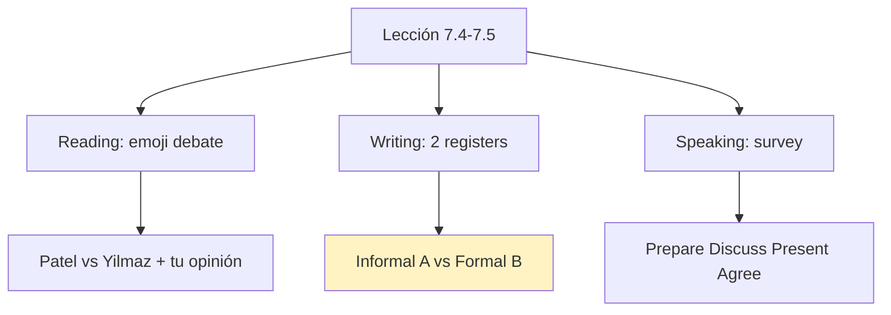
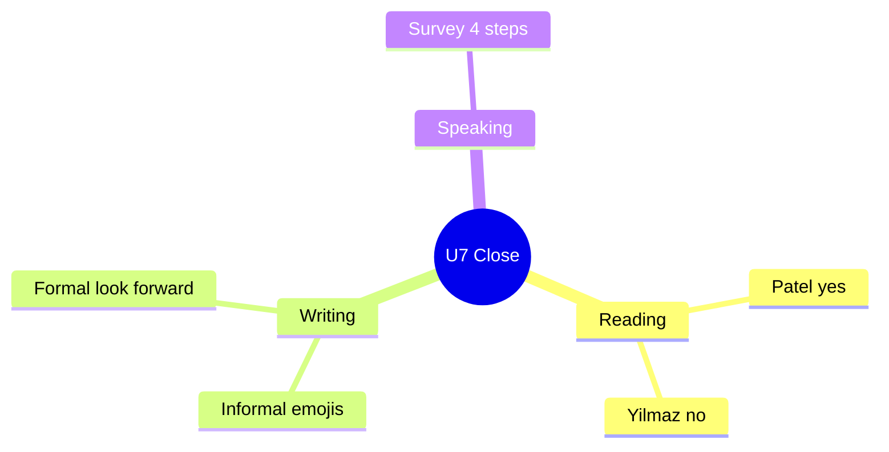

# 📰 Reading, Writing, Speaking - Emoji, Emails & Survey (U7)

## 🎯 Introducción

> [!info] 💡 ¿Por Qué Importa?
>
> El cierre de la unidad combina las 3 destrezas: leer el debate emoji-lenguaje, escribir emails en 2 registros y presentar una survey. Es el mini-examen de todo U7 en una lección (7.4–7.5).
>
> **Analogía del mundo real:** registro es vestimenta — *Speak soon!* 😊 es camiseta (amigos), *Looking forward to speaking with you* es traje (trabajo). Nunca al revés.
>
> | Sin Esto | Con Esto |
> |---|---|
> | Mismo email para jefe y amigo | Informal con emojis ↔ formal con *I look forward to* |
> | Opinas sin evidencia | Patel dice X / Yilmaz responde Y + tu postura |
>
> **En esta nota:** lectura #WORLD, emails A/B con equivalentes, WRITE IT (100 palabras) y survey 7.5.

---

## 📋 Definiciones Formales

> [!note] 📋 Lectura: *It's a #World* (7.4B–C)
>
> - **Patel (lingüista):** los emojis **sí** son lenguaje — mensaje inmediato y claro (*your message is immediately clear*).
> - **Yilmaz (inglés):** **no** son lenguaje — atajo "simple", menús que piensan por ti (*the easy road*).
> - **Acuerdo:** los hashtags **no** son lenguaje, son política — unen gente alrededor de ideas.
> - Preguntas del libro: ¿por qué Patel compara con body language? · ¿qué cree Yilmaz de los menús? · ¿opinión compartida?

> [!note] 📋 Tabla 1×1 — Registro informal (A) vs formal (B)
>
> | Informal (Email A, a Melanie) | Formal (Email B, de Melanie) |
> |---|---|
> | *How's things?* | *I am writing to see if…* |
> | *Very boring meeting!* | ***I have a meeting all morning.*** |
> | *OK with you???* | *Does that time suit you?* |
> | *Speak soon!* 😊 | *Looking forward to speaking with you,* |
> | emojis que cambian el registro | *I look forward to your reply* (cierre que exige acción) |
> | Temas OK: gossip, salud, finde | Temas OK: reuniones, trabajo, problemas (no gossip) |

---

## 🛠️ Método / Procedimiento (WRITE IT: 2 emails, 100 palabras)

> [!note] 📋 Procedimiento General (7.4E)
>
> 1. **Elige destinatario** (amigo → informal; coworker → formal) — el registro sale solo.
> 2. **Actualiza** (qué hiciste en trabajo/tiempo libre) + **propón cita** (*Can we meet…? / Does that time suit you?*).
> 3. **Revisa registro:** ¿hay emojis en el formal? ¿hay *I look forward* en el informal? Cruza y corrige.
>
> **Principio clave:** máximo 100 palabras por email — la brevedad también se evalúa.

---

## 🎨 Ejemplos Trabajados (Bilingües)

> [!example] 🟢 Ejemplo 1 — Equivalentes formal/informal (7.4C)
>
> - *Very boring meeting!* → ***I have a meeting all morning.*** (Tengo reunión toda la mañana.)
> - *OK with you???* → ***Does that time suit you?*** (¿Te viene bien esa hora?)
> - *Speak soon!* → ***Looking forward to speaking with you.*** (Quedo atento a hablar contigo.)

> [!example] 🟢 Ejemplo 2 — Survey 7.5 (prepare → agree)
>
> - **Prepare:** *To me, these images mean… / I think they represent…*
> - **Discuss:** *I think we should ask about… / My favorite news source is… because…*
> - **Present:** *The results of this survey clearly show… / From this survey, we can conclude…*
> - Muestra 7.5: preguntas 1–4 + 3 tuyas → presenta → conclusiones → vota desacuerdos.

---

## 📝 Ejercicios del Libro (7.4 drills + WRITE IT)

> [!example] ✏️ Ejercicio 1 — Equivalentes formales (7.4C)
>
> Da el equivalente formal de Email B para:
>
> - *Very boring meeting!*
> - *OK with you???*
> - *Speak soon!*
>
> > [!success]- ✅ Solución
> >
> > - ***I have a meeting all morning.***
> > - ***Does that time suit you?***
> > - ***Looking forward to speaking with you.***

> [!example] ✏️ Ejercicio 2 — WRITE IT: tus 2 emails (7.4E, máx. 100 palabras)
>
> Escribe un email formal a un coworker y uno informal a un amigo: actualiza (trabajo/tiempo libre) + propón cita. Modelo compacto:
>
> > [!success]- ✅ Respuesta modelo (formal, 58 palabras)
> >
> > *"Dear Mr. Paredes, I am writing to update you on the report: I finished the first part this morning. I have a meeting all morning tomorrow. Does Thursday suit you to review it together? Looking forward to your reply. Freddy."*
> >
> > Informal espejo: *"Hi Luis! Finished half the report 😅 Can we meet Thursday? Does that time suit you? Speak soon!"*

> [!example] ✏️ Ejercicio 3 — Opinions Patel vs Yilmaz (7.4C)
>
> Relee y responde:
>
> - Why does Patel think modern symbols ARE language? What comparison does he make?
> - Why does Yilmaz claim emojis are NOT language? What does he think of emoji menus?
> - What do both agree on? What is their shared opinion?
>
> > [!success]- ✅ Solución
> >
> > - Patel: **sí son lenguaje** — mensaje inmediato y claro; los compara con **body language** (comunican sin palabras).
> > - Yilmaz: **no son lenguaje** — atajo "simple"; los menús **piensan por ti** (*the easy road*).
> > - Acuerdo: los **hashtags no son lenguaje, son política** — unen gente alrededor de ideas.

> [!example] ✏️ Ejercicio 4 — Register + content (7.4-2B/2D)
>
> - ¿Cómo cambian los emojis el registro? (2B)
> - ¿Qué temas van en email formal? Marca: *gossip / health / changes at work / scheduling meetings / free time / work problem.*
>
> > [!success]- ✅ Solución
> >
> > - Los emojis **bajan** el registro: con emojis = informal (A); sin ellos + *I look forward* = formal (B).
> > - Formal: ***scheduling meetings, changes at work, work problem***. Informal: todo, incluido *gossip/health/free time*.

> [!example] ✏️ Ejercicio 5 — Survey 7.5 (con tu compañero)
>
> Respondan 1–4 + inventen 5–7, presenten y voten desacuerdos (modelos):
>
> > [!success]- ✅ Respuestas modelo
> >
> > - *I have **2 accounts**: WhatsApp (family) and Instagram (news).*
> > - *I write ~**30 texts** a day, mostly to **my mom**.*
> > - *I keep up with news on **X/Twitter** — fastest source.*
> > - Presenta: ***The results clearly show** we text more than call. **We can conclude** phones replaced calls.*

---

## ⚠️ Errores Comunes y Principios Lógicos

> [!danger] ❌ Error 1 — Registros cruzados (viola **traje vs camiseta**)
>
> - ❌ **EL ERROR ESTÁ AQUÍ:** emojis en el email al jefe / *I look forward to* al amigo.
> - ✅ Así sí: informal = emojis + *Speak soon!*; formal = 0 emojis + *Looking forward to…*.

> [!danger] ❌ Error 2 — Email sin cita (viola **propósito**)
>
> - ❌ **EL ERROR ESTÁ AQUÍ:** actualizar sin proponer encuentro — el email no pide nada.
> - ✅ Así sí: todo email cierra con propuesta (*Can we meet…? / Does that time suit you?*).

> [!danger] ❌ Error 3 — Opinión sin evidencia en lectura (viola **Patel vs Yilmaz**)
>
> - ❌ **EL ERROR ESTÁ AQUÍ:** *"Emojis are bad"* sin citar a nadie.
> - ✅ Así sí: *Patel argues X, Yilmaz responds Y, I agree with… because…*.

---

## 🎯 Metas de Aprendizaje

> [!note] 🎯 Nivel Básico
>
> - [ ] Distingo registro formal/informal en 5 marcas.
> - [ ] Doy las 3 frases de survey (prepare/discuss/present).

> [!note] 🎯 Nivel Intermedio
>
> - [ ] Escribo los 2 emails (≤100 palabras) con registro correcto.
> - [ ] Opino sobre emojis citando a Patel y Yilmaz + mi postura.

---

## 🔁 Repaso SR (flashcards)

#flashcards/ingles-iii-u1

> [!note] 🧠 Repasa con el plugin Spaced Repetition
>
> - ¿Cierre formal que exige acción?::*I look forward to your reply.*
> - ¿*Very boring meeting!* en formal?::*I have a meeting all morning.*
> - ¿Patel vs Yilmaz en 1 línea?::Emojis sí son lenguaje vs no, son atajo.
> - ¿Survey en 4 verbos?::Prepare → Discuss → Present → Agree.
> - ¿Máximo por email (WRITE IT)?::100 palabras, 2 registros distintos.

---

## 📊 Resumen Visual

> [!success] 🔍 Comparación Final
>
> | Aspecto | Sin Esto | Con Esto |
> |---|---|---|
> | Emails | Uno para todos | Registro según destinatario |
> | Opinión | Suelta | Patel vs Yilmaz + postura |

---

## 🔗 Seguir estudiando

> [!info] 📚 Seguir estudiando
>
> - Índice: [[00 - Índice Unit 1]]
> - Anterior: [[03 - Functional Language & Pronunciation - Recounting Stories]]
> - Siguiente: (vacío — por ahora última del libro; U2 Lifestyles en camino)

## 📚 Referencias

> [!quote] 📖 Fuentes Consultadas
>
> - Empower B1+ (Cambridge): Unit 7, lessons 7.4–7.5 (pp. 72–75).
> - Capturas: [[Libro de ingles las primeras unidades]] (§ 7.4, 7.5).

---

**Tags:** #IDIG1008 #unit1 #reading #writing #speaking #english
