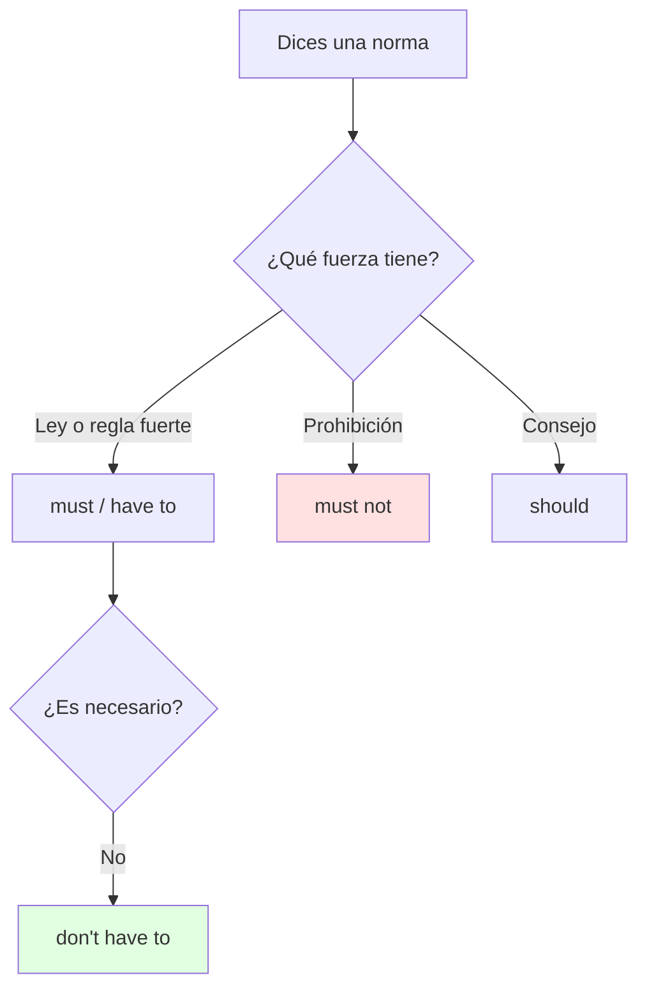
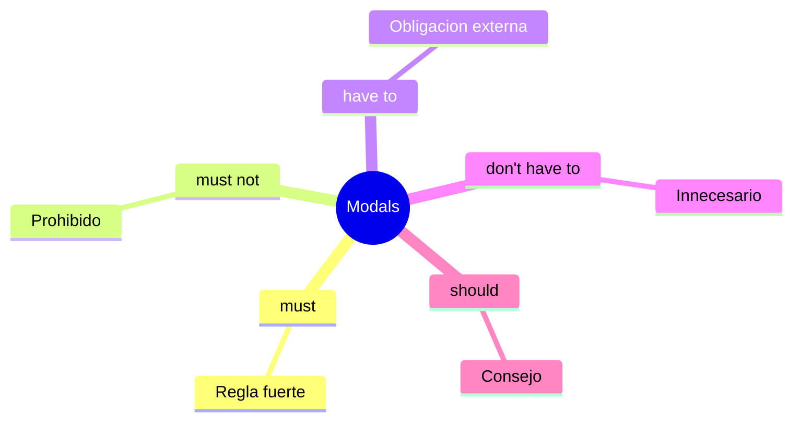

# 🗣️ Obligation Modals — Talking About Customs (Unit 1)

## 🎯 Introducción

> [!info] 💡 ¿Por Qué Importa?
>
> La Unidad 1 pide **discutir costumbres de otros países** — y las costumbres son obligaciones: lo que se *debe*, lo que *está prohibido* y lo que *no es necesario* hacer. Sin modales de obligación solo puedes describir; con ellos puedes opinar y comparar culturas.
>
> **Analogía del mundo real:** los modales son señales de tránsito del idioma — *must* es luz roja, *don't have to* es vía libre, *should* es sugerencia del GPS.
>
> | Sin Modales | Con Modales |
> |---|---|
> | "In Japan people take off shoes." (plano) | "In Japan you **must** take off your shoes." (norma clara) |
> | "No photos maybe?" (duda) | "You **mustn't** take photos here." (prohibición) |
>
> **En esta nota:** *must / mustn't / have to / don't have to / should* con fórmula, tabla 1×1, método para discutir costumbres, errores clásicos y drill.

---

## 📋 Definiciones Formales

> [!note] 📋 Fórmula única — S + modal + base verb
>
> Todos los modales usan el verbo **sin -s, sin *to***: *She must **go*** (no *goes*, no *to go*). La negación y pregunta cambian por modal (ver tabla).

> [!note] 📋 Tabla 1×1 — Los 5 modales de la unidad
>
> | Modal | Significado | Ejemplo ES → EN |
> |---|---|---|
> | **must** | obligación fuerte / regla | Debes quitarte los zapatos → *You **must** take off your shoes.* |
> | **mustn't** (= must not) | prohibición | No debes fumar aquí → *You **mustn't** smoke here.* |
> | **have to** | obligación (externa, horarios/leyes) | Tengo que llevar pasaporte → *I **have to** carry my passport.* |
> | **don't have to** | NO es necesario (¡no es prohibición!) | No tienes que pagar → *You **don't have to** pay.* |
> | **should** | consejo / recomendación | Deberías probar el ceviche → *You **should** try ceviche.* |

---

## 🛠️ Método / Procedimiento (Discutir una costumbre)

> [!note] 📋 Procedimiento en 3 pasos
>
> 1. **Nombra la costumbre** (dónde + qué): *"In Ecuador, at the coast…"*
> 2. **Pon el modal exacto** (¿obliga, prohíbe o aconseja?): *"you **have to**…"*
> 3. **Da la razón** (because…): *"…because the sun is very strong."*
>
> **Principio clave:** cada costumbre lleva 1 modal + 1 *because* — sin razón es solo una frase suelta.

---

## 🎨 Ejemplos Trabajados (Bilingües)

> [!example] 🟢 Ejemplo 1 — Costumbres del mundo
>
> - Japón: *You **must** take off your shoes before entering a house.* (Debes quitarte los zapatos.)
> - Ecuador, costa: *You **have to** use sunscreen every day.* (Tienes que usar bloqueador.)
> - Museos: *You **mustn't** touch the paintings.* (No debes tocar los cuadros.)
> - Fiestas: *You **don't have to** bring food.* (No tienes que traer comida.)
> - Visitas: *You **should** greet with a kiss on the cheek.* (Deberías saludar con beso en la mejilla.)

> [!example] 🟢 Ejemplo 2 — mustn't vs don't have to (el contraste que evalúan)
>
> - *You **mustn't** drive without a license.* = Está prohibido (si lo haces, hay multa).
> - *You **don't have to** drive; we can walk.* = No es necesario (caminar también vale).

---

## ⚠️ Errores Comunes y Principios Lógicos

> [!danger] ❌ Error 1 — *mustn't* por *don't have to* (viola **prohibición ≠ innecesario**)
>
> - ❌ **EL ERROR ESTÁ AQUÍ:** *"You mustn't pay, it's free"* para decir que no es necesario.
> - ✅ Así sí: si es gratis → *You **don't have to** pay*; *mustn't* solo para prohibir.

> [!danger] ❌ Error 2 — *have to* con tercera persona (viola **have → has**)
>
> - ❌ **EL ERROR ESTÁ AQUÍ:** *"She have to wear uniform."*
> - ✅ Así sí: *She **has to** wear uniform.* (solo *have to* cambia; *must* nunca lleva -s).

> [!danger] ❌ Error 3 — Doble modal o *to* extra (viola **S + modal + base**)
>
> - ❌ **EL ERROR ESTÁ AQUÍ:** *"You must to go"* / *"You should must try."*
> - ✅ Así sí: un solo modal + verbo base — *You **must go***, *You **should try***.

---

## 🎯 Metas de Aprendizaje

> [!note] 🎯 Nivel Básico
>
> - [ ] Conjuguo los 5 modales sin *to* ni *-s* (salvo *has to*).
> - [ ] Distingo *mustn't* (prohibido) de *don't have to* (innecesario).

> [!note] 🎯 Nivel Intermedio
>
> - [ ] Discuto 3 costumbres (1 por modal) con estructura costumbre + modal + *because*.
> - [ ] Corrijo errores de modales en frases ajenas.

---

## 🔁 Repaso SR (flashcards)

#flashcards/ingles-iii-u1

> [!note] 🧠 Repasa con el plugin Spaced Repetition
>
> - ¿Fórmula de todo modal?::S + modal + base verb (sin -s, sin to).
> - ¿*mustn't* vs *don't have to*?::Prohibición vs no-necesario.
> - ¿Tercera persona de *have to*?::*Has to* (must nunca cambia).
> - ¿Estructura para discutir costumbres?::Costumbre + modal + because.

---

## 📊 Resumen Visual

> [!success] 🔍 Comparación Final
>
> | Aspecto | Sin Esto | Con Esto |
> |---|---|---|
> | Normas | Describes ("people do…") | Obligas/prohíbes/aconsejas |
> | Examen | Frases planas | Costumbre + modal + because |

---

## 🔗 Seguir estudiando

> [!info] 📚 Seguir estudiando
>
> - Índice: [[00 - Índice Unit 1]]
> - Anterior: (vacío — primera nota de la unidad)
> - Siguiente: [[02 - Comparatives and Superlatives (Food)]]

## 📚 Referencias

> [!quote] 📖 Fuentes Consultadas
>
> - Empower B1+ Combo B (Cambridge): modals of obligation.
> - R. Murphy, *Essential Grammar in Use* (5th): units *must / have to / should*.
> - EIII Course Contents (IDIG1008): Unit 1, costumbres con modales de obligación.

---

**Tags:** #IDIG1008 #unit1 #modals #obligation #customs #english
