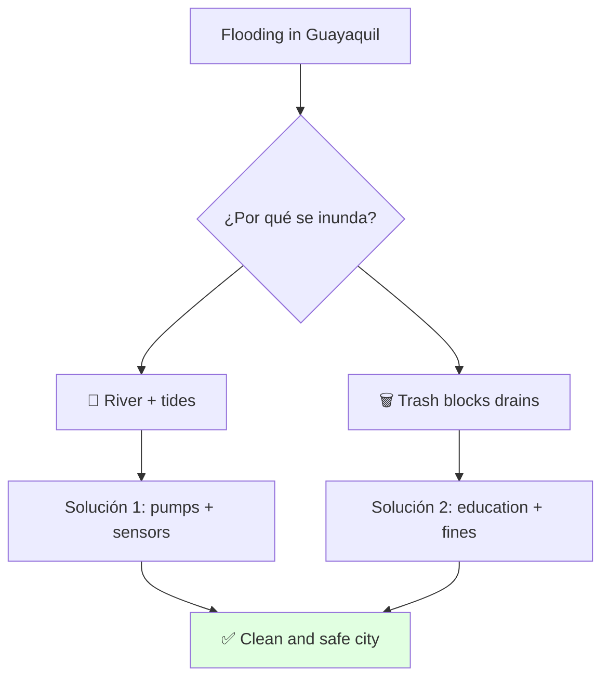
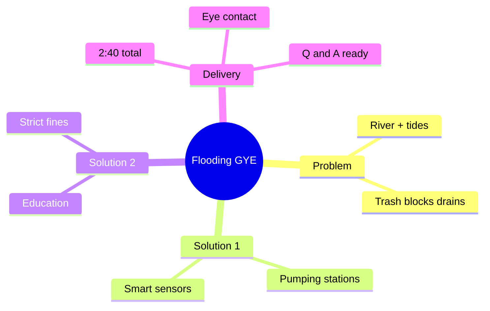

# 📝 Guía y Guion: Flooding in Guayaquil (B1+ Level)

## 🎯 Introducción

> [!info] 💡 ¿Por Qué Importa?
>
> Cada invierno Guayaquil se inunda: calles cortadas, clases suspendidas, negocios bajo agua. Hablar del problema con causas y soluciones concretas es exactamente lo que evalúa este speaking: explicar, proponer y responder preguntas.
>
> **Analogía del mundo real:** la ciudad es como una tina — llueve (grifo abierto), la marea tapa el desagüe y la basura lo bloquea. Tres fallas a la vez, por eso se desborda.
>
> | Sin Esta Charla | Con Esta Charla |
> |---|---|
> | Describes "mucha agua" sin causas | Explicas 2 causas + 2 soluciones |
> | Lees las diapositivas | Hablas 2:40 mirando al público |
> | Te traban las preguntas | Respondes Q&A con 3 respuestas listas |
>
> **En esta nota:** vocabulario clave, las 2 causas, las 2 soluciones, guion cronometrado por slide (2:40 total), drill de Q&A y checklist pre-presentación.

---

## 📋 Definiciones Formales (Vocabulario Clave)

> [!note] 📋 Vocabulario 1 — Agua y ciudad
>
> | English | Español | Úsalo en |
> |---|---|---|
> | **tide** | marea | Slide 2 (causa 1) |
> | **drain / sewer** | alcantarilla | Slide 2 (causa 2) |
> | **blockage** | obstrucción | Slide 2 y 3 |
> | **overflow** | desbordamiento | Slide 2 (calles-ríos) |

> [!note] 📋 Vocabulario 2 — Soluciones
>
> | English | Español | Úsalo en |
> |---|---|---|
> | **pumping station** | estación de bombeo | Slide 3 |
> | **to monitor / in real time** | monitorear / en tiempo real | Slide 3 |
> | **waste management** | manejo de basura | Slide 4 |
> | **fine** | multa | Slide 4 |

---

## 🧵 Desarrollo

### 🎭 Las 2 Causas

> [!note] 🎨 Causa → efecto (Slide 2)
>
> | Causa | Efecto |
> |---|---|
> | Lluvia fuerte + marea alta (río y estero) | El agua no puede escapar |
> | Basura en calles tapa los desagües | Las calles se vuelven ríos en minutos |

### 🎭 Las 2 Soluciones

> [!note] 🎨 Solución → qué ataca (Slides 3–4)
>
> | Solución | Ataca |
> |---|---|
> | Pumping stations + smart sensors | Infraestructura (sacar agua + detectar tapones) |
> | Education campaigns + strict fines | Comunidad (hábitos + consecuencias) |

---

## 🛠️ Método / Procedimiento (Estructura del Discurso)

> [!note] 📋 Procedimiento General — 5 slides, 2:40 total
>
> 1. **Hook + tema** (0:25) — saludo, nombre, problema y por qué lo elegiste.
> 2. **Causas** (0:40) — geografía primero, comportamiento después.
> 3. **Solución 1** (0:35) — infraestructura + tecnología.
> 4. **Solución 2** (0:35) — comunidad: educar + multar.
> 5. **Cierre** (0:25) — conclusión + "Thank you" + abrir preguntas.
>
> **Principio clave:** cada slide abre retomando el anterior (🔗) y cierra pasando la posta al siguiente.
>
> **Reglas de Oro (rúbrica):** cero oraciones en slides (máx. 3 palabras por viñeta) · contacto visual con el público, no con la pantalla · ritmo tranquilo ~130 palabras/min.

---

## 🎨 Ejemplos Trabajados (Guion por Slide)

> [!example] 🟢 Slide 1 — Introduction (0:25)
>
> 👁️ **Diseño:** foto de calle inundada + `FLOODING IN GUAYAQUIL` + `Freddy Sánchez`.
>
> 🗣️ **Guion:** "Good afternoon, teacher and classmates. My name is Freddy Sánchez. Today, I am going to talk about a serious problem that affects our daily lives: flooding in several areas of Guayaquil. I chose this topic because every winter our city struggles with this situation, and we urgently need real solutions."

> [!example] 🟢 Slide 2 — Problem (0:40)
>
> 👁️ **Diseño:** dos columnas — `RIVER + TIDES` (lluvia/río) · `TRASH BLOCKS DRAINS` (basura/tubo).
>
> 🗣️ **Guion:** "🔗 To solve a problem, we must first understand it. Why does Guayaquil flood? There are two main reasons. First, geography. Our city is next to the Guayas River and the Estero Salado. When heavy rain combines with high tides, the water cannot escape. Second, human behavior. People throw garbage in the streets. Plastics block the drains. When drains are blocked, streets become rivers in minutes."

> [!example] 🟢 Slide 3 — Solution 1 (0:35)
>
> 👁️ **Diseño:** dos íconos — `PUMPING STATIONS` (bomba) · `SMART SENSORS` (chip).
>
> 🗣️ **Guion:** "🔗 Now that we understand the causes, let's look at solutions. I have two proposals. The first one focuses on infrastructure and technology. The city needs more powerful water pumping stations in critical areas. Also, we can install smart sensors inside the main sewers. These sensors monitor water levels and detect blockages in real time. If trash blocks a pipe, the system alerts maintenance workers so they can clean it before the rain starts."

> [!example] 🟢 Slide 4 — Solution 2 (0:35)
>
> 👁️ **Diseño:** dos íconos — `EDUCATION CAMPAIGNS` (colegio) · `STRICT FINES` (prohibido).
>
> 🗣️ **Guion:** "🔗 Technology alone is not enough if we don't change our habits. My second solution is about community action. We must create education campaigns in schools and neighborhoods to teach people how to manage waste properly. In addition, the local government must apply strict fines to people who throw garbage in the streets. If we keep our streets clean, the water will flow naturally."

> [!example] 🟢 Slide 5 — Closing (0:25)
>
> 👁️ **Diseño:** foto soleada del Malecón + `A CLEAN & SAFE GUAYAQUIL` + `Thank You!`.
>
> 🗣️ **Guion:** "🔗 In conclusion, flooding in Guayaquil is a complex challenge caused by nature and human actions. However, by combining smart infrastructure with an educated community, we can control this problem. We all want a better, safer city to live in. Thank you very much for your attention. Are there any questions?"

---

## 📝 Ejercicios Propuestos (Drill de Q&A)

> [!example] ✏️ Pregunta 1 — ¿Quién paga las bombas?
>
> *"Who should pay for the pumping stations?"*
>
> > [!success]- ✅ Respuesta modelo (20 segundos)
> >
> > "The local government, with support from the national budget, because flooding affects the whole economy of the city: businesses close and roads break every winter."

> [!example] ✏️ Pregunta 2 — ¿Qué pueden hacer los estudiantes?
>
> *"What can students do about this problem?"*
>
> > [!success]- ✅ Respuesta modelo (20 segundos)
> >
> > "We can stop throwing garbage in the streets and join cleaning campaigns in our neighborhoods. Small actions protect the drains near our homes."

> [!example] ✏️ Pregunta 3 — ¿Empeora cada año?
>
> *"Is the problem getting worse every year?"*
>
> > [!success]- ✅ Respuesta modelo (20 segundos)
> >
> > "Yes, because the city grows fast and the drainage system is old. That is why we need action now, before the next winter."

---

## 📋 Tablas Comparativas

> [!note] 📋 Solución 1 vs Solución 2
>
> | Aspecto | Infraestructura | Comunidad |
> |---|---|---|
> | Qué hace | Saca agua + detecta tapones | Evita que la basura llegue al desagüe |
> | Quién actúa | Municipio + técnicos | Vecinos + colegios + municipio (multas) |
> | Cuándo rinde | Desde la instalación | A mediano plazo (cambio de hábitos) |

---

## ⚠️ Errores Comunes y Principios Lógicos

> [!danger] ❌ Error 1 — Oraciones en las slides (viola **rúbrica: cero oraciones**)
>
> - ❌ **EL ERROR ESTÁ AQUÍ:** poner "The city needs more powerful water pumping stations" como texto del slide.
> - ✅ Así sí: máximo 3 palabras por viñeta (`PUMPING STATIONS`) — la explicación sale de tu boca, no de la pantalla.

> [!danger] ❌ Error 2 — Leer la pantalla (viola **contacto visual**)
>
> - ❌ **EL ERROR ESTÁ AQUÍ:** girarte a leer el guion proyectado en cada slide.
> - ✅ Así sí: memoriza las 4 transiciones 🔗 (son tu hilo); el slide solo tiene fotos y keywords.

> [!danger] ❌ Error 3 — Saltar transiciones y correr (viola **estructura + tiempo**)
>
> - ❌ **EL ERROR ESTÁ AQUÍ:** pasar de causas a soluciones sin puente y acelerar para "terminar rápido".
> - ✅ Así sí: cada slide abre con 🔗 (retoma lo anterior); si vas largo, recorta ejemplos, nunca las transiciones.

---

## 🎯 Metas de Aprendizaje

> [!note] 🎯 Nivel Básico
>
> - [ ] Digo las 2 causas y las 2 soluciones sin mirar (keywords en inglés).
> - [ ] Pronuncio tide / sewer / blockage / fine sin trabarme.
> - [ ] Cada slide respeta: máx. 3 palabras por viñeta, cero oraciones.

> [!note] 🎯 Nivel Intermedio
>
> - [ ] Presento 2:30–3:00 cronometrado, con las 4 transiciones 🔗 de memoria.
> - [ ] Respondo las 3 preguntas Q&A en ~20 segundos cada una.

---

## 🔁 Repaso SR (flashcards)

#flashcards/ingles-iii-u1

> [!note] 🧠 Repasa con el plugin Spaced Repetition
>
> - ¿tide?::Marea — causa 1 (slide 2).
> - ¿sewer / drain?::Alcantarilla — lo que tapa la basura.
> - ¿blockage?::Obstrucción — lo que detectan los sensores.
> - ¿pumping station?::Estación de bombeo — solución 1.
> - ¿fine?::Multa — solución 2 (strict fines).
> - ¿Estructura del discurso en 5?::Hook → causas → solución 1 → solución 2 → cierre + Q&A.
> - ¿Tiempo total y ritmo?::2:30–3:00 a ~130 palabras/min.
> - ¿Las 4 transiciones empiezan con?::"To solve… / Now that… / Technology alone… / In conclusion…".

---

## 📊 Resumen Visual

> [!success] 🔍 Comparación Final
>
> | Aspecto | Sin Esto | Con Esto |
> |---|---|---|
> | Contenido | "Mucha agua" | 2 causas + 2 soluciones |
> | Slides | Párrafos que lees | Fotos + 3 palabras |
> | Preguntas | Improvisas | 3 respuestas de 20 s |

---

## 🚀 Próximos Pasos

> [!quote] 🌟 Continuando
>
> **Has aprendido:**
>
> ✅ Explicar causas y proponer soluciones en B1+ con transiciones.
> ✅ Defender tu propuesta en Q&A con respuestas cortas.
>
> **Próximo tema:**
>
> | Tema | Qué verás | Por qué importa |
> |---|---|---|
> | Presentación real en clase | Delivery + Q&A en vivo | Es la nota evaluada |

---

## 🔗 Seguir estudiando

> [!info] 📚 Seguir estudiando
>
> - Índice: [[00 - Índice Unit 1]]
> - Anterior: (vacío — primer recurso de la unidad)
> - Siguiente: (vacío — por ahora el único recurso)

## 📚 Referencias

> [!quote] 📖 Fuentes Consultadas
>
> - Rúbrica del docente: PPT sin oraciones, 2:30–3:00 min, contacto visual.
> - Conocimiento local: Guayas, Estero Salado, inviernos de Guayaquil.

---

**Tags:** #ingles-iii #speaking #presentations #IDIG1008
