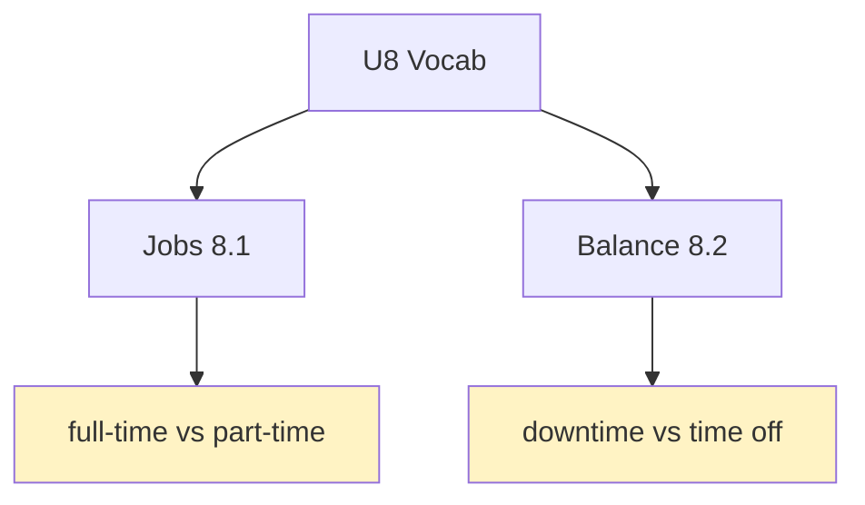
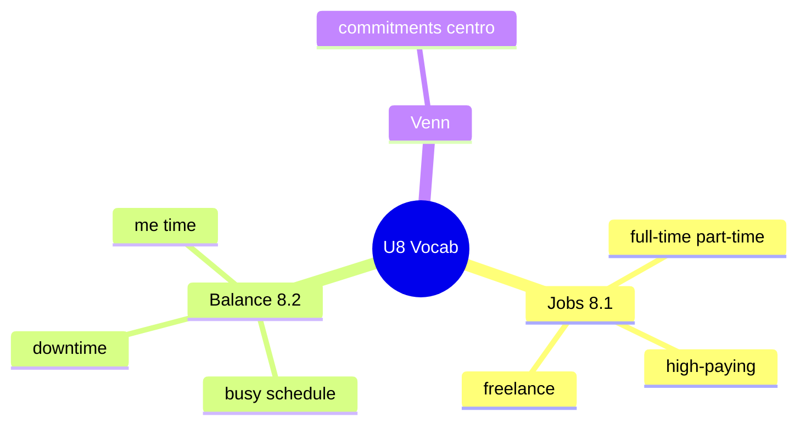

# 📖 Vocabulary & Use - Jobs, Work-Life & Lifestyles (U8)

## 🎯 Introducción

> [!info] 💡 ¿Por Qué Importa?
>
> La unidad 8 habla de estilos de vida a través del trabajo — y necesitas el vocabulario exacto: *freelance* no es *part-time*, *downtime* no es *time off*, *commitments* viven en el medio del Venn. Sin ellos, todo trabajo "es bueno/malo"; con ellos, describes con precisión.
>
> **Analogía del mundo real:** son etiquetas de frascos — si etiquetas mal (*temporary* vs *permanent*), la receta (tu descripción) sale mal.
>
> | Sin Esto | Con Esto |
> |---|---|
> | "Babysitter is a good job." | "Babysitting is probably a **part-time** job, not very **high-paying**, but very **challenging**." |
> | "I have no time." | "I have a **busy schedule** and no **downtime** — my **me time** is zero." |
>
> **En esta nota:** jobs (8.1), work/life balance (8.2), el Venn work–commitments–home y drills del libro.

---

## 📋 Definiciones Formales

> [!note] 📋 Tabla 1×1 — Jobs (8.1A)
>
> | Palabra | Significado | Ejemplo ES → EN |
> |---|---|---|
> | **challenging / tough** | desafiante / duro | Es desafiante → *It's very **challenging**.* |
> | **full-time / part-time** | tiempo completo / parcial | Medio tiempo → *a **part-time** job.* |
> | **permanent / temporary** | fijo / temporal | Solo meses → *It only lasts a few months → **temporary**.* |
> | **high-paying** | bien pagado | Buen salario → *You get a good salary → **high-paying**.* |
> | **freelance / second job** | independiente / segundo empleo | Trabajo extra → *a **second job** for extra money.* |
> | **dream job / main job** | trabajo soñado / principal | Lo que siempre quisiste → *your **dream job**.* |
> | **desk job / government job** | oficina / público | En oficina → *a **desk job**.* |
> | **tiring / stressful / hiring** | agotador / estresante / contratar | Muchas horas → *very **tiring**.* |

> [!note] 📋 Tabla 1×1 — Work/life balance (8.2A)
>
> | Palabra | Significado | Ejemplo |
> |---|---|---|
> | **busy schedule** | agenda llena | *I have such a **busy schedule** at the moment.* |
> | **downtime** | descanso real (apagado) | *Do you get enough **downtime**?* |
> | **time off** | permiso/ausencia | *Can I take **time off** next week?* |
> | **commitments** | compromisos (van al centro del Venn) | *Work, school or home **commitments**.* |
> | **me time** | tiempo para mí | *Is your downtime also **me time**?* |
> | **chilling out / 9-to-5** | relajarse / horario oficina | *Stop **chilling out**, back to work!* |
> | **shift / overtime** | turno / horas extra | *Night **shift** at the hospital.* |
> | **always connected** | siempre en línea | *Lawyers are **always connected**.* |

> [!note] 📋 El Venn (8.2A) — work/school ∩ commitments ∩ home life
>
> *Commitments* ("I guess that…") van al centro: valen para trabajo, escuela y hogar. Pregunta del libro: *Do you think it's a good idea to combine work/school with social life?*

---

## 🛠️ Método / Procedimiento (Describir un trabajo)

> [!note] 📋 Procedimiento (8.1D: factual + opinión)
>
> 1. **Factual** (subraya): tipo de jornada + salario + estabilidad (*part-time, high-paying, temporary*).
> 2. **Opinión** (encierra): cómo se siente (*challenging, stressful, tough*).
> 3. **Modelo:** *"Being a babysitter is probably a **part-time** job, and it isn't very **high-paying**, but it is very **challenging**."*
>
> **Principio clave:** primero lo factual (subrayado), después la opinión (encerrada) — nunca mezclados.

---

## 🎨 Ejemplos Trabajados (Bilingües)

> [!example] 🟢 Ejemplo 1 — Tres trabajos (8.1D)
>
> - *Firefighter is a **full-time**, **stressful** job, but very respected.* (Bombero: tiempo completo, estresante, respetado.)
> - *Doctor is **high-paying** but the **shift** system destroys your **family life**.* (Médico: bien pagado pero turnos vs familia.)
> - *Fashion designer is freelance and **tough** at the start.* (Diseñador: independiente y duro al inicio.)

> [!example] 🟢 Ejemplo 2 — Tu balance (8.2C, en grupo)
>
> - *Do you feel you have a **busy schedule**? Do you get enough **downtime**? Is your downtime also **"me time"**?*

---

## ⚠️ Errores Comunes y Principios Lógicos

> [!danger] ❌ Error 1 — *part-time* por *freelance* (viola **jornada vs contrato**)
>
> - ❌ **EL ERROR ESTÁ AQUÍ:** *"I'm freelance, I work 4 hours"* (eso es *part-time*; *freelance* = sin empleador fijo).
> - ✅ Así sí: *part-time* = pocas horas; *freelance* = por cuenta propia; *temporary* = con fecha fin.

> [!danger] ❌ Error 2 — *downtime* = *time off* (viola **descanso vs permiso**)
>
> - ❌ **EL ERROR ESTÁ AQUÍ:** *"I need downtime from my boss"* (el permiso se pide: *time off*).
> - ✅ Así sí: ***time off*** se pide/toma; ***downtime*** es desconexión real.

---

## 🎯 Metas de Aprendizaje

> [!note] 🎯 Nivel Básico
>
> - [ ] Digo los 15 términos de jobs sin mirar.
> - [ ] Distingo downtime / time off / me time.

> [!note] 🎯 Nivel Intermedio
>
> - [ ] Describo 3 trabajos con factual + opinión (modelo 8.1D).
> - [ ] Ubico 5 palabras en el Venn work/commitments/home.

---

## 🔁 Repaso SR (flashcards)

#flashcards/ingles-iii-u2

> [!note] 🧠 Repasa con el plugin Spaced Repetition
>
> - ¿*part-time* vs *freelance* vs *temporary*?::Pocas horas / sin empleador fijo / con fecha fin.
> - ¿*downtime* vs *time off*?::Desconexión real vs permiso que se pide.
> - ¿Qué va al centro del Venn?::*Commitments* (valen para work, school y home).
> - ¿Modelo 8.1D en 1 línea?::Factual subrayado + opinión encerrada.

---

## 📊 Resumen Visual

> [!success] 🔍 Comparación Final
>
> | Aspecto | Sin Esto | Con Esto |
> |---|---|---|
> | Trabajos | "good/bad job" | Jornada + salario + feeling |
> | Tiempo | "no time" | schedule / downtime / me time |

---

## 🔗 Seguir estudiando

> [!info] 📚 Seguir estudiando
>
> - Índice: [[00 - Índice Unit 2]]
> - Anterior: (vacío — primera nota del libro U8)
> - Siguiente: [[02 - Grammar & Examples - Unreal Conditionals & I Wish]]

## 📚 Referencias

> [!quote] 📖 Fuentes Consultadas
>
> - Empower B1+ (Cambridge): Unit 8, lessons 8.1–8.2 (pp. 76–79).
> - Capturas: [[Libro de ingles las primeras unidades]] (§ 8.1, 8.2).

---

**Tags:** #IDIG1008 #unit2 #vocabulary #jobs #worklife #english
