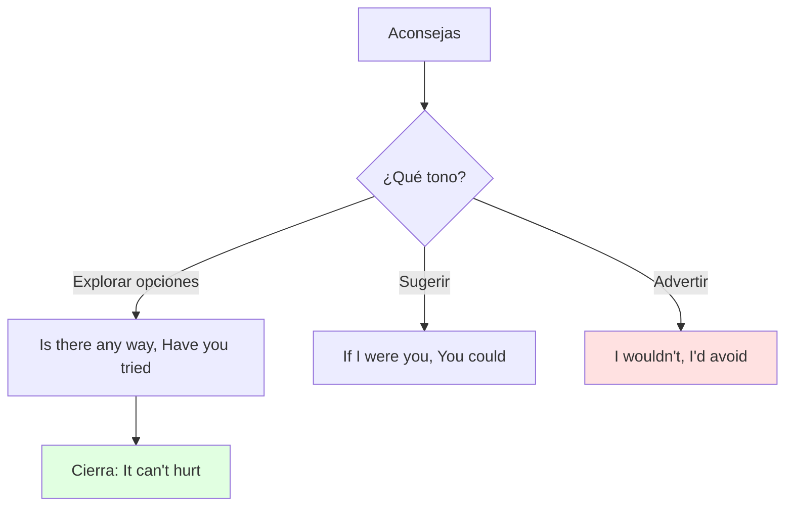
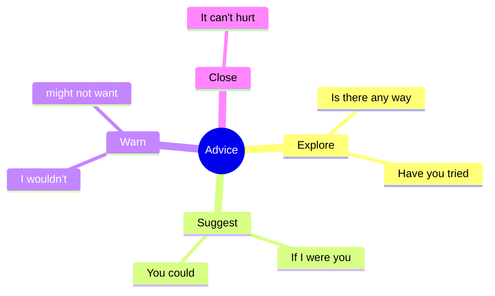

# 🗣️ Functional Language & Pronunciation - Options & Warnings (U8)

## 🎯 Introducción

> [!info] 💡 ¿Por Qué Importa?
>
> Aconsejar sin imponer (*If I were in your shoes… / It can't hurt to…*) y advertir sin prohibir (*You might not want to…*) es la función de 8.3 — más los pares vocálicos /ɜː/ vs /ʊ/ que el libro evalúa aquí.
>
> **Analogía del mundo real:** recomendar es ser GPS — ofreces rutas (*you could…*), adviertes del tráfico (*I'd avoid…*), pero el volante lo lleva el otro.
>
> | Sin Esto | Con Esto |
> |---|---|
> | *"Don't go."* (orden seca) | *"**I'd avoid that** if I were you."* (advertencia suave) |
> | *"Do yoga."* (imposición) | *"**You could try** yoga — **you've got nothing to lose**."* |
>
> **En esta nota:** talking through options, warnings (8.3), *I guess* (insider) y /ɜː/ vs /ʊ/.

---

## 📋 Definiciones Formales

> [!note] 📋 Tabla 1×1 — Talking through options (8.3)
>
> | Función | Frases | Ejemplo del libro |
> |---|---|---|
> | **Pedir opciones** | *Is there any way you can…? / Have you tried…?* | *Have you tried talking to your boss?* |
> | **Sugerir** | *You could… / Maybe you… / That could work.* | *Maybe you could offer to work remotely?* |
> | **Recomendar personal** | *If I were in your shoes… / I'd try that if I were you.* | ***If I were in your shoes**, I'd talk to him.* |
> | **Animar** | *It can't hurt (to…) / You've got nothing to lose.* | ***It can't hurt** to ask.* |
> | **Insider: *I guess*** | *I guess* = considerar sugerencias (*I guess I could…*) | *I guess it wouldn't hurt.* |

> [!note] 📋 Warnings — advertir sin prohibir (8.3)
>
> - ***You don't want to do that!*** (directa, fuerte)
> - ***I wouldn't do that** if I were you.* (personal, suave)
> - ***You might not want to** do that.* (la más suave)
> - ***I'd avoid that** if I were you.* (recomendación negativa)
> - Modelo: *I really don't want to go to Dale's party → Well, you might… (not go)?*

> [!note] 📋 Pronunciación /ɜː/ vs /ʊ/ (8.3)
>
> - **/ɜː/** (*hurt*): *hurt, birthday, alternative* — larga, boca media.
> - **/ʊ/** (*lose*): *lose, you, school, few* — corta, labios redondos.
> - Drill: *schedule / alternative / you / school / birthday / few* → A (/ɜː/) o B (/ʊ/).

---

## 🛠️ Método / Procedimiento (Aconsejar en 3 pasos)

> [!note] 📋 Procedimiento General
>
> 1. **Explora** (*Is there any way…? / Have you tried…?*).
> 2. **Sugiere** (*You could… / If I were you…*).
> 3. **Cierra animando** (*It can't hurt / You've got nothing to lose*).
>
> **Principio clave:** explorar antes de sugerir — el consejo sin diagnóstico suena a orden.

---

## 🎨 Ejemplos Trabajados (Bilingües)

> [!example] 🟢 Ejemplo 1 — Laura y la reunión del sábado (8.3 audio)
>
> - Laura: *"My boss scheduled a meeting for Saturday."* (Mi jefe puso reunión el sábado.)
> - Mamá explora: ***Is there any way you can get out of it?***
> - Mamá sugiere: ***If I were in your shoes**, I'd talk to your boss. **It can't hurt**, right?*
> - Advierte: ***You might not want to** just skip it.*

> [!example] 🟢 Ejemplo 2 — Role play (8.3D: cena / deporte / laptop bag)
>
> - Situación: no quieres gastar mucho en la cena.
> - Tú: ***We could try** the food court — **there's a good salad bar there**.*
> - Adviertes: ***I wouldn't** order the most expensive dish if I were you.*

---

## 📝 Ejercicios del Libro (8.3 drills)

> [!example] ✏️ Ejercicio 1 — /ɜː/ o /ʊ/ (8.3 drill B)
>
> Escribe A (/ɜː/) o B (/ʊ/): *schedule, alternative, you, school, birthday, few*.
>
> > [!success]- ✅ Solución
> >
> > - ***schedule* → B** (/ˈʃedjuːl/ — redonda corta).
> > - ***alternative* → A** (/ɔːlˈtɜːnətɪv/).
> > - ***you* → B**.
> > - ***school* → B**.
> > - ***birthday* → A** (/ˈbɜːθdeɪ/).
> > - ***few* → B**.

> [!example] ✏️ Ejercicio 2 — Warn the bad ideas (8.3C)
>
> Da un warning para cada mala idea:
>
> - "I need to cancel my meeting saying I'm sick."
> - "I just won't go to Dale's birthday party."
> - "I'll go to Ben's party instead of studying (I failed the last test)."
>
> > [!success]- ✅ Respuestas modelo
> >
> > - ***I wouldn't do that** if I were you — **it can't hurt** to tell the truth instead.*
> > - ***You might not want to** just disappear — send a message at least.*
> > - ***I'd avoid that** if I were you — one party isn't worth another fail.*

> [!example] ✏️ Ejercicio 3 — Laptop bag role play (8.3, modelo)
>
> Customer quiere laptop bag (no sabe cuál); clerk recomienda. Modelo compacto:
>
> > [!success]- ✅ Respuesta modelo
> >
> > - *Customer: I want a bag for my laptop. **Is there anything** light but strong?*
> > - *Clerk: **You could try** this one — **I've always had luck with** this brand. **That could work** for daily use.*
> > - *Customer: **I like that option**. I'll take it!*

---

## ⚠️ Errores Comunes y Principios Lógicos

> [!danger] ❌ Error 1 — Ordenar en vez de sugerir (viola **recomendar ≠ imponer**)
>
> - ❌ **EL ERROR ESTÁ AQUÍ:** *"Do yoga. Stop complaining."*
> - ✅ Así sí: ***You could try** yoga — **you've got nothing to lose**.*

> [!danger] ❌ Error 2 — Warning como prohibición (viola **advertir ≠ prohibir**)
>
> - ❌ **EL ERROR ESTÁ AQUÍ:** *"Don't go to the party!"* (suena a orden).
> - ✅ Así sí: ***I wouldn't** go if I were you / **You might not want to**…*.

> [!danger] ❌ Error 3 — /ɜː/ por /ʊ/ (viola **duración**)
>
> - ❌ **EL ERROR ESTÁ AQUÍ:** *lose* largo como *hurt*.
> - ✅ Así sí: *hurt/birthday* largos y abiertos; *lose/school* cortos y redondos.

---

## 🎯 Metas de Aprendizaje

> [!note] 🎯 Nivel Básico
>
> - [ ] Digo las 5 frases de opciones + 4 warnings sin mirar.
> - [ ] Distingo /ɜː/ de /ʊ/ en las 6 del drill.

> [!note] 🎯 Nivel Intermedio
>
> - [ ] Aconsejo en 3 pasos (explorar → sugerir → animar) en role play.
> - [ ] Advierto suave (*might not want*) en vez de ordenar.

---

## 🔁 Repaso SR (flashcards)

#flashcards/ingles-iii-u2

> [!note] 🧠 Repasa con el plugin Spaced Repetition
>
> - ¿Recomendación personal clásica?::*If I were in your shoes…*
> - ¿Cierre que anima?::*It can't hurt to… / You've got nothing to lose.*
> - ¿Warning más suave?::*You might not want to…*
> - ¿/ɜː/ ejemplo?::*hurt, birthday* (larga); /ʊ:? *lose, school* (corta).
> - ¿Pasos para aconsejar?::Explorar → sugerir → animar.

---

## 📊 Resumen Visual

> [!success] 🔍 Comparación Final
>
> | Aspecto | Sin Esto | Con Esto |
> |---|---|---|
> | Consejo | Orden | Explorar → sugerir → animar |
> | Peligro | *"Don't!"* | *I wouldn't… / might not…* |

---

## 🔗 Seguir estudiando

> [!info] 📚 Seguir estudiando
>
> - Índice: [[00 - Índice Unit 2]]
> - Anterior: [[02 - Grammar & Examples - Unreal Conditionals & I Wish]]
> - Siguiente: [[04 - Reading, Writing, Speaking - Detox, Podcast & Plan]]

## 📚 Referencias

> [!quote] 📖 Fuentes Consultadas
>
> - Empower B1+ (Cambridge): Unit 8, lesson 8.3 (pp. 80–81).
> - Capturas: [[Libro de ingles las primeras unidades]] (§ 8.3).

---

**Tags:** #IDIG1008 #unit2 #functional #pronunciation #advice #english
