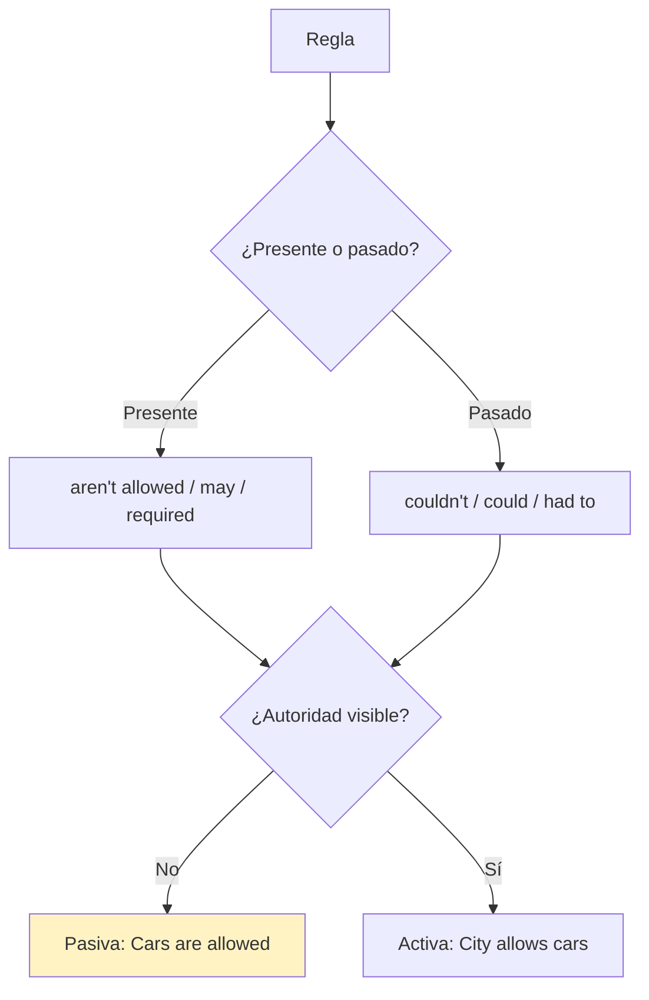
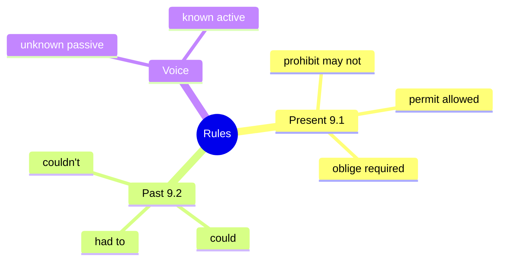

# 📐 Grammar & Examples - Present & Past Rules (U9)

## 🎯 Introducción

> [!info] 💡 ¿Por Qué Importa?
>
> Prohibir, permitir y obligar — en presente (*aren't allowed to*) y en pasado (*couldn't*) — es la gramática doble de 9.1–9.2, casi siempre en **pasiva** (la autoridad se sobreentiende). Sin ella, todas las reglas suenan a *must*; con ella, gradúas la fuerza.
>
> **Analogía del mundo real:** son 3 semáforos por época — rojo (prohibir), verde (permitir), amarillo obligatorio (obligar) — y cambian de color en pasado.
>
> | Sin Esto | Con Esto |
> |---|---|
> | *"You must not skateboard"* (siempre must) | *You **aren't allowed to** skateboard here.* |
> | *"Kids must come home"* (ayer también) | *We **had to** come home by nine.* |
>
> **En esta nota:** present (9.1) + past (9.2) + pasiva de autoridad + accuracy check.

---

## 📋 Definiciones Formales

> [!note] 📋 Present: prohibition / permission / obligation (9.1)
>
> | Fuerza | Estructuras (de fuerte a suave) | Ejemplo del libro |
> |---|---|---|
> | **Prohibir** | *may not / aren't allowed to / aren't supposed to* | *You **may not** skateboard here. / You **aren't supposed to** bring pets.* |
> | **Permitir** | *are allowed to / may / can* | *You **are allowed to** bring your guide dog. / You **may** request an interpreter.* |
> | **Obligar** | *should / are required to / are supposed to* | *Cameras **should** see you. / You're **required to** wear a hard hat.* |
>
> Matices: *may not* > *supposed to* (prohibir); *required to* > *supposed to* (obligar).

> [!note] 📋 Past: las mismas 3 en pasado (9.2)
>
> | Fuerza | Estructuras | Ejemplo del libro |
> |---|---|---|
> | **Prohibir** | *couldn't / were not allowed to* | *Drivers **were prohibited** from parking left.* |
> | **Permitir** | *could / were allowed to* | *Carriages **were allowed to** circulate freely.* |
> | **Obligar** | *had to / were required to / were supposed to* | *Drivers **had to** drive right. / Pedestrians **were required to** cross.* |
>
> *Required* > *supposed* también en pasado.
>
> **Accuracy check (pasiva):** autoridad desconocida → pasiva (*Cars **are allowed** to park here*); autoridad visible → activa (***City regulations allow** cars here*).

---

## 🛠️ Método / Procedimiento (3 preguntas)

> [!note] 📋 Procedimiento General
>
> 1. **¿Prohíbe, permite u obliga?** Elige la fila.
> 2. **¿Presente o pasado?** Cambia el color del semáforo (*aren't allowed → weren't allowed*).
> 3. **¿Se ve la autoridad?** No → pasiva; sí → activa.
>
> **Principio clave:** fuerza + época + voz — las 3 o la regla cojea.

---

## 🎨 Ejemplos Trabajados (Bilingües)

> [!example] 🟢 Ejemplo 1 — Signs (9.1C: reglas de un lugar)
>
> - Aeropuerto: ***No one is allowed to** enter without boarding pass.* (Nadie puede entrar sin pase.)
> - Hospital: *You **are required to** wear a mask.* (Mascarilla obligatoria.)
> - Teatro: *You **aren't supposed to** use phones.* (Se supone que no usas el teléfono.)

> [!example] 🟢 Ejemplo 2 — Infancia (9.2C: 3 reglas + ¿padres estrictos?)
>
> - *When we were kids, we **couldn't stay** up after 10.* (No podíamos trasnochar.)
> - *At school, we **had to wear** uniform.* (Teníamos que usar uniforme.)
> - *Whose parents were the strictest?* (¿Qué padres eran más estrictos?)

---

## 📝 Ejercicios del Libro (grammar ref + drills)

> [!example] ✏️ Ejercicio 1 — Replace the bold (9.1 drill A)
>
> Reemplaza con el box (*be allowed to, be required to, be supposed to, can, may*): *You **can't** eat in the lab. / You **should** leave your dog outside. / You **shouldn't** wear outdoor shoes on court. / You **can** park here 30 min. / You **must** show ID. / You **must not** skateboard inside.*
>
> > [!success]- ✅ Solución
> >
> > - *You **aren't allowed to** eat…* (*can't* = prohibición).
> > - *You **are supposed to** leave…* (*should* ≈ *supposed to*).
> > - *You **aren't supposed to** wear…* (*shouldn't* ≈ *not supposed to*).
> > - *You **are allowed to** park…* (*can* = permiso).
> > - *You **are required to** show ID.* (*must* = obligación fuerte).
> > - *You **aren't allowed to** skateboard…* (*must not* = prohibición).

> [!example] ✏️ Ejercicio 2 — Past sets (9.2 drill A)
>
> Completa: *When kids, we ___ stay up after 10 (trouble if so). / At school, we ___ wear uniform. / In high school, I ___ play video games before homework. / As a teen, I ___ come home by nine (sometimes later).*
>
> > [!success]- ✅ Solución
> >
> > - *we **weren't allowed to / couldn't** stay up…* (prohibición).
> > - *we **had to** wear uniform.* (obligación).
> > - *I **wasn't allowed to / couldn't** play…* (prohibición).
> > - *I **had to** come home…* (obligación).

> [!example] ✏️ Ejercicio 3 — Fake law? (9.2 speaking: sin clave única)
>
> De estas "leyes", 3 fueron reales y 1 es falsa. Vota y defiende: *No soda on Sunday / men must grow beards / teachers weren't allowed to marry / only 100+ lb people could vote.*
>
> > [!success]- ✅ Cómo defender tu voto (modelos)
> >
> > - *That **couldn't** be real because no government controls faces.* (imposible → *couldn't*).
> > - *Teachers **weren't allowed to** marry in some places — that **had to** be hard.* (prohibición + obligación pasadas).
> > - Regla del juego: cada argumento usa 1 modal pasado.

---

## ⚠️ Errores Comunes y Principios Lógicos

> [!danger] ❌ Error 1 — *must* para el pasado (viola **época**)
>
> - ❌ **EL ERROR ESTÁ AQUÍ:** *"Yesterday we must wear uniform."*
> - ✅ Así sí: ***had to / were required to*** — *must* no tiene pasado.

> [!danger] ❌ Error 2 — Activa sin autoridad (viola **pasiva**)
>
> - ❌ **EL ERROR ESTÁ AQUÍ:** *"They allow cars to park"* (¿quiénes?).
> - ✅ Así sí: ***Cars are allowed** to park here.* (autoridad desconocida → pasiva).

---

## 🎯 Metas de Aprendizaje

> [!note] 🎯 Nivel Básico
>
> - [ ] Digo las 3 fuerzas en presente y pasado sin mirar.
> - [ ] Gradúo: *required* > *supposed*, *may not* > *supposed*.

> [!note] 🎯 Nivel Intermedio
>
> - [ ] Escribo 3 reglas de mi infancia en pasado + comparo estrictés.
> - [ ] Elijo pasiva/activa según la autoridad.

---

## 🔁 Repaso SR (flashcards)

#flashcards/ingles-iii-u3

> [!note] 🧠 Repasa con el plugin Spaced Repetition
>
> - ¿Prohibir en presente (3)?::*May not / aren't allowed to / aren't supposed to*.
> - ¿Obligar en pasado (3)?::*Had to / were required to / were supposed to*.
> - ¿*Must* en pasado?::No existe: *had to*.
> - ¿Pasiva cuándo?::Autoridad desconocida (*Cars are allowed…*).

---

## 📊 Resumen Visual

> [!success] 🔍 Comparación Final
>
> | Aspecto | Sin Esto | Con Esto |
> |---|---|---|
> | Fuerza | *must* todo | 3 grados exactos |
> | Pasado | *must* ayer | had to / couldn't |

---

## 🔗 Seguir estudiando

> [!info] 📚 Seguir estudiando
>
> - Índice: [[00 - Índice Unit 3]]
> - Anterior: [[01 - Vocabulary & Use - Places & Rules]]
> - Siguiente: [[03 - Functional Language & Pronunciation - Generalizations]]

## 📚 Referencias

> [!quote] 📖 Fuentes Consultadas
>
> - Empower B1+ (Cambridge): Unit 9, grammar 9.1–9.2 (pp. 86–89).
> - Capturas: [[Libro de ingles ultimas unidades]] (§ 9.1, 9.2).

---

**Tags:** #IDIG1008 #unit3 #grammar #modals #rules #english
