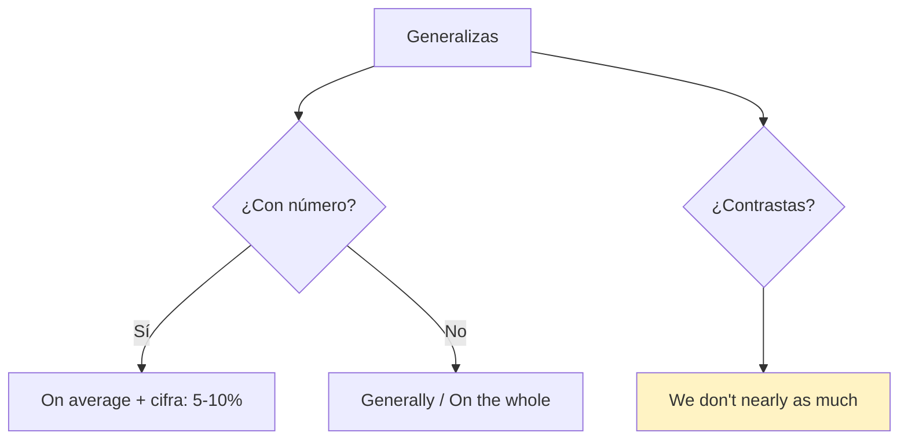
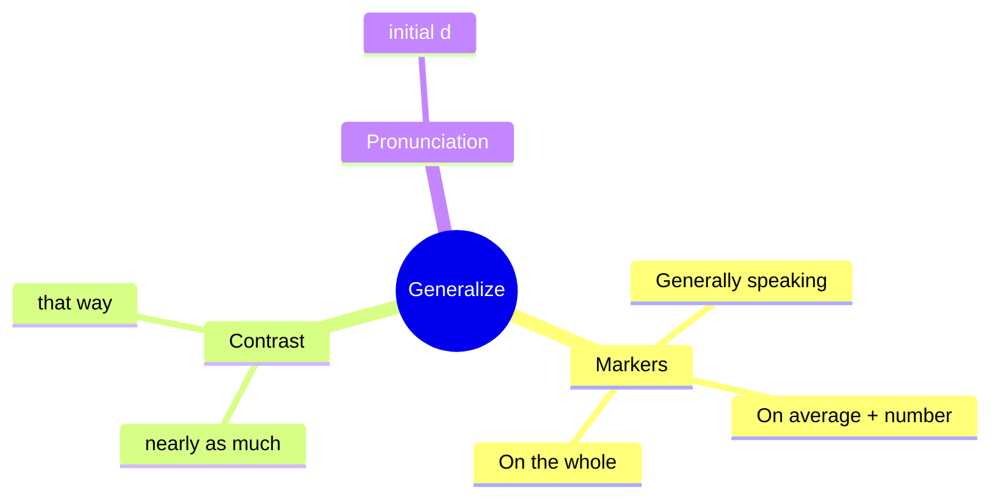

# 🗣️ Functional Language & Pronunciation - Generalizations (U9)

## 🎯 Introducción

> [!info] 💡 ¿Por Qué Importa?
>
> Generalizar (*Generally speaking… / On average… / On the whole…*) te deja hablar de culturas sin sonar absoluto — la función de 9.3, con el contraste cultural (*We don't tip nearly as much*) y la /d/ inicial que el libro evalúa aquí.
>
> **Analogía del mundo real:** generalizar es pintar con brocha gorda a propósito — *generally* y *on average* son tu cinta de "mojado, no tocar" contra los absolutos.
>
> | Sin Esto | Con Esto |
> |---|---|
> | "Americans tip 20%." (absoluto falso) | *"**Generally speaking**, Americans tip 15–20%."* |
> | "Here different." | *"**We don't tip nearly as much** as that."* |
>
> **En esta nota:** generalizing chart (9.3), contrasting culture y /d/ inicial.

---

## 📋 Definiciones Formales

> [!note] 📋 Tabla 1×1 — Making generalizations (9.3B)
>
> | Marcador | Uso | Ejemplo del libro |
> |---|---|---|
> | **Generally speaking,** | en general | ***Generally speaking**, we leave 15–20%.* |
> | **People don't tend to…** | no suelen | *People **don't tend to** tip as much.* |
> | **We generally don't…** | generalmente no | *We **generally don't** tip in fast food.* |
> | **On average,** + número | en promedio | ***On average**, people tip 5–10%.* |
> | **On the whole,** | en conjunto | ***On the whole**, service jobs don't pay well.* |

> [!note] 📋 Contrasting information (9.3, estrategia real)
>
> - ***We don't tip nearly as much** as that.* (ni de cerca tanto)
> - ***Really? We don't do it that way** in my country.* (¿en serio? aquí no)
> - ***We do things differently** back home.* (en casa distinto)
> - ***That's not how we do/say it** (in Portuguese).* (así no se hace/dice)

> [!note] 📋 Pronunciación /d/ inicial (9.3)
>
> *drop, different, depend, do, difficult, deep* — la /d/ suena plena al inicio. Drill: escucha quién la dice (A o B) y repite con tu compañero.

---

## 🛠️ Método / Procedimiento (Generalizar sin absolutizar)

> [!note] 📋 Procedimiento General
>
> 1. **Marca el alcance** (*Generally / On average* + cifra si hay).
> 2. **Contrasta** con tu cultura (*We don't nearly as much…*).
> 3. **Cierra con sorpresa** si aplica (*Really? / That's not how we…*).
>
> **Principio clave:** todo absoluto necesita su escudo (*generally, on average*) o es falso.

---

## 🎨 Ejemplos Trabajados (Bilingües)

> [!example] 🟢 Ejemplo 1 — Tipping USA vs casa (9.3 audio)
>
> - Júlia: *"I'll pick up the check if you leave the tip."* (Yo pago la cuenta si dejas propina.)
> - Charlie: ***Generally speaking**, how much should we leave?* → ***On average**, people tip 5–10%.* (¿Cuánto se deja? En promedio 5–10%.)
> - Contraste: ***We don't tip nearly as much** as that in my country.*

> [!example] 🟢 Ejemplo 2 — Tus costumbres (9.3C + speaking)
>
> - *Think of a time you visited a new town: in what ways were things different?*
> - Modelo: ***On the whole**, people wear more colorful clothes than back home.* (En conjunto, visten más colorido.)

---

## 📝 Ejercicios del Libro (9.3 drills)

> [!example] ✏️ Ejercicio 1 — Complete the generalizations (9.3 drill C)
>
> Completa con el chart: *1 ___ speaking, we don't really give many tips. / 2 People ___ to tip more in nicer restaurants. / 3 ___, service workers don't depend on tips. / 4 People ___ don't tip taxi drivers unless it's a long journey. / 5 ___, people tip around 10% in restaurants.*
>
> > [!success]- ✅ Solución
> >
> > - ***Generally*** *speaking,…* (apertura clásica).
> > - *People **tend** to tip more…* (*tend to* = suelen).
> > - ***On the whole**, service workers…* (en conjunto).
> > - *People **generally don't** tip taxi drivers…* (generalmente no).
> > - ***On average**, people tip around 10%…* (*on average* + cifra).

---

## ⚠️ Errores Comunes y Principios Lógicos

> [!danger] ❌ Error 1 — Absoluto sin escudo (viola **generalizar**)
>
> - ❌ **EL ERROR ESTÁ AQUÍ:** *"Americans tip 20%. Ecuadorians don't tip."*
> - ✅ Así sí: ***Generally speaking**… / **On average**,…* — todo absoluto lleva escudo.

> [!danger] ❌ Error 2 — *on average* sin número (viola **promedio = cifra**)
>
> - ❌ **EL ERROR ESTÁ AQUÍ:** *"On average, people tip."*
> - ✅ Así sí: ***On average**, people tip **5–10%**.* — *on average* exige cifra.

---

## 🎯 Metas de Aprendizaje

> [!note] 🎯 Nivel Básico
>
> - [ ] Digo los 5 marcadores sin mirar.
> - [ ] Contrasto con *nearly as much / that way / differently*.

> [!note] 🎯 Nivel Intermedio
>
> - [ ] Generalizo 3 costumbres con escudo + cifra.
> - [ ] Distingo /d/ inicial en 6 palabras.

---

## 🔁 Repaso SR (flashcards)

#flashcards/ingles-iii-u3

> [!note] 🧠 Repasa con el plugin Spaced Repetition
>
> - ¿Abrir generalización?::*Generally speaking,…*
> - ¿Con cifra?::*On average, people tip 5–10%.*
> - ¿Contrastar cultura?::*We don't tip nearly as much as that.*
> - ¿Escudo contra absolutos?::*Generally / on average / on the whole*.

---

## 📊 Resumen Visual

> [!success] 🔍 Comparación Final
>
> | Aspecto | Sin Esto | Con Esto |
> |---|---|---|
> | Afirmar | Absolutos falsos | Escudo + cifra |
> | Comparar | "Different" | *nearly as much* |

---

## 🔗 Seguir estudiando

> [!info] 📚 Seguir estudiando
>
> - Índice: [[00 - Índice Unit 3]]
> - Anterior: [[02 - Grammar & Examples - Present & Past Rules]]
> - Siguiente: [[04 - Reading, Writing, Speaking - Ramp, Complaint & Town]]

## 📚 Referencias

> [!quote] 📖 Fuentes Consultadas
>
> - Empower B1+ (Cambridge): Unit 9, lesson 9.3 (pp. 90–91).
> - Capturas: [[Libro de ingles ultimas unidades]] (§ 9.3).

---

**Tags:** #IDIG1008 #unit3 #functional #pronunciation #generalizations #english
