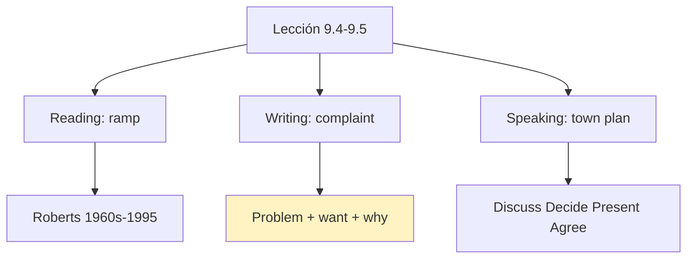
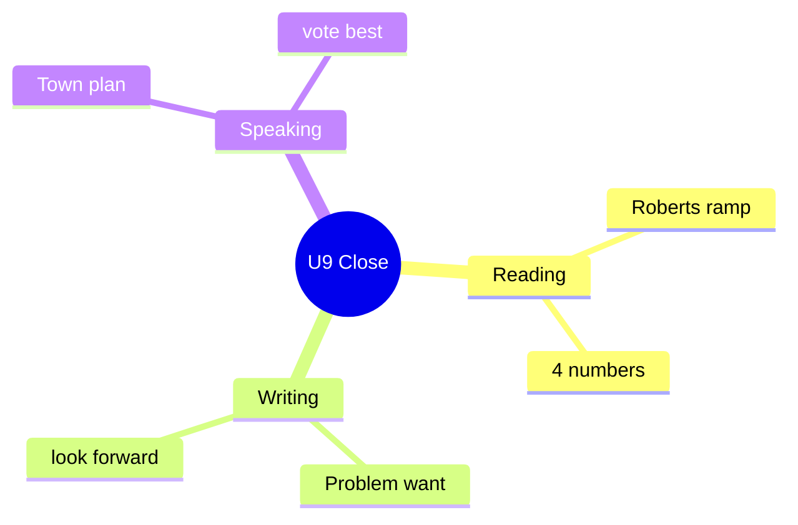

# 📰 Reading, Writing, Speaking - Ramp, Complaint & Town (U9)

## 🎯 Introducción

> [!info] 💡 ¿Por Qué Importa?
>
> El cierre de U9 combina leer historia (la rampa de Ed Roberts), escribir quejas formales (*I look forward to your reply*) y proponer mejoras a tu ciudad. Es el mini-examen de la unidad en 9.4–9.5.
>
> **Analogía del mundo real:** quejarse bien es reclamar con traje — datos (*1960s, 400 centers*), tono firme y cierre que exige acción.
>
> | Sin Esto | Con Esto |
> |---|---|
> | "Your restaurant is bad." | *One step, no ramp — **I look forward to your reply**.* |
> | "Parks need things." | *Local authorities **should** add ramps because…* |
>
> **En esta nota:** reading rampa (9.4), complaint letter y mejoras 9.5.

---

## 📋 Definiciones Formales

> [!note] 📋 Reading: *The Story of the Ramp* (9.4A–C)
>
> - **Ed Roberts:** primer estudiante con discapacidad grave en Berkeley (1960s); rampas nocturnas con activistas.
> - **Cifras:** 1972 (primer centro), 400+ centros hoy, 1990 (Americans with Disabilities Act), 1995 (campus en su memoria).
> - **Gist:** ¿a/b/c? Mejor título: historia de las rampas (b).
> - **Crítica:** ¿acceso fácil donde vives? ¿quién paga: negocio, municipio o caridad?

> [!note] 📋 Tabla 1×1 — Complaint message (9.4A + Register Check)
>
> | Parte | Qué hace | Ejemplo (modelo restaurante) |
> |---|---|---|
> | **Problem** | Qué pasó | *One step at the entrance, no ramp — embarrassing.* |
> | **Want + why** | Qué pides y por qué | *Meet to make changes **so** all can enter.* |
> | **Close** | Exige acción | ***I look forward to your reply.*** |
> | **Adverbs** | Marcan actitud | *amazingly / luckily / sadly / surprisingly / unfortunately / unluckily* |

---

## 🛠️ Método / Procedimiento (WRITE IT: complaint ~100 palabras)

> [!note] 📋 Procedimiento General (9.4D)
>
> 1. **Problema** (qué + cuándo): *Last week I visited… one step, no ramp.*
> 2. **Want + why** (qué pides + ley/razón): *There's a law… meet to fix it.*
> 3. **Cierre que exige:** ***I look forward to your reply.***
>
> **Principio clave:** problema + pedido + cierre de acción — sin cierre es solo desahogo.

---

## 🎨 Ejemplos Trabajados (Bilingües)

> [!example] 🟢 Ejemplo 1 — Útiles 9.5 por fase
>
> - **Discuss:** *They **might have** problems getting… / They **may not be allowed** to…* (¡past modals en acción!).
> - **Local:** *Local authorities **should**… / It'd be a good idea to…*
> - **Present:** *We **discussed**… / We **decided** that… / We **suggest** that…*

> [!example] 🟢 Ejemplo 2 — Mejoras a tu ciudad (9.5: grupos + voto)
>
> - Grupo (familias, sillas de ruedas, perros): 3 problemas + 3 soluciones (leyes, facilidades).
> - Presenta problemas y soluciones → votan la más ambiciosa, práctica e imaginativa.

---

## 📝 Ejercicios del Libro (9.4 drills)

> [!example] ✏️ Ejercicio 1 — Gist + números (9.4A–B)
>
> - ¿Cuál es el mejor título? *a) Ed Roberts and the movement / b) A short history of wheelchair ramps / c) Student life at Berkeley.*
> - ¿A qué refieren? *1960s / 1972 / 400 / 1990 / 1995.*
>
> > [!success]- ✅ Solución
> >
> > - Título ***b*** — el artículo recorre rampas y movimiento, no solo Berkeley.
> > - ***1960s*** — Roberts entra a Berkeley; ***1972*** — primer centro; ***400*** — centros hoy en USA; ***1990*** — Disabilities Act; ***1995*** — campus en su memoria.

> [!example] ✏️ Ejercicio 2 — Adverbs de actitud (9.4B–C)
>
> Subraya en el mensaje 3 adverbios que muestran actitud + agrega 1 del box (*amazingly, luckily, sadly, surprisingly, unfortunately, unluckily*).
>
> > [!success]- ✅ Solución
> >
> > - ***Fortunately**, the website showed a ramp…* (alivio).
> > - ***Embarrassingly**, I had to ask staff for help…* (vergüenza).
> > - ***Happily**, from then on everything was wonderful.* (alivio final).
> > - Uno más del box a tu elección (*surprisingly / sadly / unluckily*) — justifica dónde lo pondrías.

---

## ⚠️ Errores Comunes y Principios Lógicos

> [!danger] ❌ Error 1 — Queja sin pedido (viola **problem + want**)
>
> - ❌ **EL ERROR ESTÁ AQUÍ:** *"Your place is bad. Bye."*
> - ✅ Así sí: problema + qué quieres + ***I look forward to your reply***.

> [!danger] ❌ Error 2 — Sin cifras en historia (viola **evidencia**)
>
> - ❌ **EL ERROR ESTÁ AQUÍ:** *"Roberts did things long ago."*
> - ✅ Así sí: *1960s Berkeley → 1972 first center → 400+ today → 1990 Act.*

---

## 🎯 Metas de Aprendizaje

> [!note] 🎯 Nivel Básico
>
> - [ ] Resumo la rampa con 4 cifras sin mirar.
> - [ ] Digo las útiles 9.5 por fase.

> [!note] 🎯 Nivel Intermedio
>
> - [ ] Escribo una complaint (~100 palabras) con cierre de acción.
> - [ ] Propongo 3 mejoras con leyes + facilidades.

---

## 🔁 Repaso SR (flashcards)

#flashcards/ingles-iii-u3

> [!note] 🧠 Repasa con el plugin Spaced Repetition
>
> - ¿Cierre que exige acción?::*I look forward to your reply.*
> - ¿Rampa en 4 cifras?::1960s → 1972 → 400+ → 1990.
> - ¿Mejoras en 4 verbos?::Discuss → Decide → Present → Agree(vote).
> - ¿9.5 usa qué modales?::*Might / may not / should* en discusión.

---

## 📊 Resumen Visual

> [!success] 🔍 Comparación Final
>
> | Aspecto | Sin Esto | Con Esto |
> |---|---|---|
> | Queja | Desahogo | Pedido + cierre acción |
> | Historia | "Long ago" | 4 cifras |

---

## 🔗 Seguir estudiando

> [!info] 📚 Seguir estudiando
>
> - Índice: [[00 - Índice Unit 3]]
> - Anterior: [[03 - Functional Language & Pronunciation - Generalizations]]
> - Siguiente: [[00 - Índice Unit 4]]

## 📚 Referencias

> [!quote] 📖 Fuentes Consultadas
>
> - Empower B1+ (Cambridge): Unit 9, lessons 9.4–9.5 (pp. 92–95).
> - Capturas: [[Libro de ingles ultimas unidades]] (§ 9.4, 9.5).

---

**Tags:** #IDIG1008 #unit3 #reading #writing #speaking #english
