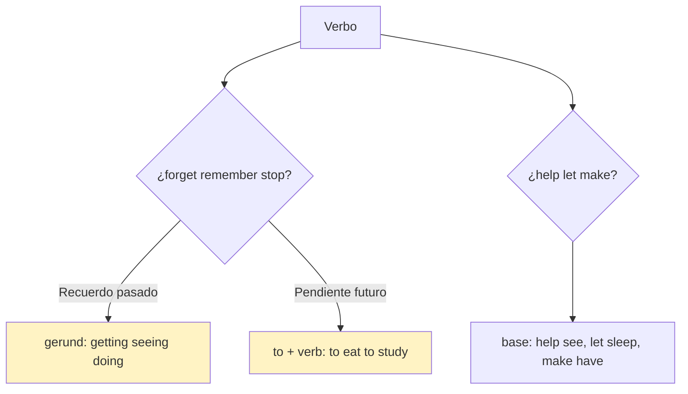
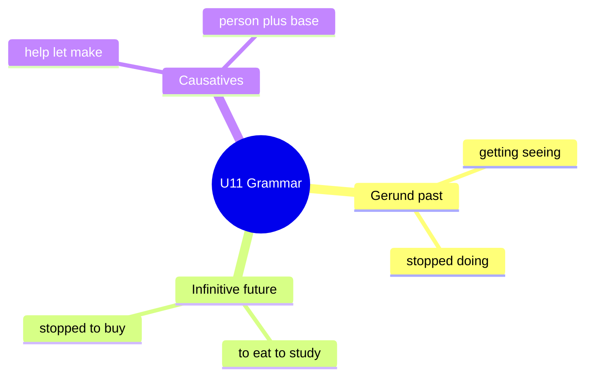

# 📐 Grammar & Examples - Gerunds & Causatives (U11)

## 🎯 Introducción

> [!info] 💡 ¿Por Qué Importa?
>
> *I stopped smoking* (dejé el vicio) vs *I stopped to smoke* (paré para fumar) — una letra cambia tu vida. Y *help/let/make* deciden quién causa qué. Son las dos gramáticas de 11.1–11.2 con accuracy check.
>
> **Analogía del mundo real:** gerundio vs infinitivo es pasado vs futuro con la misma palabra — *remember seeing* (recuerdo viejo) vs *remember to study* (alarma puesta).
>
> | Sin Esto | Con Esto |
> |---|---|
> | *"I stopped to eat"* (= paré para comer… ¿o dejé de comer?) | Sabes que es **parar para comer** — y lo usas a propósito. |
> | *"Carrots help to see"* (dudoso) | *Carrots **help you see** better.* (base form, seguro) |
>
> **En esta nota:** *forget/remember/stop* + gerund/inf (11.1) y causativos (11.2).

---

## 📋 Definiciones Formales

> [!note] 📋 Gerund vs infinitive (11.1) — el tiempo del recuerdo
>
> | Estructura | Significado | Ejemplo del libro |
> |---|---|---|
> | **gerund** (*-ing*) | acción **terminada** (recuerdo) | *I'll never forget **getting** my letter. / I remember **seeing** them.* |
> | **to + verb** | acción **general/pendiente** | *Sometimes I even forget **to eat**! / Remember **to study**.* |
> | *stop + gerund* | dejar el hábito | *I **stopped doing** all that (partying).* |
> | *stop + to* | parar **para** otra cosa | *I **stopped to buy** groceries on the way home.* |

> [!note] 📋 Causative *help / let / make* (11.2) — quién causa qué
>
> Fórmula en texto: *causativo + persona + **base verb*** (¡sin *to*!). El objeto va **en medio**.
>
> | Verbo | Patrón | Ejemplo del libro |
> |---|---|---|
> | **help** | *help + persona + base* | *Carrots **help you see** better.* |
> | **let** | *let + persona + base* (permitir) | *Honey calms a cough and **lets you sleep**.* |
> | **make** | *make + persona + base* (provocar) | *Cheese **makes people have** bad dreams.* |
>
> **Accuracy check:** base form tras los tres — *Carrots help you **to see*** ❌ → *help you **see*** ✅.

---

## 🛠️ Método / Procedimiento (3 preguntas)

> [!note] 📋 Procedimiento General
>
> 1. **¿Recuerdo o pendiente?** Terminado → gerundio; por hacer → *to*.
> 2. **¿Quién causa?** *help/let/make* + persona + base (objeto en medio, sin *to*).
> 3. **Verifica:** ¿el *to* sobra? (*help you to see* ❌ en este nivel).
>
> **Principio clave:** gerundio mira atrás, infinitivo mira adelante, causativo mira a la persona.

---

## 🎨 Ejemplos Trabajados (Bilingües)

> [!example] 🟢 Ejemplo 1 — Pares mínimos (11.1D, dilos distinto)
>
> - *I'll never forget **meeting** my advisor / I can't forget **to meet** my advisor tomorrow!* (Conocer ≠ no olvidar la cita.)
> - *I remember **putting** my keys in my bag / I have to **remember to put** the key out.* (Recuerdo dónde ≠ alarma.)
> - *I **stopped buying** groceries there (too dirty) / I **stopped to buy** groceries home.* (Dejé de comprar ≠ paré a comprar.)

> [!example] 🟢 Ejemplo 2 — Causativos (11.2C, arma preguntas)
>
> - *What helps you **stay** awake for a test?* (¿Qué te ayuda a seguir despierto?)
> - *What makes you **feel** more relaxed if stressed?* (¿Qué te relaja estresado?)

---

## 📝 Ejercicios del Libro (11.1–11.2 drills)

> [!example] ✏️ Ejercicio 1 — Gerund or infinitive (11.1 drill A)
>
> Elige: *Everyone stopped talking / to talk. / I stopped getting / to get something to eat. / I remember seeing / to see them. / I remembered buying / to buy a gift. / Did you forget locking / to lock the door? / I'll never forget playing / to play in the snow.*
>
> > [!success]- ✅ Solución
> >
> > - ***talking*** (dejaron de hablar = hábito terminado).
> > - ***to get*** (paró **para** comer).
> > - ***seeing*** (recuerdo: los vio).
> > - ***to buy*** (pendiente: el regalo por comprar).
> > - ***to lock*** (alarma no cumplida: *Look, it's wide open!*).
> > - ***playing*** (recuerdo de infancia).

> [!example] ✏️ Ejercicio 2 — Causatives (11.2 drill A)
>
> Completa con *help, let, make* + persona: *My dad can ___ fix your car. / My parents never ___ me stay out late. / He ___ me build my website in an hour! / They even ___ the dog ride in front. / He used ___ me do all his homework. / Could you ___ me carry boxes?*
>
> > [!success]- ✅ Solución
> >
> > - ***help*** (*can help fix* — ayudar).
> > - ***let*** (*never let me stay* — permitir).
> > - ***helped*** (*helped me build* — ayudar).
> > - ***let*** (*let the dog ride* — permitir).
> > - ***to make*** (*used to make me do* — obligar; ¡*used to* sí lleva *to*!).
> > - ***help*** (*help me carry* — base, sin *to*).

---

## ⚠️ Errores Comunes y Principios Lógicos

> [!danger] ❌ Error 1 — *to* tras causativo (viola **base form**)
>
> - ❌ **EL ERROR ESTÁ AQUÍ:** *"help you to see"*, *"let me to go"*.
> - ✅ Así sí: ***help/let/make + persona + base*** — el *to* sobra siempre aquí.

> [!danger] ❌ Error 2 — Gerundio por pendiente (viola **atrás vs adelante**)
>
> - ❌ **EL ERROR ESTÁ AQUÍ:** *"Remember putting the key out"* (para decir que no olvides sacarla).
> - ✅ Así sí: pendiente → ***remember to put***; recuerdo → ***remember putting***.

---

## 🎯 Metas de Aprendizaje

> [!note] 🎯 Nivel Básico
>
> - [ ] Distingo gerundio-recuerdo de infinitivo-pendiente en 6 frases.
> - [ ] Armo causativos con objeto en medio + base.

> [!note] 🎯 Nivel Intermedio
>
> - [ ] Resuelvo 11.1A y 11.2A sin mirar.
> - [ ] Explico pares mínimos (*stopped doing/to buy*) a un compañero.

---

## 🔁 Repaso SR (flashcards)

#flashcards/ingles-iii-u5

> [!note] 🧠 Repasa con el plugin Spaced Repetition
>
> - ¿Recuerdo terminado o pendiente?::Gerundio (*getting*) vs *to* (*to eat*).
> - ¿*Stop doing* vs *stop to do*?::Dejar hábito vs parar para otra cosa.
> - ¿Causativo + qué forma?::Base, sin *to*: *help you see*.
> - ¿Objeto del causativo dónde?::En medio: *let **me** stay*.

---

## 📊 Resumen Visual

> [!success] 🔍 Comparación Final
>
> | Aspecto | Sin Esto | Con Esto |
> |---|---|---|
> | Recuerdos | Todo igual | *-ing* atrás, *to* adelante |
> | Causa | *"help to"* | Persona + base |

---

## 🔗 Seguir estudiando

> [!info] 📚 Seguir estudiando
>
> - Índice: [[00 - Índice Unit 5]]
> - Anterior: [[01 - Vocabulary & Use - College & Science]]
> - Siguiente: [[03 - Functional Language & Pronunciation - Alternatives]]

## 📚 Referencias

> [!quote] 📖 Fuentes Consultadas
>
> - Empower B1+ (Cambridge): Unit 11, grammar 11.1–11.2 (pp. 108–111).
> - Capturas: [[Libro de ingles ultimas unidades]] (§ 11.1, 11.2).

---

**Tags:** #IDIG1008 #unit5 #grammar #gerunds #causatives #english
