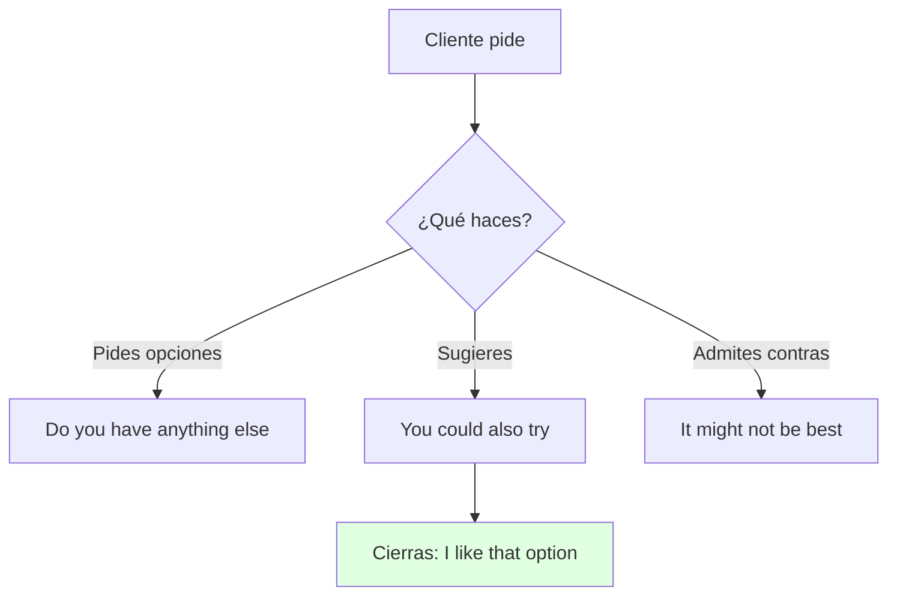
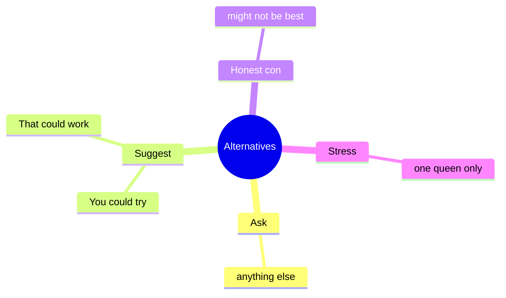

# 🗣️ Functional Language & Pronunciation - Alternatives (U11)

## 🎯 Introducción

> [!info] 💡 ¿Por Qué Importa?
>
> Sugerir alternativas (*You could also try… / That could work*) y recomendar en persona (*This one's always worked for me*) es la función de 11.3 — más el estrés en palabras largas que el libro evalúa aquí.
>
> **Analogía del mundo real:** recomendar es ser vendedor honesto — muestras opciones (*these patches*), admites contras (*might not be the best*), y el cliente elige.
>
> | Sin Esto | Con Esto |
> |---|---|
> | *"Buy this."* (seco) | *"**You could also try** these patches — **that could work** for nighttime."* |
> | Lees *scientifically* plano | Estresas ***sci**-en-tif-ic-al-ly* (6 sílabas, 1 reina). |
>
> **En esta nota:** chart de alternativas (11.3), register check y word stress.

---

## 📋 Definiciones Formales

> [!note] 📋 Tabla 1×1 — Alternatives (11.3C, complétala con el audio)
>
> | Función | Frases | Ejemplo del libro |
> |---|---|---|
> | **Asking for options** | *Do you have anything else?* | *I'm looking for something different — spray is unhealthy.* |
> | **Suggesting** | *You could also try… / That could work.* | ***You could also try** these patches. **That could work** at night.* |
> | **Disadvantages** | *It might not be the best (for…).* | *They're not great for nighttime — you shouldn't wear them while you sleep.* |
> | **Responding** | *I like that option. / I'll take it!* | *Yes, that looks like a good alternative.* |
> | **Personal recommendation** | *This one's always worked for me. / I've always had luck with…* | ***This one's always worked for me**.* |

> [!note] 📋 Register check — aconsejar con respeto (11.3)
>
> Al dar consejos evita el imperativo seco: usa ***"I" statements*** para mostrar respeto (*I think… / I've always had luck…*), no órdenes (*Buy this — it's the best* ❌).

> [!note] 📋 Word stress (11.3) — 1 reina por palabra
>
> - *sci-en-**tif**-ic-al-ly* (6) · *al-**ter**-na-tives* · *dis-ad-**van**-tag-es* · *si-tu-**a**-tion* · *re-com-men-**da**-tion*.
> - Drill: cuenta sílabas y encierra la tónica con tu compañero.

---

## 🛠️ Método / Procedimiento (Recomendar en 4 pasos)

> [!note] 📋 Procedimiento General
>
> 1. **Pide opciones** (*Do you have anything else?*).
> 2. **Sugiere 2** (*You could… / That could work…*).
> 3. **Admite 1 contra** (*It might not be the best for…*).
> 4. **Cierra** (*I like that option / I'll take it!*).
>
> **Principio clave:** 2 pros + 1 contra honesta = recomendación creíble.

---

## 🎨 Ejemplos Trabajados (Bilingües)

> [!example] 🟢 Ejemplo 1 — Farmacia: repelente (11.3 audio)
>
> - Cliente: *"Spray is unhealthy. **Do you have anything** more natural?"* (¿Algo más natural?)
> - Farmacéutico: ***You could also try** these patches — **that could work** at night.* (Prueba estos parches.)
> - Contra honesta: *They're 100% natural, but I **don't think they're great** while you sleep.*

> [!example] 🟢 Ejemplo 2 — Role play laptop bag (11.3D)
>
> - Situación: cena barata / nuevo deporte / laptop bag.
> - Modelo: ***We could try** the food court. **There's a good salad bar there**.* → *But it's so crowded… **I don't think** the mall works. → There are salads AND quiet corners — **I like that option**.*

> [!example] ✏️ Ejercicio 1 — Situaciones 11.3D (cena + deporte)
>
> Recomienda con el chart (modelos):
>
> > [!success]- ✅ Respuestas modelo
> >
> > - Cena barata: ***We could try** the food court. **There's a good salad bar there**.* → *But it's so crowded… **I don't think** the mall works. → Salads AND quiet corners — **I like that option**.*
> > - Nuevo deporte (sin tiempo): *I want to try a new sport but have no time. → **You could try** weekend yoga — **I've always had luck with** morning classes. → **That could work**!*

---

## ⚠️ Errores Comunes y Principios Lógicos

> [!danger] ❌ Error 1 — Solo pros, cero contras (viola **recomendación creíble**)
>
> - ❌ **EL ERROR ESTÁ AQUÍ:** vender sin admitir nada malo.
> - ✅ Así sí: 2 pros + 1 contra (*It might not be the best for nighttime*).

> [!danger] ❌ Error 2 — Imperativo al aconsejar (viola **register check**)
>
> - ❌ **EL ERROR ESTÁ AQUÍ:** *"Buy this. It's the best."*
> - ✅ Así sí: ***I statements*** — *This one's always worked for me / I've had luck with…*.

> [!danger] ❌ Error 3 — Estrés plano (viola **1 reina**)
>
> - ❌ **EL ERROR ESTÁ AQUÍ:** *sci-en-ti-fi-CA-lly* (acento al final).
> - ✅ Así sí: ***sci**-en-tif-ic-al-ly* — cuenta sílabas, encierra 1 tónica.

---

## 🎯 Metas de Aprendizaje

> [!note] 🎯 Nivel Básico
>
> - [ ] Digo las 5 frases de alternativas sin mirar.
> - [ ] Marco la sílaba tónica en 5 palabras largas.

> [!note] 🎯 Nivel Intermedio
>
> - [ ] Recomiendo con 2 pros + 1 contra en role play.
> - [ ] Aconsejo con *I statements*, sin imperativos.

---

## 🔁 Repaso SR (flashcards)

#flashcards/ingles-iii-u5

> [!note] 🧠 Repasa con el plugin Spaced Repetition
>
> - ¿Pedir más opciones?::*Do you have anything else?*
> - ¿Sugerir alternativa?::*You could also try… / That could work.*
> - ¿Recomendación personal?::*This one's always worked for me.*
> - ¿Contra honesta?::*It might not be the best (for…)*.
> - ¿Estrés de *scientifically*?::***sci**-en-tif-ic-al-ly* (6 sílabas, 1 tónica).

---

## 📊 Resumen Visual

> [!success] 🔍 Comparación Final
>
> | Aspecto | Sin Esto | Con Esto |
> |---|---|---|
> | Vender | *"Buy this"* | 2 pros + 1 contra |
> | Pronunciar | Plano | 1 sílaba reina |

---

## 🔗 Seguir estudiando

> [!info] 📚 Seguir estudiando
>
> - Índice: [[00 - Índice Unit 5]]
> - Anterior: [[02 - Grammar & Examples - Gerunds & Causatives]]
> - Siguiente: [[04 - Reading, Writing, Speaking - Argument Comment & Mediation]]

## 📚 Referencias

> [!quote] 📖 Fuentes Consultadas
>
> - Empower B1+ (Cambridge): Unit 11, lesson 11.3 (pp. 112–113).
> - Capturas: [[Libro de ingles ultimas unidades]] (§ 11.3).

---

**Tags:** #IDIG1008 #unit5 #functional #pronunciation #recommendations #english
