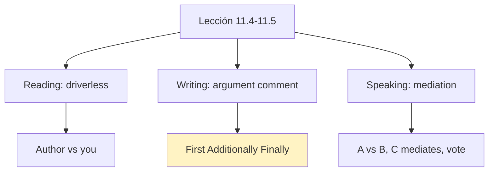
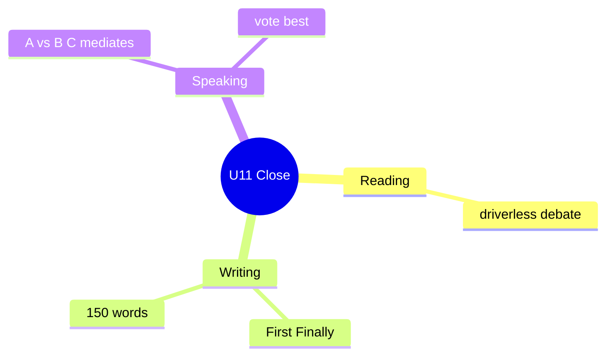

# 📰 Reading, Writing, Speaking - Argument Comment & Mediation (U11)

## 🎯 Introducción

> [!info] 💡 ¿Por Qué Importa?
>
> El cierre de U11 combina leer postura (driverless cars), escribir comentarios con argumento (*First of all… Where I strongly disagree…*) y mediar un conflicto real (el árbol). Es el mini-examen de la unidad en 11.4–11.5.
>
> **Analogía del mundo real:** mediar es arbitrar final — escuchas al Grupo A (el árbol) y al B (parqueo), y propones para que ambos firmen.
>
> | Sin Esto | Con Esto |
> |---|---|
> | "Technology is bad." | *First of all… Where I strongly disagree is… Additionally… And finally…* |
> | Grita el más fuerte | El mediador (Grupo C) propone y votan |
>
> **En esta nota:** reading driverless (11.4), argument comment y mediación del árbol (11.5).

---

## 📋 Definiciones Formales

> [!note] 📋 Reading: *Embrace the technical revolution? Not me!* (11.4A–D)
>
> - **Autora:** anti-tech-takeover — ama manejar, robots sin *human touch*, banter perdido.
> - **Inferir postura (11.4B):** ¿a/b/c? (b: *tech won't reduce our ability if careful*).
> - **Vocab:** *embrace* (aceptar con ganas), *automate*, *banter* (charla ligera), *buzz* (emoción).
> - **Crítica:** ¿exagera? ¿qué otro ejemplo de *gone too far* conoces?

> [!note] 📋 Tabla 1×1 — Argument comment (11.4D + modelo)
>
> | Parte | Qué hace | Ejemplo (modelo driverless) |
> |---|---|---|
> | **First of all** | Abre postura | ***First of all**, I'd like to say that…* |
> | **Where I disagree** | Marca el choque | ***Where I strongly disagree** is driverless cars…* |
> | **Additionally** | Suma argumento | ***Additionally**, they help elderly and disabled…* |
> | **And finally** | Cierra (150 palabras) | ***And finally**, they're optional — drive yourself!* |

---

## 🛠️ Método / Procedimiento (Mediación 11.5)

> [!note] 📋 Procedimiento General — Prepare → Discuss → Present (+ vote)
>
> 1. **Prepare (grupos):** A defiende el árbol (*One argument for keeping…*), B pide parqueo (*We need to consider…*), C prepara preguntas (*Would you consider…?*).
> 2. **Discuss (mixtos):** A y B exponen, C media (*As an alternative, we could…*).
> 3. **Present + vote:** C reporta (*The main arguments for/against… In the end, we decided… / We couldn't come to an agreement because…*).
>
> **Principio clave:** el mediador no toma lado — propone alternativas que ambos puedan firmar.

---

## 🎨 Ejemplos Trabajados (Bilingües)

> [!example] 🟢 Ejemplo 1 — Útiles 11.5 por fase
>
> - **Prepare:** *One argument for keeping the tree is… / Another good argument might be…*
> - **Discuss:** *We think it's really important to… / We need to consider… / Would you consider…?*
> - **Present:** *The main arguments for keeping it were… / In the end, we decided to… / We couldn't come to an agreement because…*

> [!example] 🟢 Ejemplo 2 — Robot waiters (11.4C, 3 vs 3)
>
> - A favor: *They never get tired / service is fast / no mistakes with bills.*
> - En contra: *No human touch / no banter / jobs lost.*
> - Los más convincentes: elige 1 de cada lado y defiende con *Where I strongly disagree…*.

> [!example] ✏️ Ejercicio 1 — Phrases por propósito (11.4 drill B)
>
> Clasifica del modelo: *First of all, I'd like to say that… / Where I strongly disagree with the article is… / Additionally, they will help… / And finally, they're optional.*
>
> - begin an argument
> - add a new argument
> - conclude
>
> > [!success]- ✅ Solución
> >
> > - Begin: ***First of all**, I'd like to say that…*
> > - Add: ***Where I strongly disagree…*** + ***Additionally**, they will help…*
> > - Conclude: ***And finally**, they're optional.*

> [!example] ✏️ Ejercicio 2 — Mediation tasks (11.5A–D, modelos)
>
> Prepara, discute, presenta y vota (modelos):
>
> > [!success]- ✅ Respuestas modelo
> >
> > - *Tree problems: roots break sidewalks; shade kills grass; **one argument for keeping** it is clean air.*
> > - *Group A: **Another good argument** is birds and beauty. Group B: parking helps workers — **we need to consider** jobs.*
> > - *Mediator C: **As an alternative, we could** trim roots + keep the tree. **Would you consider** half parking?*
> > - *Present: **The main arguments for keeping it were** air and beauty. **In the end, we decided to** trim + keep. Vote: best solution wins.*

---

## ⚠️ Errores Comunes y Principios Lógicos

> [!danger] ❌ Error 1 — Comment sin estructura (viola **First/Additionally/Finally**)
>
> - ❌ **EL ERROR ESTÁ AQUÍ:** 3 opiniones sueltas sin conectores.
> - ✅ Así sí: *First of all… / Where I disagree… / Additionally… / And finally…* (~150 palabras).

> [!danger] ❌ Error 2 — Mediador con camiseta (viola **neutralidad**)
>
> - ❌ **EL ERROR ESTÁ AQUÍ:** el Grupo C defiende al A desde el minuto 1.
> - ✅ Así sí: preguntas y alternativas (*Would you consider…? / As an alternative…*), el voto decide.

---

## 🎯 Metas de Aprendizaje

> [!note] 🎯 Nivel Básico
>
> - [ ] Resumo la postura anti-driverless en 3 líneas.
> - [ ] Digo las útiles 11.5 por fase.

> [!note] 🎯 Nivel Intermedio
>
> - [ ] Escribo un argument comment (~150 palabras) con las 4 marcas.
> - [ ] Medio un mini-conflicto sin tomar lado.

---

## 🔁 Repaso SR (flashcards)

#flashcards/ingles-iii-u5

> [!note] 🧠 Repasa con el plugin Spaced Repetition
>
> - ¿Abrir argumento?::*First of all, I'd like to say that…*
> - ¿Marcar choque?::*Where I strongly disagree is…*
> - ¿Cerrar comment?::*And finally,…* (~150 palabras).
> - ¿Mediador qué dice?::*Would you consider…? / As an alternative, we could…*
> - ¿Reportar sin acuerdo?::*We couldn't come to an agreement because…*

---

## 📊 Resumen Visual

> [!success] 🔍 Comparación Final
>
> | Aspecto | Sin Esto | Con Esto |
> |---|---|---|
> | Opinar | Suelto | First/Additionally/Finally |
> | Conflicto | Grita el fuerte | C media, todos votan |

---

## 🔗 Seguir estudiando

> [!info] 📚 Seguir estudiando
>
> - Índice: [[00 - Índice Unit 5]]
> - Anterior: [[03 - Functional Language & Pronunciation - Alternatives]]
> - Siguiente: (vacío — U6 Looking Back en camino)

## 📚 Referencias

> [!quote] 📖 Fuentes Consultadas
>
> - Empower B1+ (Cambridge): Unit 11, lessons 11.4–11.5 (pp. 114–117).
> - Capturas: [[Libro de ingles ultimas unidades]] (§ 11.4, 11.5).

---

**Tags:** #IDIG1008 #unit5 #reading #writing #speaking #english
