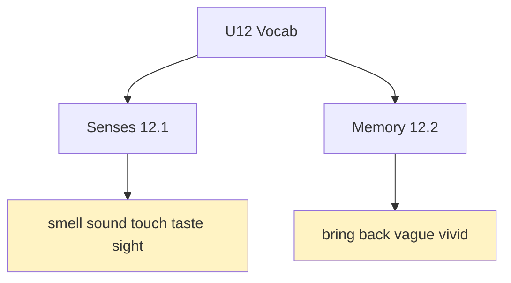
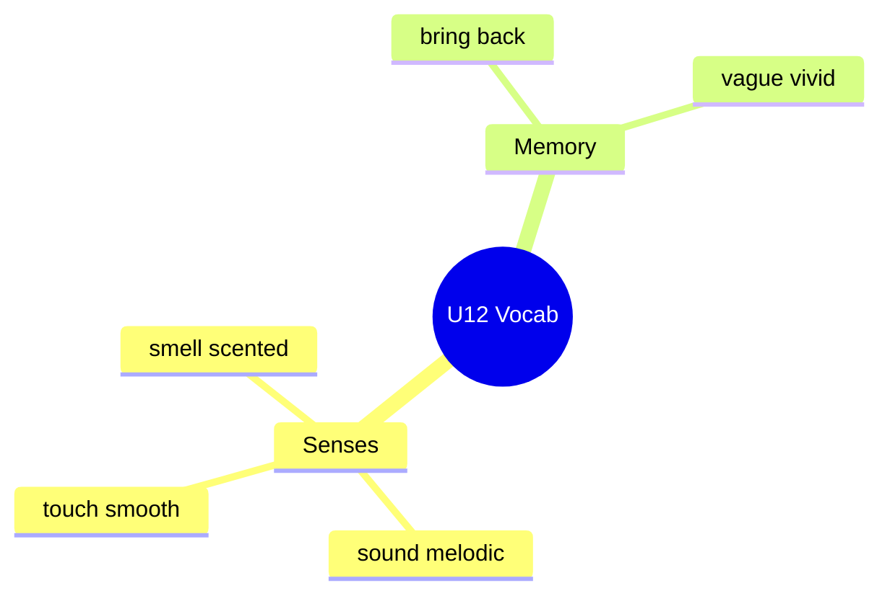

# 📖 Vocabulary & Use - Senses & Memories (U12)

## 🎯 Introducción

> [!info] 💡 ¿Por Qué Importa?
>
> Describir recuerdos exige adjetivos de sentidos (*musty, melodic, vivid*) y el vocabulario de memoria (*bring back, vague, look back on*). Sin ellos, "recuerdo algo" se queda plano; con ellos, hueles las especias de la abuela y oyes el vinilo del abuelo.
>
> **Analogía del mundo real:** los sentidos son cámaras — cada adjetivo enfoca un canal (olor, sonido, vista) y la memoria es la película que proyectan.
>
> | Sin Esto | Con Esto |
> |---|---|
> | "I remember food." | *The air was **scented** with spices; icing **tasty** off my fingers.* |
> | "I don't remember." | *It's **vague** — I've **blocked** things out.* |
>
> **En esta nota:** senses (12.1), memory words (12.2) y drills pp. 152.

---

## 📋 Definiciones Formales

> [!note] 📋 Tabla 1×1 — Senses (12.1A: Gary, Sonia, Alex)
>
> | Sentido | Adjetivos + / − | Ejemplo del libro |
> |---|---|---|
> | **Smell** | *scented* (+) | *The air was **scented** with spices.* |
> | **Sound** | *melodic* (+) / *high-pitched, rough* (−) | *Hands big and **rough**, voice **deep, melodic**.* |
> | **Touch** | *smooth, damp, sticky* | *Smooth fur and **damp** breath; pretty **sticky**.* |
> | **Taste** | *tasty, flavorful* | *Licking the **tasty** icing off my fingers.* |
> | **Sight** | *bright, colorful* | *The light was really **bright**.* |

> [!note] 📋 Tabla 1×1 — Memory words (12.2A)
>
> | Palabra | Significado | Ejemplo |
> |---|---|---|
> | **bring back** | traer de vuelta (recuerdo) | *Smell **brings back** childhood.* |
> | **look back on** | rememorar | *We **look back on** the 2000s.* |
> | **vague / vivid** | vago / vívido | *A **vague** memory vs a **vivid** one.* |
> | **recall / recognize** | recordar / reconocer | *I don't **recall** skipping classes.* |
> | **childhood / early / recent** | infancia / temprano / reciente | ***Early** memories may be false.* |
> | **distant / short-term** | lejano / corto plazo | *Only **distant** memories distort.* |

---

## 🛠️ Método / Procedimiento (Describir un recuerdo)

> [!note] 📋 Procedimiento General (12.1B–C: sentidos del hoy)
>
> 1. **Elige 1 sentido** (*smell, sound…*) + 1 adjetivo con signo (+/−).
> 2. **Conecta a memoria** (*reminds me of / brings back…*).
> 3. **Modelo:** *"I opened the curtain and the light was really **bright**… I hate mornings!"*
>
> **Principio clave:** sentido + adjetivo + memoria — los 3 o es solo una palabra.

---

## 🎨 Ejemplos Trabajados (Bilingües)

> [!example] 🟢 Ejemplo 1 — Las 3 fotos (12.1: Gary, Sonia, Alex)
>
> - Gary + Milo: ***What I remember most** is my pet dog — **smooth** fur, **damp** breath.* (Lo que más recuerdo: mi perro.)
> - Sonia + abuela: *The air was **scented**; **the thing I loved** was our special relationship.* (Aire con especias; lo que amaba: nosotras.)
> - Alex + abuelo: *His voice was **deep, melodic** — **what I miss most** is our music hours.* (Voz grave y melódica.)

> [!example] 🟢 Ejemplo 2 — ¿Falso o real? (12.2C: debate)
>
> - *Do you have a memory others say happened differently?* (¿Recuerdo en disputa?)
> - *Do people distort memories on purpose?* (¿Distorsionan a propósito?)

---

## 📝 Ejercicios del Libro (p. 152: 12.1 + 12.2 drills)

> [!example] ✏️ Ejercicio 1 — Senses match (12.1 drill A)
>
> Une adjetivo→sustantivo (*stinky/trash, colorful/towel, damp/voices, musty/clothes, melodic/cookies, bright/voices, tasty/clothes, high-pitched/…, deep/…, flavorful/…*). Pista: ¡hay más de una opción válida en varias!
>
> > [!success]- ✅ Solución
> >
> > - ***stinky → trash*** (apestoso: basura).
> > - ***colorful → towel / clothes*** (colorido: toalla/ropa).
> > - ***damp → clothes*** (húmedo: ropa).
> > - ***musty → clothes*** (a humedad encerrada: ropa).
> > - ***melodic → voices*** (melódico: voces).
> > - ***bright → towel / cookies?*** — ***bright → towel*** (brillante); *cookies → **tasty/flavorful***.
> > - ***tasty, flavorful → cookies*** (ricos: galletas).
> > - ***high-pitched → voices*** (agudo: voces).
> > - ***deep → voices*** (grave: voces).

> [!example] ✏️ Ejercicio 2 — Memory box (12.2 drill A)
>
> Completa con el box (*bring back, childhood, clear, distant, early, long-term, look back on, recall, recent, recognize, remind, short-term, vague, vivid*): *We met at Sam's? I only have a ___ memory of the people. / I don't like to ___ unhappy times. / I didn't ___ her face, but I remembered her voice! / I have a really ___ memory of the first time we met. / That song always ___ me of 2005.*
>
> > [!success]- ✅ Solución
> >
> > - ***vague*** (recuerdo vago de la gente).
> > - ***recall / look back on*** (*don't like to **recall*** — no rememorar).
> > - ***recognize*** (*didn't **recognize** her face*).
> > - ***vivid / clear*** (*really **vivid** memory*).
> > - ***reminds*** (*always **reminds** me of 2005*).

> [!example] ✏️ Ejercicio 3 — Short vs long (12.2 drill B)
>
> Elige: *It was 20 years ago → distant / early memory. / Grandma loses short-term / long-term but remembers childhood. / What brings back / looks back on early years? / I have a very early / vague memory (I was 4, at the zoo). / Smell brings back / looks back on the most vivid memories.*
>
> > [!success]- ✅ Solución
> >
> > - ***distant*** (20 años = lejano).
> > - ***short-term*** (pierde lo reciente; la infancia intacta).
> > - ***brings back*** (qué *trae de vuelta*).
> > - ***vague*** (a los 4 años: vago, quizá falso).
> > - ***brings back*** (el olor *trae* los más vívidos).

> [!example] ✏️ Ejercicio 4 — Who is who? (12.1A match)
>
> Une persona→foto: Gary + Milo / Sonia + grandma / Alex + grandpa — con cocina, bebé-perro, vinilo.
>
> > [!success]- ✅ Solución
> >
> > - **Cocina (Sonia + grandma)** — especias, horneando, *helper*.
> > - **Bebé + perro (Gary + Milo)** — patio, *smooth fur*, 10 años.
> > - **Vinilo (Alex + grandpa)** — *record cabinet, deep melodic voice*.

> [!example] ✏️ Ejercicio 5 — Senses Q&A (12.1B, modelos)
>
> Responde con las historias (modelos):
>
> > [!success]- ✅ Respuestas modelo
> >
> > - *Touch/smell/taste/sound/sight — who mentions what? → Gary: **touch** (smooth fur) + **smell** (damp breath); Sonia: **smell** (spices) + **taste** (icing); Alex: **sound** (music) + **sight** (records).*
> > - *What exactly? → Sonia talks about **the smell of spices in the air**.*

---

## ⚠️ Errores Comunes y Principios Lógicos

> [!danger] ❌ Error 1 — Adjetivo sin sentido (viola **canal + signo**)
>
> - ❌ **EL ERROR ESTÁ AQUÍ:** *"tasty voices"* / *"melodic cookies"*.
> - ✅ Así sí: cada adjetivo tiene su canal (*tasty→taste, melodic→sound*).

> [!danger] ❌ Error 2 — *remind* sin *of* (viola **remind of**)
>
> - ❌ **EL ERROR ESTÁ AQUÍ:** *"remind me my cousin"*.
> - ✅ Así sí: ***remind** me **of** my cousin* / *You remind me **of** my cousin in many ways.*

---

## 🎯 Metas de Aprendizaje

> [!note] 🎯 Nivel Básico
>
> - [ ] Digo senses con signo (+/−) sin mirar.
> - [ ] Distingo bring back / look back on / recall / recognize.

> [!note] 🎯 Nivel Intermedio
>
> - [ ] Describo un recuerdo de hoy con sentido + adjetivo + memoria.
> - [ ] Resuelvo drills p. 152 sin errores.

---

## 🔁 Repaso SR (flashcards)

#flashcards/ingles-iii-u6

> [!note] 🧠 Repasa con el plugin Spaced Repetition
>
> - ¿*bring back* vs *look back on*?::Traer recuerdo vs rememorar época.
> - ¿*vague* vs *vivid*?::Vago (dudoso) vs vívido (nítido).
> - ¿*remind* + qué?::*Remind **of*** (*reminds me of 2005*).
> - ¿Adjetivo con canal?::*Tasty→taste, melodic→sound, bright→sight*.

---

## 📊 Resumen Visual

> [!success] 🔍 Comparación Final
>
> | Aspecto | Sin Esto | Con Esto |
> |---|---|---|
> | Recuerdos | "I remember things" | Sentido + adjetivo + memoria |
> | Duda | "I don't know" | vague / blocked out |

---

## 🔗 Seguir estudiando

> [!info] 📚 Seguir estudiando
>
> - Índice: [[00 - Índice Unit 6]]
> - Anterior: (vacío — primera nota del libro U12)
> - Siguiente: [[02 - Grammar & Examples - Emphasis & Substitution]]

## 📚 Referencias

> [!quote] 📖 Fuentes Consultadas
>
> - Empower B1+ (Cambridge): Unit 12, lessons 12.1–12.2 (pp. 118–121).
> - Capturas: [[Libro de ingles ultimas unidades]] (§ 12.1, 12.2).

---

**Tags:** #IDIG1008 #unit6 #vocabulary #senses #memory #english
