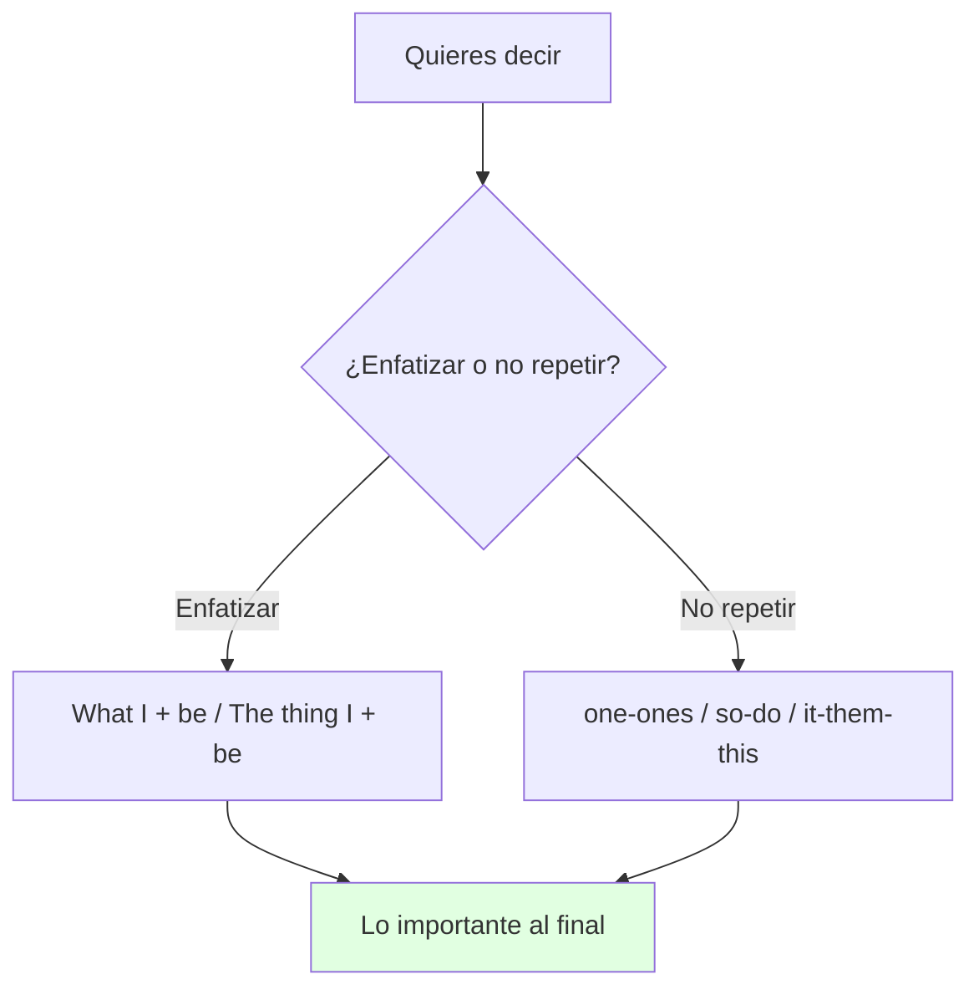
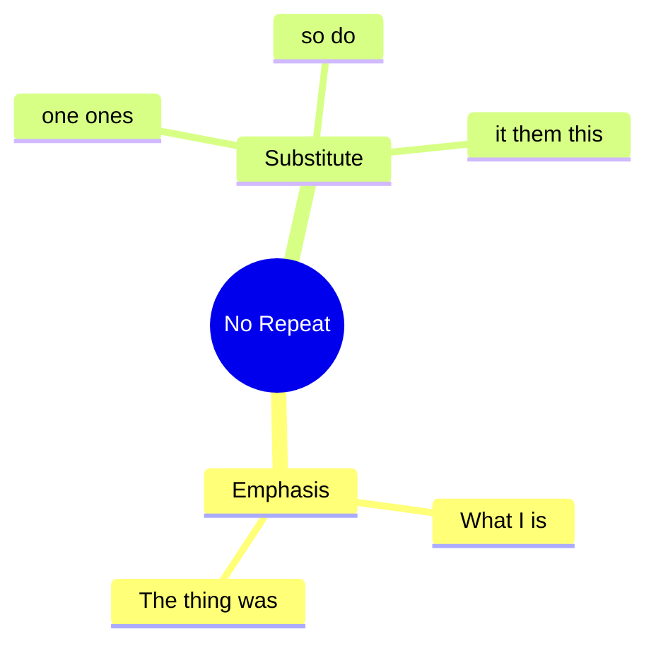

# 📐 Grammar & Examples - Emphasis & Substitution (U12)

## 🎯 Introducción

> [!info] 💡 ¿Por Qué Importa?
>
> Enfatizar (*What I remember most is…*) y no repetir (*the one with Nolan*, *I do*, *so*) son las dos gramáticas de 12.1–12.2 con accuracy check. Sin ellas repites *childhood memories* 5 veces; con ellas, sustituyes con elegancia.
>
> **Analogía del mundo real:** enfatizar es reflector — *What I… / The thing I…* ilumina lo importante; sustituir es pronombre ecológico — *one/so/do* reciclan palabras.
>
> | Sin Esto | Con Esto |
> |---|---|
> | "I remember the beach. The beach was nice." | *What I remember most **is** the beach.* + *the **one** with Nolan.* |
> | "I love hearing stories. I love hearing stories." | *I know! I **do**, too. / I love **so**.* |
>
> **En esta nota:** adding emphasis (12.1) + substitution/referencing (12.2).

---

## 📋 Definiciones Formales

> [!note] 📋 Adding emphasis (12.1) — dos moldes
>
> Fórmula en texto: *What + I + verbo (+ about) **is/was** + lo enfatizado* **O** *The thing + I + verbo **is/was** + lo enfatizado*. El verbo *be* conecta.
>
> | Molde | Ejemplo del libro |
> |---|---|
> | *What I + verb … **is*** | *What I remember most about my childhood **is** my pet dog, Milo.* |
> | *The thing I + verb … **was*** | *The thing I liked most **was** licking the tasty icing.* |
> | *What I didn't know…* | *What I didn't know **was** the door was locked!* |
> | *The thing I liked most about living in California **was**…* | *…**was** the weather.* |
>
> Ejercicio 12.1A: reescribe con énfasis (*I really liked the sunroof → The thing I really liked… **was** the sunroof*).

> [!note] 📋 Substitution & referencing (12.2) — no repitas
>
> | Recurso | Regla | Ejemplo del libro |
> |---|---|---|
> | ***one / ones*** | evita repetir sustantivo **contable** | *The **one** with Nolan* (= the winter break). |
> | ***so / do*** | evita repetir verbo/frase | *If **so**, send us an email. / I know I **do**.* |
> | ***it / them*** | cosas **específicas** | *When you recall a memory often, **it** becomes distorted.* |
> | ***this / that*** | ideas **completas** | *That's why **this** only happens with distant memories.* |
>
> **Accuracy check:** el sustituto concuerda — *It happens with childhood memories, not recent **one*** ❌ → ***ones*** ✅.

---

## 🛠️ Método / Procedimiento (3 preguntas)

> [!note] 📋 Procedimiento General
>
> 1. **¿Enfatizar?** → molde *What I…is / The thing I…was* + lo importante al final.
> 2. **¿Ya lo dije?** → sustituye: contable *one*, verbo *so/do*, cosa *it*, idea *this*.
> 3. **¿Concuerda?** *ones* con plural, *one* con singular.
>
> **Principio clave:** enfatiza 1 cosa por frase; sustituye todo lo repetido.

---

## 🎨 Ejemplos Trabajados (Bilingües)

> [!example] 🟢 Ejemplo 1 — Rewrites con énfasis (12.1C)
>
> - *I really liked the sunroof.* → ***The thing I really liked** about my family's old car **was** the sunroof.* (Lo que más me gustó fue el techo.)
> - *I miss cooking with my grandma most of all.* → ***What I miss most** is cooking with my grandma.* (Lo que más extraño es cocinar con mi abuela.)

> [!example] 🟢 Ejemplo 2 — Sin repetición (12.2C)
>
> - *Do you have a **favorite childhood memory**? If **so**, tell me about **your favorite** childhood memory.* → mejor: *…tell me about **it**.* (¡*it* en vez de repetir!).
> - *No, you never told me about **the time** I met Harrison Ford!* → *about **that time**…* no — ***that*** ya refiere la idea completa.

---

## 📝 Ejercicios del Libro (12.1–12.2 drills)

> [!example] ✏️ Ejercicio 1 — Rewrite with emphasis (12.1 drill C)
>
> Reescribe: *I really liked the sunroof in my family's old car. / As a child I loved mangoes more than anything! / I miss cooking with my grandma most of all. / From my childhood I remember riding on trains most clearly. / As a teenager I really loved skateboarding.*
>
> > [!success]- ✅ Solución
> >
> > - ***The thing I really liked** about my family's old car **was** the sunroof.*
> > - *What I loved **more than anything** as a child **was** mangoes.* (molde *What I…was*).
> > - ***What I miss most** is cooking with my grandma.*
> > - *What I remember **most clearly** from my childhood **is** riding on trains.*
> > - ***The thing I really loved** as a teenager **was** skateboarding.*

> [!example] ✏️ Ejercicio 2 — Underline repetition (12.2 drill A)
>
> Subraya la repetición innecesaria y reescribe con sustituto: *Your podcast on false memories was very interesting. But how can I learn from my past? I've tried to learn lessons from my mistakes. But what if I can't remember my mistakes correctly? If I can't remember my mistakes correctly, are the lessons real? Maybe some lessons are based on accurate memories and other lessons are based on false memories.*
>
> > [!success]- ✅ Solución
> >
> > - *false memories / my mistakes / accurate lesson / false memories* se repiten → ***them / it / this / ones***.
> > - Modelo: *Your podcast was interesting, but how can I learn from my past if I can't remember **it** correctly? Maybe some lessons are based on accurate memories and others on false **ones**. How could I tell?*

> [!example] ✏️ Ejercicio 3 — Nolan & Rivas (12.2 listen, del script)
>
> Responde según el audio script:
>
> - Did Nolan and David stay friends or lose contact?
> - Do they recall their time together the same way or differently?
> - Dr. Rivas compares recalling distant memories to…?
>
> > [!success]- ✅ Solución
> >
> > - ***Lost contact*** — *he didn't recognize me at first*.
> > - ***Differently*** — vague vs shocked; *was shocked!*.
> > - ***Making copies of copies*** — each recall distorts, like copy-of-copy.

> [!example] ✏️ Ejercicio 4 — Your fondest look-back (Speaking B, modelos)
>
> Responde las 3 (modelos):
>
> > [!success]- ✅ Respuestas modelo
> >
> > - *School/family/sports event looked back fondly? → **Family beach trips**: the ones I **look back on** most fondly.*
> > - *Met an old friend — same or different memories? → **Differently** — he **recalls** parties I **don't recognize** at all.*
> > - *Nice early memory told (not lived)? → Grandma's stories — **someone told me**, so is it **real or vague**?*

---

## ⚠️ Errores Comunes y Principios Lógicos

> [!danger] ❌ Error 1 — *one* con plural (viola **concordancia**)
>
> - ❌ **EL ERROR ESTÁ AQUÍ:** *"childhood memories, not recent **one**"*.
> - ✅ Así sí: ***ones*** con plural — *not recent **ones***.

> [!danger] ❌ Error 2 — Énfasis sin *be* (viola **molde**)
>
> - ❌ **EL ERROR ESTÁ AQUÍ:** *"What I remember most my dog."*
> - ✅ Así sí: ***What I remember most is** my dog.* — el *be* conecta siempre.

---

## 🎯 Metas de Aprendizaje

> [!note] 🎯 Nivel Básico
>
> - [ ] Armo los 2 moldes de énfasis sin mirar.
> - [ ] Sustituyo con one/so/do/it/this según el caso.

> [!note] 🎯 Nivel Intermedio
>
> - [ ] Reescribo 5 frases con énfasis (drill C).
> - [ ] Limpio un párrafo repetido con sustitutos.

---

## 🔁 Repaso SR (flashcards)

#flashcards/ingles-iii-u6

> [!note] 🧠 Repasa con el plugin Spaced Repetition
>
> - ¿2 moldes de énfasis?::*What I…is / The thing I…was* + lo importante.
> - ¿Sustantivo contable repetido?::*One/ones* (*the one with Nolan*).
> - ¿Verbo repetido?::*So/do* (*If so… / I know I do*).
> - ¿Idea completa?::*This/that* (*That's why this…*).

---

## 📊 Resumen Visual

> [!success] 🔍 Comparación Final
>
> | Aspecto | Sin Esto | Con Esto |
> |---|---|---|
> | Énfasis | Plano | *What I…is* + final |
> | Repetición | Todo repetido | one/so/it/this |

---

## 🔗 Seguir estudiando

> [!info] 📚 Seguir estudiando
>
> - Índice: [[00 - Índice Unit 6]]
> - Anterior: [[01 - Vocabulary & Use - Senses & Memories]]
> - Siguiente: [[03 - Functional Language & Pronunciation - Shared Memories]]

## 📚 Referencias

> [!quote] 📖 Fuentes Consultadas
>
> - Empower B1+ (Cambridge): Unit 12, grammar 12.1–12.2 (pp. 118–121).
> - Capturas: [[Libro de ingles ultimas unidades]] (§ 12.1, 12.2).

---

**Tags:** #IDIG1008 #unit6 #grammar #emphasis #substitution #english
