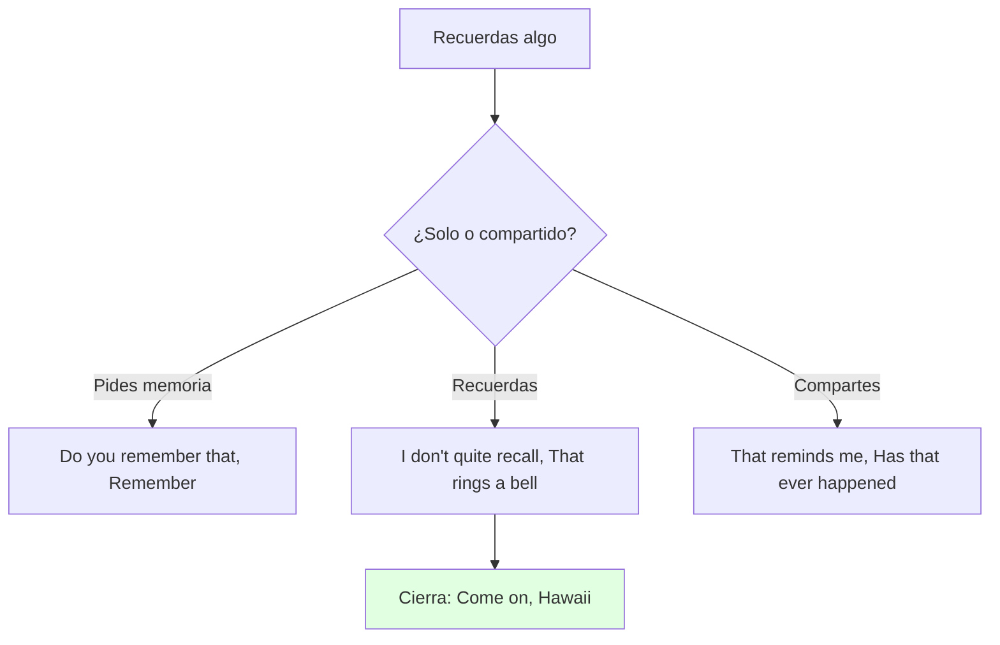
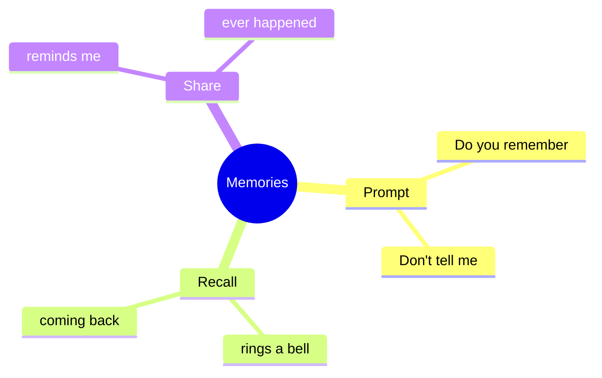

# 🗣️ Functional Language & Pronunciation - Shared Memories (U12)

## 🎯 Introducción

> [!info] 💡 ¿Por Qué Importa?
>
> Compartir recuerdos (*That reminds me of… / Has that ever happened to you?*) y pronunciar clusters (*blocked, campground, experienced*) es la función de 12.3 — más el role play de memorias que el libro evalúa aquí.
>
> **Analogía del mundo real:** compartir recuerdos es trueque — pones tu historia (*White Mountains*), recibes la suya (*Hawaii*), y ambas valen más juntas.
>
> | Sin Esto | Con Esto |
> |---|---|
> | "I remember Hawaii." (seco) | ***That reminds me of** a story… **Has that ever happened to you?*** |
> | *blocked* a medias | *b-l-o-cked*: cada letra del cluster suena. |
>
> **En esta nota:** prompting/recalling chart (12.3), sharing strategy y clusters.

---

## 📋 Definiciones Formales

> [!note] 📋 Tabla 1×1 — Prompting vs Recalling (12.3B)
>
> | Función | Frases | Ejemplo del libro |
> |---|---|---|
> | **Prompting** (pedir) | *Do you remember that…? / Don't tell me you don't remember.* | ***Do you remember that** time we got lost?* |
> | **Recalling** (recordar) | *I don't quite recall… / That rings a bell. / It's all coming back to me now.* | ***That rings a bell** — a hundred meters from camp!* |
> | **Sharing** (estrategia) | *That reminds me of a story… / That's like the time that… / I had a similar experience once… / Has that ever happened to you?* | ***That reminds me of** Hawaii…* |

> [!note] 📋 Clusters (12.3) — cada letra suena
>
> *bl-ocked, h-un-dreds, camp-gr-ound, experi-enced, pani-cked* — escribe las letras que faltan escuchando, luego practica con tu compañero hasta que cada cluster suene claro.

---

## 🛠️ Método / Procedimiento (Role play 12.3)

> [!note] 📋 Procedimiento General (A: recuerda, B: no recuerda, C: suma)
>
> 1. **A recuerda** con detalles (*Don't tell me you don't remember the time we…?*).
> 2. **B duda** (*I don't quite recall that. What happened exactly?*).
> 3. **A insiste** (*Come on. We were in Hawaii…*) → **C suma** historia similar.
>
> **Principio clave:** más detalles cada ronda — el recuerdo crece al contarse.

---

## 🎨 Ejemplos Trabajados (Bilingües)

> [!example] 🟢 Ejemplo 1 — White Mountains (12.3 audio)
>
> - A: ***That reminds me** of the White Mountains. **Do you remember that** time we got lost?* (Me acuerda… ¿Recuerdas cuando nos perdimos?)
> - B: ***I don't quite recall** that. **What happened exactly?*** (No lo recuerdo bien. ¿Qué pasó?)
> - A: ***Come on**. We were in Hawaii… no — a hundred meters from camp! **That rings a bell**, right?*

> [!example] 🟢 Ejemplo 2 — Modelo examen (útiles 12.3)
>
> - *Don't tell me you don't remember the time we…? / I don't quite recall that. / Come on. We were in Hawaii…*

---

## ⚠️ Errores Comunes y Principios Lógicos

> [!danger] ❌ Error 1 — Contar sin invitar (viola **sharing**)
>
> - ❌ **EL ERROR ESTÁ AQUÍ:** monólogo de tu recuerdo sin *Has that ever happened to you?*.
> - ✅ Así sí: cierra invitando — la estrategia exige respuesta.

> [!danger] ❌ Error 2 — Clusters a medias (viola **cada letra**)
>
> - ❌ **EL ERROR ESTÁ AQUÍ:** decir *blocked* sin la *k* ni la *t* final.
> - ✅ Así sí: *b-l-o-ck-e-d* completo, luego fluido.

---

## 🎯 Metas de Aprendizaje

> [!note] 🎯 Nivel Básico
>
> - [ ] Digo prompting/recalling/sharing sin mirar.
> - [ ] Pronuncio los 6 clusters completos.

> [!note] 🎯 Nivel Intermedio
>
> - [ ] Sostengo el role play A/B/C con detalles crecientes.
> - [ ] Invito con *Has that ever happened to you?*.

---

## 🔁 Repaso SR (flashcards)

#flashcards/ingles-iii-u6

> [!note] 🧠 Repasa con el plugin Spaced Repetition
>
> - ¿Pedir un recuerdo?::*Do you remember that…? / Don't tell me…*
> - ¿Recordar a medias?::*I don't quite recall… / That rings a bell.*
> - ¿Compartir historia?::*That reminds me of… / Has that ever happened to you?*
> - ¿Clusters completos?::*Blocked, campground, experienced* (todas las letras).

---

## 📊 Resumen Visual

> [!success] 🔍 Comparación Final
>
> | Aspecto | Sin Esto | Con Esto |
> |---|---|---|
> | Recordar | Solo | Trueque A/B/C |
> | Pronunciar | A medias | Clusters completos |

---

## 🔗 Seguir estudiando

> [!info] 📚 Seguir estudiando
>
> - Índice: [[00 - Índice Unit 6]]
> - Anterior: [[02 - Grammar & Examples - Emphasis & Substitution]]
> - Siguiente: [[04 - Reading, Writing, Speaking - Pets, Moment & Review]]

## 📚 Referencias

> [!quote] 📖 Fuentes Consultadas
>
> - Empower B1+ (Cambridge): Unit 12, lesson 12.3 (pp. 122–123).
> - Capturas: [[Libro de ingles ultimas unidades]] (§ 12.3).

---

**Tags:** #IDIG1008 #unit6 #functional #pronunciation #memories #english
