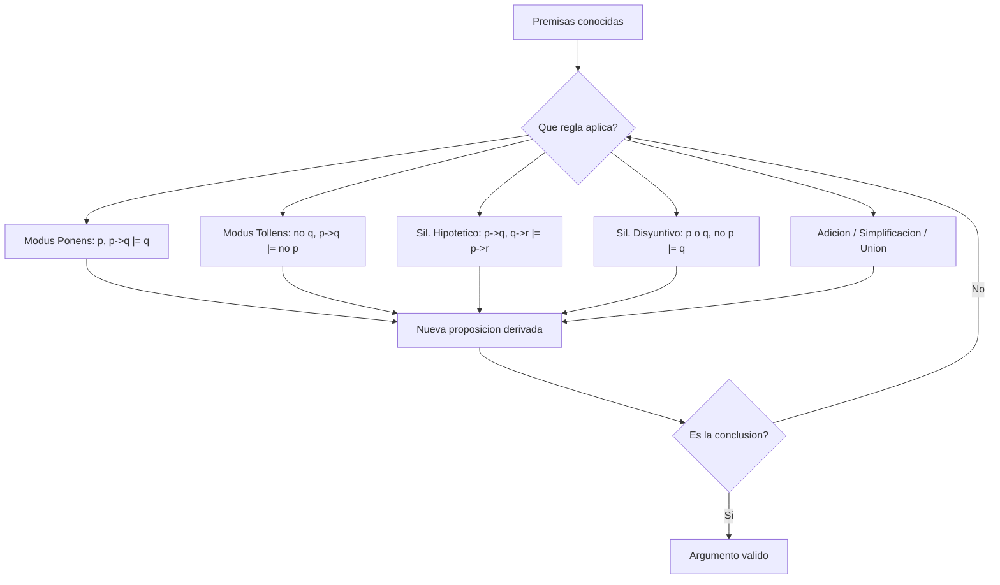

# 🧩 Reglas de Inferencia

## 🎯 Introducción

> [!info] 💡 ¿Qué es el razonamiento deductivo?
> 
> El proceso de obtener conclusiones a partir de una secuencia de proposiciones se llama **razonamiento deductivo**.
> 
> - Las proposiciones de partida se llaman **hipótesis** o **premisas**.
> - La proposición que se deriva de las hipótesis se llama **conclusión**.
> - Un **argumento (deductivo)** consiste en hipótesis junto con una conclusión.
> 
> Cualquier argumento tiene la forma:
> 
> $$\text{Si } p_1 \text{ y } p_2 \text{ y } \cdots \text{ y } p_n \text{ entonces } q.$$
>
> ```mermaid
> graph LR
>     H["Hipótesis<br/>p₁…pₙ"] --> R["Regla<br/>MP, MT, Silogismo..."]
>     R --> C{"¿Conclusión<br/>forzada?"}
>     C -->|"Sí"| V["Válido ✅"]
>     C -->|"No"| I["Inválido ❌<br/>falacia"]
>     style V fill:#e1ffe1
>     style I fill:#ffe1e1
> ```
>
> **En esta nota:** validez vs verdad (premisas verdaderas + forma válida = conclusión verdadera), reglas clásicas (Modus Ponens/Tollens, silogismo, dilema) y falacias típicas (afirmar el consecuente, negar el antecedente).
>

---

## 📚 Argumentos y Validez

> [!note] 📖 Definición — Argumento válido e inválido
> 
> Diremos que el argumento es **válido** si cada vez que $p_1, p_2, \ldots, p_n$ son verdaderas entonces $q$ también es verdadera. De lo contrario diremos que el argumento es **inválido**.
> 
> Los argumentos se representan en la forma:
> 
> $$\frac{p_1 \quad p_2 \quad \cdots \quad p_n}{\therefore\ q}$$
> 
> Si el argumento es válido, lo denotaremos $p_1, p_2, \ldots, p_n \Rightarrow q$. El símbolo $\Rightarrow$ se lee: **implica**.

> [!warning] ⚠️ Observación importante
> 
> No se está afirmando que la conclusión es cierta; sólo se dice que si se garantiza la hipótesis, también se debe garantizar la conclusión.
> 
> > [!example] 🟢 Ejemplo
> >
> > **Un argumento es válido por su forma, no por su contenido.**

---


> [!note] 📋 Mapa — Reglas clásicas
>
> ```mermaid
> graph LR
>     A["p → q"] --> MP["+ p ⇒ q<br/>Modus Ponens"]
>     A --> MT["+ ¬q ⇒ ¬p<br/>Modus Tollens"]
>     B["p → q, q → r"] --> S["⇒ p → r<br/>Silogismo"]
>     style MP fill:#e1ffe1
>     style MT fill:#e1ffe1
> ```
>
> **Se lee así:** Ponens afirma el antecedente; Tollens niega el consecuente; el silogismo encadena.

## 📋 Tabla de Reglas de Inferencia

> [!note] 📖 Reglas fundamentales
> 
> | Regla de inferencia | Nombre |
> |---|---|
> | $p \to q,\ p \Rightarrow q$ | **Modus Ponens** |
> | $p,\ q \Rightarrow p \wedge q$ | **Conjunción** |
> | $p \to q,\ \neg q \Rightarrow \neg p$ | **Modus Tollens** |
> | $p \to q,\ q \to r \Rightarrow p \to r$ | **Silogismo Hipotético** |
> | $p \Rightarrow p \vee q$ | **Suma (Adición)** |
> | $p \vee q,\ \neg p \Rightarrow q$ | **Silogismo Disyuntivo** |
> | $p \wedge q \Rightarrow p$ | **Simplificación** |
> 
![[ChatGPT Image 2 jun 2026, 00_08_36.png]]

---

## 🔍 Reglas Detalladas

### 1 — Modus Ponens

> [!tip] ⚙️ Descripción
> 
> Si $p$ es verdadera y $p$ implica $q$, entonces $q$ debe ser verdadera.
> 
> $$\frac{p \to q \qquad p}{\therefore\ q}$$

---

### 2 — Modus Tollens

> [!tip] ⚙️ Descripción
> 
> Si $p$ implica $q$ pero $q$ es falsa, entonces $p$ también debe ser falsa.
> 
> $$\frac{p \to q \qquad \neg q}{\therefore\ \neg p}$$

---

### 3 — Silogismo Hipotético

> [!tip] ⚙️ Descripción
> 
> Transitividad del condicional: si $p \to q$ y $q \to r$, entonces $p \to r$.
> 
> $$\frac{p \to q \qquad q \to r}{\therefore\ p \to r}$$

---

### 4 — Silogismo Disyuntivo

> [!tip] ⚙️ Descripción
> 
> Si tenemos $p \vee q$ y sabemos que $p$ es falsa, entonces $q$ debe ser verdadera.
> 
> $$\frac{p \vee q \qquad \neg p}{\therefore\ q}$$

---

### 5 — Suma (Adición)

> [!tip] ⚙️ Descripción
> 
> Si $p$ es verdadera, entonces $p \vee q$ es verdadera para cualquier $q$.
> 
> $$\frac{p}{\therefore\ p \vee q}$$

---

### 6 — Simplificación

> [!tip] ⚙️ Descripción
> 
> Si $p \wedge q$ es verdadera, entonces cada componente por separado también lo es.
> 
> $$\frac{p \wedge q}{\therefore\ p}$$

---

### 7 — Conjunción

> [!tip] ⚙️ Descripción
> 
> Si $p$ y $q$ son verdaderas de forma independiente, entonces $p \wedge q$ también lo es.
> 
> $$\frac{p \qquad q}{\therefore\ p \wedge q}$$

---

## 📝 Ejemplos

> [!example] 📝 Ejemplo 1 — Verificar validez: Modus Tollens
> 
> Determine si el argumento es válido:
> 
> $$\frac{p \to q \qquad \neg q}{\therefore\ \neg p}$$
> 
> **Solución:**
> 
> Supongamos que $p \to q$ y $\neg q$ son verdaderas. Así, $q$ es falsa; como $p \to q$ es verdadera entonces $p$ es falsa, por lo que $\neg p$ es verdadera.
> 
> El razonamiento es válido: $p \to q,\ \neg q \Rightarrow \neg p$. $\blacksquare$

> [!example] 📝 Ejemplo 2 — Argumento inválido (Falacia)
> 
> Determine la validez del argumento:
> 
> *Si el equipo jugó bien entonces ganó el partido. El equipo no jugó bien. Por tanto, el equipo no ganó el partido.*
> 
> **Solución:** Sea $p$: el equipo jugó bien, $q$: el equipo ganó el partido. El argumento toma la forma:
> 
> $$\frac{p \to q \qquad \neg p}{\therefore\ \neg q}$$
> 
> Supongamos que $p \to q$ y $\neg p$ son verdaderas. Así, $p$ es falsa, pero independientemente de que $q$ sea verdadera o falsa, $p \to q$ es verdadera **por omisión**. No podemos concluir nada sobre $q$.
> 
> > [!example] 🟢 Ejemplo
> >
> > El argumento es **inválido**. Esta es la falacia de **negación del antecedente**. $\blacksquare$

> [!example] 📝 Ejemplo 3 — Cadena de inferencia con De Morgan
> 
> Determine la validez del argumento:
> 
> *Si estudio oportunamente entonces apruebo Cálculo y tomo vacaciones. No aprobé Cálculo o no tomé vacaciones. $\therefore$ No estudié oportunamente.*
> 
> **Solución:** Sea $p$: estudio oportunamente, $q$: apruebo cálculo, $r$: tomo vacaciones. El argumento se representa:
> 
> $$\frac{p \to q \wedge r \qquad \neg q \vee \neg r}{\therefore\ \neg p}$$
> 
> Ahora, por **De Morgan**: $\neg(q \wedge r) \equiv \neg q \vee \neg r$.
> 
> Así, $p \to q \wedge r$ y $\neg(q \wedge r)$ son verdaderas, por lo que $\neg p$ es verdadera (**Modus Tollens**).
> 
> Esto es, $p \to q \wedge r,\ \neg q \vee \neg r \Rightarrow \neg p$. El argumento es **válido**. $\blacksquare$

> [!example] 📝 Ejemplo 4 — Demostración paso a paso
> 
> Demostrar la validez del siguiente razonamiento:
> 
> *Si me gradúo y encuentro trabajo entonces tendré un buen sueldo. Si tengo un buen sueldo entonces ayudaré a mi familia. No ayudo a mi familia. Por lo tanto, no me gradué o no encontré trabajo.*
> 
> **Solución:** Sea $p$: me gradué, $q$: encuentro trabajo, $r$: tendré un buen sueldo, $s$: ayudo a mi familia. El argumento toma la forma:
> 
> $$\frac{p \wedge q \to r \qquad r \to s \qquad \neg s}{\therefore\ \neg p \vee \neg q}$$
> 
> | Paso | Proposición | Justificación |
> |:---:|---|---|
> | 1 | $r \to s,\ \neg s \Rightarrow \neg r$ | Modus Tollens |
> | 2 | $p \wedge q \to r,\ \neg r \Rightarrow \neg(p \wedge q)$ | Modus Tollens |
> | 3 | $\neg(p \wedge q) \equiv \neg p \vee \neg q$ | De Morgan |
> 
> Concluimos que el razonamiento es **válido**. $\blacksquare$
> 
> > [!example] 🟢 Ejemplo
> >
> > **Ejercicio propuesto:** Demuestre que $p \to r,\ p \to (r \to q) \Rightarrow p \to r \wedge q$.

---

## 📝 Ejercicios Propuestos (Guía 1)

> [!example] ✏️ Ejercicio 1 — Juan y la procrastinación (Guía 1, ej. 10)
>
> Premisas: (1) $\forall x: d(x) \to r(x)$ — quien aplaza es procrastinador; (2) $\forall x: r(x) \to \neg v(x)$ — no pueden revisar; (3) $\forall x: b(x) \to v(x)$ — buena nota requiere revisar; (4) $d(j)$ — Juan aplaza. Demuestra $\neg b(j)$ (Juan no tiene buena nota).
>
> > [!success]- ✅ Solución guiada
> >
> > Instancia a Juan y encadena: $d(j)$ (P4) + IU en (1) → $r(j)$ por MP; IU en (2) → $\neg v(j)$ por MP; IU en (3) da $b(j) \to v(j)$, y con $\neg v(j)$ → $\neg b(j)$ por **Modus Tollens**. Válido. ✅

> [!example] ✏️ Ejercicio 2 — Argumento con 5 premisas (Guía 1, ej. 11)
>
> De $\neg s \to \neg p$; $u$; $t \to \neg u$; $\neg p \to \neg(\neg q \land \neg r)$; $s \to t$ — demuestra $\neg q \to r$.
>
> > [!success]- ✅ Solución guiada
> >
> > De $u$ y $t \to \neg u$ → $\neg t$ (MT); de $\neg t$ y $s \to t$ → $\neg s$ (MT); con $\neg s \to \neg p$ → $\neg p$ (MP); con la premisa 4 → $\neg(\neg q \land \neg r)$ (MP) → $q \vee r$ (De Morgan) → $\neg q \to r$. Válido. ✅

> [!example] ✏️ Ejercicio 3 — Argumento con 3 premisas (Guía 1, ej. 12)
>
> De $p \wedge q \to r$; $(p \to r) \to s$; $t \vee \neg q$ — demuestra $q \to (s \wedge t)$ por reducción al absurdo.
>
> > [!success]- ✅ Solución guiada
> >
> > Supón $\neg[q \to (s \wedge t)] \equiv q \wedge (\neg s \vee \neg t)$. De $q$ y $t \vee \neg q$ → $t$ (silogismo disyuntivo); con $\neg s \vee \neg t$ → $\neg s$. La contrarrecíproca de la premisa 2 da $\neg s \to \neg(p \to r)$ → $\neg(p \to r) \equiv p \wedge \neg r$ (MP + equivalencia): $p$ y $\neg r$. Con $q$: $p \wedge q$ → $r$ (MP con premisa 1): $r \wedge \neg r$ = ⊥. Contradicción → la conclusión vale. ✅

---

## ⚠️ Falacias Comunes

> [!warning] 🚫 Errores de razonamiento frecuentes
> 
> Las siguientes **no son** reglas de inferencia válidas:
> 
> | Falacia | Forma inválida | ¿Por qué es incorrecta? |
> |---|---|---|
> | **Afirmación del consecuente** | $q,\ p \to q \;\therefore p$ | $q$ puede ser verdadera por otras razones distintas a $p$ |
> | **Negación del antecedente** | $\neg p,\ p \to q \;\therefore \neg q$ | Cuando $p$ es falsa, el condicional no dice nada sobre $q$ |

---

## 📊 Resumen Visual




---

## 📋 Resumen Ejecutivo

> [!summary] 📋 Lo Esencial
>
> - Argumento = hipótesis + conclusión; **válido** = hipótesis verdaderas fuerzan conclusión verdadera.
> - Reglas: Modus Ponens, Modus Tollens, silogismo hipotético/disyuntivo, adición, simplificación, dilema.
> - Falacias: afirmar el consecuente, negar el antecedente (parecen válidas, no lo son).

---

## ✅ Metas de Aprendizaje

> [!note] 🎯 Nivel Básico
>
> - [ ] Aplico Modus Ponens, Modus Tollens y silogismo hipotético/disyuntivo sin mirar.
> - [ ] Verifico validez con tabla o con la forma (no con el contenido).
> - [ ] Detecto afirmación del consecuente y negación del antecedente.

> [!note] 🎯 Nivel Intermedio
>
> - [ ] Encadeno 2–3 reglas en una demostración con premisas numeradas.
> - [ ] Explico por qué cada falacia falla usando la tabla del condicional.

---

## 🔁 Repaso SR (flashcards)

#flashcards/discretas-u1

> [!note] 🧠 Repasa con el plugin Spaced Repetition
>
> - ¿Modus Ponens vs Tollens?::$p \to q, p \vdash q$ vs $p \to q, \neg q \vdash \neg p$.
> - ¿Afirmar el consecuente?::Falacia: $p \to q, q \not\vdash p$.
> - ¿Argumento válido?::Hipótesis verdaderas ⇒ conclusión verdadera, siempre.

---

## 🔗 Seguir estudiando

> [!info] 📚 Seguir estudiando
>
> - Mapa de contenido: [[Matemáticas Discretas]]
> - Siguiente: [[02 - Reglas de Inferencia para Afirmaciones Cuantificadas]] · Inducción: [[03 - Inducción Matemática]]
> - Base: [[03 - Demostraciones]]

---

## 📚 Referencias

> [!quote] 📖 Fuentes
>
> - Rosen, *Discrete Mathematics and Its Applications* — cap. 1 (reglas de inferencia y falacias).
> - Material de clase MATG1051: tabla de reglas y argumentos de la Guía 1.

---

**Tags:** #matematicas-discretas #logica-proposicional #reglas-de-inferencia #modus-ponens #modus-tollens #silogismo #falacias #MATG1051
