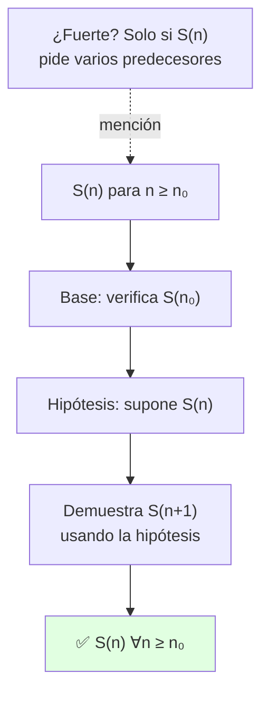

# 🔁 Inducción Matemática

## 🎯 Introducción

> [!info] 💡 ¿Para qué sirve la inducción matemática?
>
> La **inducción matemática** es una técnica de demostración que permite probar que una proposición $S(n)$ es verdadera para **todos los números naturales** (o para todo entero mayor o igual a un valor inicial $n_0$).
>
> **La idea en 1 imagen (dominó):** tumbar infinitas fichas una por una es imposible; basta probar 2 cosas: que cae la **primera** (base) y que **cada ficha tumba a la siguiente** (paso). Con eso, caen todas sin tocarlas una por una.
>
> ```mermaid
> graph LR
>     B["Base: cae S(1)"] --> P["Paso: S(n) tumba S(n+1)"]
>     P --> T["Caen todas"]
>     style T fill:#e1ffe1
> ```
>
> **Dónde la usarás en esta nota:**
>
> - Sumatorias: probar fórmulas cerradas ($\sum k^2$, geométricas).
> - Divisibilidad: $d \mid E(n)$ para todo $n$ (ej. Guía 1, ej. 18–19).
> - Desigualdades: $A(n) < B(n)$ que valen desde cierto $n$ (ej. 15, 20).
> - Recursión (Unidad 4): sucesiones definidas por casos anteriores — ahí nace la forma fuerte.
>
> Es especialmente útil cuando queremos demostrar fórmulas de sumas, desigualdades, propiedades de divisibilidad, o cualquier propiedad que dependa de $n \in \mathbb{N}$.

---

## 📐 Principio de Inducción Matemática (Simple)

> [!note] 📖 Principio de Inducción Matemática
> 
> Suponga que se tiene una función proposicional $S(n)$, cuyo dominio de discurso es $\mathbb{N}$. Suponga que:
> 
> 1. $S(1)$ es verdadera, **y**
> 2. Para cada $n \in \mathbb{N}$, si $S(n)$ es verdadera entonces $S(n+1)$ es verdadera.
> 
> Entonces $S(n)$ es verdadera **para cada $n \in \mathbb{N}$**.
> 
> > [!example] 🟢 Ejemplo
> >
> > La condición (1) se llama **paso base** y la condición (2) se llama **paso inductivo**. La suposición de que $S(n)$ es verdadera en el paso inductivo se llama **hipótesis inductiva**.

---

## 🔧 Estructura de una Demostración por Inducción

> [!tip] ⚙️ Pasos a seguir
>
> 1. **PASO BASE:** verificar que $S(n_0)$ es verdadera (casi siempre $n_0 = 1$, pero puede ser $0$ u otro).
> 2. **PASO INDUCTIVO:** suponer $S(n)$ verdadera para algún $n$ (hipótesis inductiva) y demostrar $S(n+1)$ usándola.
> 3. **CONCLUSIÓN:** por el principio de inducción, $S(n)$ vale $\forall n \geq n_0$.

---

## 📝 Ejemplos (Inducción Simple)

> [!example] 📝 Ejemplo 1 — Suma de los primeros $n$ impares
> 
> **Teorema:** $1 + 3 + 5 + \cdots + (2n-1) = n^2$, para todo $n \in \mathbb{N}$.
> 
> **Demostración:**
> 
> Sea $t_n = 1 + 3 + \cdots + (2n-1)$ y $S(n) : t_n = n^2$.
> 
> **Paso base:** $S(1) : t_1 = 1 = 1^2$ ✅
> 
> **Paso inductivo:** Supongamos que $S(n)$ es verdadera para algún $n \in \mathbb{N}$, es decir, $t_n = n^2$. Probemos que $S(n+1)$ es verdadera:
> 
> $$t_{n+1} = 1 + 3 + \cdots + (2n-1) + (2(n+1)-1)$$
> 
> $$= t_n + 2(n+1) - 1$$
> 
> $$= n^2 + 2(n+1) - 1 \quad \text{(por hipótesis inductiva)}$$
> 
> $$= n^2 + 2n + 1$$
> 
> $$= (n+1)^2$$
> 
> Así, $S(n+1)$ es verdadera. Por el principio de inducción, $S(n)$ es verdadera para todo $n \in \mathbb{N}$. $\blacksquare$

---

## 🧭 Todos los Casos de Inducción Simple

> [!note] 📋 Cómo reconocer cada caso
>
> ```mermaid
> flowchart TD
>     A["¿Qué afirma S(n)?"] --> B{"¿Igualdad con suma/"}
>     B -->|"Suma cerrada"| C["Caso 1: Sumatorias"]
>     B -->|"Divisibilidad"| D["Caso 2: Divisibilidad"]
>     B -->|"Desigualdad"| E["Caso 3: Desigualdades"]
>     B -->|"Fórmula cerrada"| F["Caso 4: Geométricas y potencias"]
>     style C fill:#e1ffe1
> ```
>
> ### Caso 1 — Sumatorias (el clásico)
>
> Forma: $\sum_{k=1}^{n} a_k = F(n)$. Paso inductivo: $t_{n+1} = t_n + a_{n+1}$, sustituyes la hipótesis y simplificas hasta $F(n+1)$. Ejemplo: impares $= n^2$ (arriba).
>
> ### Caso 2 — Divisibilidad
>
> Forma: $d \mid E(n)$ para todo $n$. Paso inductivo: escribe $E(n+1)$ separando un múltiplo de $d$ más algo que la hipótesis ya garantiza divisible. Ejemplo: $8 \cdot 7^n - 3 \cdot 2^n$ divisible por $5$ (ejercicio 1: resta $E(n+1) - 7E(n)$ y factoriza).
>
> ### Caso 3 — Desigualdades
>
> Forma: $A(n) < B(n)$ (o $\leq$). Paso inductivo: parte de la hipótesis como desigualdad y encadena ($\leq$ es transitivo). La base suele necesitar varios $n_0$ si la desigualdad "despierta" tarde. Ejemplo: $r^0 + \cdots + r^n < \frac{1}{1-r}$ con $0 < r < 1$ (ejercicios 3–4: mayora cada término).
>
> ### Caso 4 — Fórmulas cerradas (geométricas y potencias)
>
> Forma: suma con razón o potencias $= $ expresión cerrada. Paso inductivo: factoriza la razón común. Ejemplo: suma geométrica $a + ar + \cdots + ar^n = a\frac{1-r^{n+1}}{1-r}$ (ejercicio 2: $S_{n+1} = S_n + ar^{n+1}$, factoriza y simplifica).
>
> ### Caso especial — Base que no es $1$
>
> Si $S(n)$ solo vale desde $n_0$ (ej. $\forall n \geq 0$ en la geométrica): base en $n_0$ y el inductivo igual. La conclusión es $\forall n \geq n_0$, no $\forall n \in \mathbb{N}$.

---

## 📌 Mención — Inducción Fuerte (solo cuándo usarla)

> [!note] 📖 Inducción fuerte en 5 líneas
>
> Hipótesis reforzada: supones $S(k)$ verdadera para **todos** los $k$ con $n_0 \leq k < n$ (no solo $n-1$). Úsala cuando $S(n)$ necesita **varios predecesores** (recursiones como $C_n = C_{\lfloor n/2 \rfloor} + n$). Ambas formas son **lógicamente equivalentes**. Detalle completo y ejemplos en el historial git de esta nota.

---

## 🏋️ Ejercicios Propuestos

> [!question] 📋 Ejercicios de la clase
> 
> **Inducción simple:**
> 
> **1.** Demuestre que $8 \cdot 7^n - 3 \cdot 2^n$ es divisible por 5, $\forall n \in \mathbb{N}$.
> 
> **2.** Demuestre que si $a \in \mathbb{R}$ y $r \neq 1$, entonces:
> $$a + ar + ar^2 + \cdots + ar^n = a\,\frac{1 - r^{n+1}}{1 - r}, \quad \forall n \geq 0 \quad \text{(Suma geométrica)}$$
> 
> **3.** Use la suma geométrica para demostrar que si $0 < r < 1$ entonces:
> $$r^0 + r + r^2 + \cdots + r^n < \frac{1}{1-r}, \quad \forall n \geq 0$$
> 
> **4.** Usando el ejercicio anterior, demuestre que si $0 < r < 1$ entonces:
> $$1 \cdot r + 2 \cdot r^2 + \cdots + n \cdot r^n < \frac{r}{(1-r)^2}, \quad \forall n \in \mathbb{N}$$
>
> **Guía 1 (por caso):**
>
> - Caso 1: ej. 16 ($\sum k^2 = \frac{n(n+1)(2n+1)}{6}$), ej. 17 (suma alternante $= \frac{(-1)^n n(n+1)}{2}$), ej. 21 ($\sum k^3 = [\frac{n(n+1)}{2}]^2$).
> - Caso 2: ej. 18 (si $2 \mid n^2-1$ entonces $4 \mid n^2-1$), ej. 19 ($7^{n+1} + 8^{2n-1}$ divisible por $57$).
> - Caso 3: ej. 15 ($3^n \geq 2n+1$), ej. 20 (armónicos $> 2(\sqrt{n+1}-1)$).
> - Estructural: ej. 22 (polígono convexo de $n$ lados tiene $\frac{n(n-3)}{2}$ diagonales: quita un vértice y usa la hipótesis).

---

## 🏋️ Lección y Taller 2026 (casos reales)

> [!example] ✏️ Lección 1 (2026) — $2^n > n^2$ con base en $n_0 = 6$ (Caso 3)
>
> Para todo natural $n > 5$:
>
> - **Base** $P(6)$:
>
> $$64 > 36 \quad ✅$$
>
> - **HI explícita:** $2^k > k^2$ con $k \geq 6$.
> - **Meta** (lo que hay que probar):
>
> $$2^{k+1} > (k+1)^2$$
>
> - **Paso 1** — parte de la izquierda y usa la HI:
>
> $$2^{k+1} = 2\cdot 2^k > 2k^2$$
>
> - **Paso 2 (lema)** — falta $2k^2 \geq (k+1)^2 = k^2+2k+1$, i.e.:
>
> $$k^2-2k-1 \geq 0$$
>
> - Con $k \geq 6$: $k(k-2) \geq 24 > 1$ ✅.
> - **Cierre:** por transitividad $2^{k+1} > (k+1)^2$. ∎
>
> > [!success]- ✅ Qué mirar
> >
> > Base **no** en 1 (en $n_0 = 6$) + lema intermedio que se prueba con la cota $k \geq 6$. Si olvidas usar $k \geq 6$, el paso no cierra.

> [!example] ✏️ Taller 1 (2026) — Producto telescópico $\prod_{k=2}^{n}(1 - 1/k^2) = (n+1)/(2n)$
>
> - **Base** $n = 2$:
>
> $$(1-1/4) = 3/4 = (2+1)/(2\cdot 2) \quad ✅$$
>
> - **HI explícita** (para $p \geq 2$ fijo):
>
> $$\prod_{k=2}^{p}(1 - 1/k^2) = \frac{p+1}{2p}$$
>
> - **Meta** (lo que hay que probar para $p+1$):
>
> $$\prod_{k=2}^{p+1}(1 - 1/k^2) = \frac{p+2}{2(p+1)}$$
>
> - **Paso 1** — separa el último factor:
>
> $$\prod_{k=2}^{p+1}(1 - 1/k^2) = \left[\prod_{k=2}^{p}(1 - 1/k^2)\right]\cdot\left(1 - \frac{1}{(p+1)^2}\right)$$
>
> - **Paso 2** — sustituye la HI en el corchete:
>
> $$= \frac{p+1}{2p}\cdot\frac{(p+1)^2-1}{(p+1)^2}$$
>
> - **Paso 3** — desarrolla el numerador:
>
> $$(p+1)^2-1 = p^2+2p = p(p+2)$$
>
> - **Paso 4** — sustituye y simplifica:
>
> $$\frac{p+1}{2p}\cdot\frac{p(p+2)}{(p+1)^2} = \frac{p+2}{2(p+1)} \quad ✅$$
>
> > [!success]- ✅ Qué mirar
> >
> > Mismo esqueleto que sumatorias pero con **producto**: separar el último factor + HI + álgebra. Si el álgebra no cierra, revisa $(p+1)^2-1 = p(p+2)$.

---

## ⚠️ Errores Comunes y Principios Lógicos

> [!danger] ❌ Error 1: Probar $S(n+1)$ sin usar la hipótesis (viola **el paso inductivo**)
>
> - ❌ **EL ERROR ESTÁ AQUÍ:** demostrar $S(n+1)$ desde cero sin invocar $S(n)$ — eso es prueba directa, no inducción.
> - ✅ Así sí: $t_{n+1} = t_n + a_{n+1}$, y $t_n$ se reemplaza **por la hipótesis**.
>

> [!danger] ❌ Error 2: Base en $n$ equivocado (viola **dominio de $S$**)
>
> - ❌ **EL ERROR ESTÁ AQUÍ:** probar base $n=1$ cuando el teorema vale $\forall n \geq 0$ (o al revés).
> - ✅ Así sí: la base es el **menor** $n_0$ del enunciado; la conclusión hereda ese $n_0$.
>

> [!danger] ❌ Error 3: Sumar mal el término $(n+1)$ (viola **álgebra del paso**)
>
> - ❌ **EL ERROR ESTÁ AQUÍ:** escribir $2(n+1)-1$ como $2n-1$ (olvidar distribuir) y que "no salga" $(n+1)^2$.
> - ✅ Así sí: expande con calma y verifica que cierra en $F(n+1)$ antes de concluir.

---

## ✅ Metas de Aprendizaje

> [!note] 🎯 Nivel Básico
>
> - [ ] Enuncio el principio simple con base e inductivo sin mirar.
> - [ ] Clasifico un ejercicio en su caso (suma, divisibilidad, desigualdad, fórmula).
> - [ ] Ejecuto base + inductivo + conclusión en un caso 1.
>

> [!note] 🎯 Nivel Intermedio
>
> - [ ] Resuelvo divisibilidad separando el múltiplo en el paso inductivo.
> - [ ] Mayoro desigualdades encadenando $\leq$ sin romper la cadena.
> - [ ] Explico cuándo se necesitaría la forma fuerte (varios predecesores).

---

## 🔁 Repaso SR (flashcards)

#flashcards/discretas-u1

> [!note] 🧠 Repasa con el plugin Spaced Repetition
>
> - ¿Principio simple en 2 condiciones?::S(1) verdadera + (S(n) → S(n+1)) ∀n.
> - ¿4 casos de inducción simple?::Sumatorias, divisibilidad, desigualdades y fórmulas cerradas.
> - ¿Base que no es 1?::Base en n₀ y conclusión ∀n ≥ n₀.
> - ¿Cuándo la forma fuerte?::Cuando S(n) necesita varios predecesores (recursiones); son equivalentes.
> - ¿Error típico del paso inductivo?::Probar S(n+1) sin usar la hipótesis S(n).
> - ¿Guía 1 por caso?::16/17/21 sumatorias, 18/19 divisibilidad, 15/20 desigualdades, 22 polígono.
- ¿Lección 2026 qué pidió?::$2^n > n^2$ con base en $n_0 = 6$ + lema $k(k-2) \geq 24$.
- ¿Taller 2026 caso nuevo?::Producto telescópico: separar último factor + HI + álgebra.

---

## 🔗 Seguir estudiando

> [!info] 📚 Seguir estudiando
>
> - Mapa de contenido: [[Matemáticas Discretas]]
> - Anterior: [[02 - Reglas de Inferencia para Afirmaciones Cuantificadas]]
> - Lógica previa: [[03 - Demostraciones]]

## 📚 Referencias

> [!quote] 📖 Fuentes
>
> - Material de clase MATG1051: principio simple, casos y ejercicios 1–4 (los de inducción fuerte viven en el historial git de esta nota).

---

**Tags:** #matematicas-discretas #induccion-matematica #demostraciones #MATG1051

---

## 📊 Resumen Visual



---

**Tags:** #matematicas-discretas #induccion-matematica #induccion-fuerte #demostraciones #recursion #MATG1051
